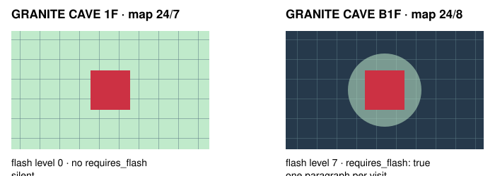
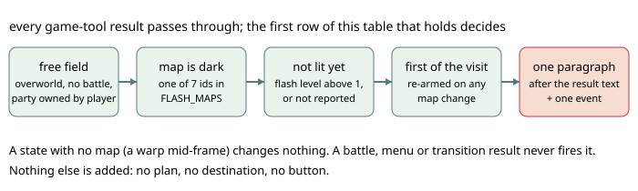

# Dark area FLASH reminder

> Markdown twin of [dark-area-flash-reminder-v1.html](../dark-area-flash-reminder-v1.html), generated from the HTML by `just explainer-twins`. The HTML is the source; edit it, not this file.

On the first free-field result after entering an unlit cave, say what your bag, your badge and your party say about FLASH — then let the model decide.

## Why: a run walked a dark cave for nothing

In the DeepSeek control run `2026-11-01T09-10-00_deepseek-v4.1-flash_control24h` the player picked up HM05 at turn 444 and won the KNUCKLE BADGE at turn 882. GRANITE CAVE B1F (map 24/8) and B2F (24/9) report darkness level 7. The run then crawled those floors for dozens of turns and reasoned more than once that SABLEYE cannot learn FLASH. The game disagrees: the party menu marks SABLEYE “ABLE!” and only COMBUSKEN “NOT ABLE!”. HM05 stayed in the bag.

The model had the facts in reach — HM05 was listed in its bag line, the Hiker had said the badge unlocks FLASH, and the party menu would have answered the learner question — but nothing pointed at the decision. This switch points at it, once, and says nothing else.

## Darkness is a map property, not a light level



Illustration only. In the recorded states the entrance (turn 926) carries flash level 0 and B1F (turns 613, 930, 953) carries 7; the red tile is the player. `requires_flash` is the map’s own flag, so dewford gym’s dim floors and every other map stay silent whatever their lighting looks like.

## The gate



## What it says, in four cases

The wording is the game’s. `<NAME>` is the KNUCKLE BADGE’s own line from dewford gym.

| Situation | Paragraph |
|---|---|
| No KNUCKLE BADGE | `SUPERVISOR: GRANITE CAVE B1F is dark. You do not have the KNUCKLE BADGE, so FLASH cannot be used outside of battle yet; choosing FLASH in the party menu, the game says "This can't be used until a new BADGE is obtained."` then the badge-free facts below. |
| A party Pokémon knows FLASH | `… , and SABLEYE knows FLASH. In the party menu, choose SABLEYE and then FLASH to light up the area.` |
| HM05 in the bag, nobody knows it | `… and HM05 in the TMs & HMs pocket of your bag, but no Pokémon in your party knows FLASH. Using HM05 from the bag teaches FLASH; the game marks SABLEYE "ABLE!" and COMBUSKEN "NOT ABLE!" to learn it. A Pokémon that knows FLASH can use it from the party menu to light up the area.` |
| Nobody can learn it, or no HM05 | `… but no Pokémon in your party knows FLASH or can learn it: using HM05 from the bag, the game marks COMBUSKEN "NOT ABLE!".` / `… , but HM05 is not in your bag and no Pokémon in your party knows FLASH.` |

## The recorded state and the exact paragraph

The module was run against the run’s own recorded state at turn 930 (`navigate_to_target`, entering B1F with the badge, HM05 and no FLASH user). This is the text it produces — one text part appended after the result’s own text:

```
SUPERVISOR: GRANITE CAVE B1F is dark. You have the KNUCKLE BADGE ("you'll be able to use the HM move FLASH outside of battle") and HM05 in the TMs & HMs pocket of your bag, but no Pokémon in your party knows FLASH. Using HM05 from the bag teaches FLASH; the game marks SABLEYE "ABLE!" and COMBUSKEN "NOT ABLE!" to learn it. A Pokémon that knows FLASH can use it from the party menu to light up the area.
```

No run has delivered this paragraph yet: the switch did not exist during the run the states come from. The event recorded beside it:

```
{"type":"dark_area_flash_reminder","turn":930,"tool":"navigate_to_target","map_id":[24,8],"location":"GRANITE CAVE B1F","flash_level":7,"badge":true,"kind":"teach","knows":[],"able":["SABLEYE"],"not_able":["COMBUSKEN"],"text":"SUPERVISOR: GRANITE CAVE B1F is dark. …"}
```

Activity History and the SUPERVISOR line read `dark area flash reminder · GRANITE CAVE B1F · HM05; ABLE: SABLEYE`, with `· no KNUCKLE BADGE` appended when the badge is missing. The TIMELINE gains no mark.

## Game grounding

| Value in the code | Where the game keeps it |
|---|---|
| `FLASH_MAPS`: 24/8, 24/9, 24/39, 24/40, 24/41, 24/44, 24/45 | `data/maps/<name>/map.json` `"requires_flash": true`, which becomes `MapHeader.cave`; `SetUpFieldMove_Flash` in `src/fldeff_flash.c` lets FLASH work only where it is set. Ids follow `data/maps/map_groups.json` order: Granite Cave B1F/B2F, the three unused Cave of Origin maps, Victory Road B1F/B2F. |
| `FLASH_BADGE = "KNUCKLE"` | `party_menu.c` `CursorCb_FieldMove` checks `FLAG_BADGE01_GET` with `FIELD_MOVE_FLASH`; the state’s badge list names it KNUCKLE. |
| the badge line it quotes | `data/maps/DewfordTown_Gym/scripts.inc` `DewfordTown_Gym_Text_KnuckleBadgeInfoTakeThis`: “you'll be able to use the HM move FLASH outside of battle”. |
| `gText_CantUseUntilNewBadge` | `src/strings.c`; printed when a field move is chosen without its badge. |
| `MOVE_FLASH = 148`, `ITEM_HM05 = 343` | `include/constants/moves.h`; `include/constants/items.h` (`ITEM_HM01` 339 + 4). The recorded party moves confirm that numbering: 10 SCRATCH, 43 LEER, 52 EMBER, 64 PECK. |
| `FLASH_LEARNERS`, “ABLE!” / “NOT ABLE!” | `src/data/pokemon/tmhm_learnsets.h` entries with `.FLASH = TRUE`, as `species.h` ids (SABLEYE 322, COMBUSKEN 281); `DisplayPartyPokemonDataToTeachMove` prints the two marks. |
| `flash_level` | `SaveBlock1.flashLevel` through the map observation; 0 on a map without darkness, 7 in a dark cave, 1 once the game counts the area as lit. |

Source: pret/pokeemerald `731ad5bf`, read-only. PokeAgent differs in one way only: it decides when to speak, and it speaks once per visit instead of leaving the discovery to the model.

## The switch contract

`dark-area-flash-reminder-v1`, group guidance. Registered default OFF; the current recipe turned it on in both arms from 2026-11-01 and turns it off in both arms since 2026-11-02, so generic next-run defaults stay OFF and frozen definitions keep the settings they recorded. Agent side only: no server change, no tool, no new prompt section.

OFF: no paragraph, no event, every result byte-identical to before. ON: at most one paragraph per map visit, recorded as a `dark_area_flash_reminder` event.

The gate reads only what the state already reports, so a state without a bag read says nothing rather than guessing, and a map the state has not observed yet counts as unlit.

## What it does not do

- It does not teach HM05, open the party menu, choose a move or press a button.
- It does not claim FLASH helps: nobody has measured a matched pair with this switch.
- It does not name maps the game does not mark, however dark they look.
- It does not speak twice on one visit, even if the model ignores it.
- It does not touch the TIMELINE, the Story goal or the objective ledger.

## Status

`9536cadb1` (switch, reminder, event, tests) and `1d404cf17` (no badge, no learner, on in both arms).

- `dark-area-flash.test.ts` 21/21; the module at 100% lines and functions, 98% branches; the wiring test fails with the hookup removed.
- Focused agent files 19/384 green; viewer 9 files/645 green; the recipe test covers four current definitions, both arms, every phase; `tsc` and `eslint` clean on the changed files.
- Multi-model review is waived by the operator (2026-11-01: “land it reviews are waived”). No reviewer verdict exists for this change.
- Not proven: no recorded run has ever reported flash level 1 on a dark map, so the “already lit, stay silent” branch rests on the decomp alone; only 24/8 and 24/9 are confirmed against an independently audited map table.
