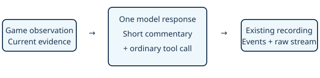

# Decision commentary

> Markdown twin of [decision-commentary-v1.html](../decision-commentary-v1.html), generated from the HTML by `just explainer-twins`. The HTML is the source; edit it, not this file.

Brief explanations of the agent’s choices, recorded beside its actions.

## One response, two outputs

No second model request, new tool or capture wrapper. The existing transcript saves ordinary response text and tool calls. Exposed provider reasoning remains separate.

## Off and on

| Switch OFF (default) | Switch ON |
|---|---|
| Existing gameplay prompt, byte for byte. | Asks for one or two short sentences stating the relevant observation, immediate intent and why the action fits, before each tool call in the same response. |

Illustrative commentary: “The menu highlights YES. I’ll confirm it to rest the party.” This is a model explanation, not a private reasoning trace or proof that the action succeeded.

## What the viewer shows

MODEL COMMENTARY and REASONING SUMMARY have separate labels. Both appear when both exist. While waiting for the next response, the preceding reply stays visible with its original turn number. A completed reply with no text says so explicitly. Older replies remain in Agent Trace and replay.

The model can still return tool calls without prose. Commentary is requested, not enforced: no retry, rejection or pause is added. More output tokens may add latency and context; gameplay benefit has not been measured.

## Capture and activation

assistant.text owns commentary; assistant.thinking owns exposed reasoning. Existing stream deltas support live viewing. No recording schema change. The switch is default OFF and is recorded in run harness features when enabled.

Prepared on a working branch. Active runs retain their original prompt and source. Activating the prompt requires a separately selected run configuration.
