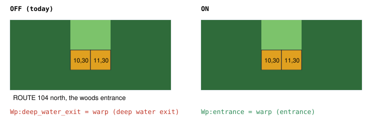
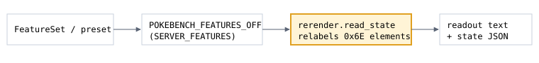

# Entrance, not water

> Markdown twin of [deep-south-warp-label-v1.html](../deep-south-warp-label-v1.html), generated from the HTML by `just explainer-twins`. The HTML is the source; edit it, not this file.

`deep-south-warp-label-v1` · observation · server switch · default OFF · needs `map-observability-v1`

## What it fixes

The map-element table named metatile behavior `0x6E` `deep_water_exit`. In the game that behavior is `MB_DEEP_SOUTH_WARP`: a plain doorway with no water in it. The PETALBURG WOODS entrances on ROUTE 104 use it. Run `2026-11-01T01-37-02_hyperqwen-gpu0_7da5` read `Wp:deep_water_exit = warp (deep water exit)` in 368 turns, and in 126 of them it reasoned about an underwater forest or Dive.

With the switch ON, those two tiles read `Wp:entrance = warp (entrance)`. Nothing else changes.

## The same tiles, switch OFF and ON

*Fixture `exit-labels-b300` seq 18834 (ROUTE 104). The two gold tiles are the only elements whose label changes. Grid simplified for the figure; the legend lines are the exact readout text.*

## Why "entrance"

| Game source (pokeemerald 731ad5b) | What it says about 0x6E |
|---|---|
| `include/constants/metatile_behaviors.h` | `MB_WATER_DOOR` 0x6C, `MB_WATER_SOUTH_ARROW_WARP` 0x6D, `MB_DEEP_SOUTH_WARP` 0x6E |
| `src/metatile_behavior.c` `MetatileBehavior_IsNonAnimDoor` | 0x6E is a non-animated door, like 0x60 |
| `src/metatile_behavior.c` `sTileBitAttributes` | no `TILE_FLAG_SURFABLE` (0x6D has it; 0x6E does not) |
| `src/overworld.c` `GetAdjustedInitialDirection` | arriving on it, the player faces north |

The game prints no text for the tile, so the label is the plain fact: a warp you walk into. It names no place.

## Wiring

*The highlighted box is the only one that changes behavior. Legend, codes, neighbour lines and `state_json` all read the same relabelled observation.*

## Status

- Tests: `env/tests/env/test_deep_south_warp_label.py` (OFF byte parity, ON label, nothing else changes, default-off registration).
- Registered default OFF; ON in both arms of the current recipe and the control 24h preset (Operator, 2026-11-02: “the label fix should be on in both arms”).
- Not measured. No runs were started for this change.
