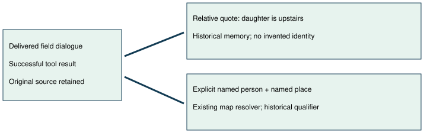

# Delivered person and place evidence

> Markdown twin of [delivered-place-evidence-v1.html](../delivered-place-evidence-v1.html), generated from the HTML by `just explainer-twins`. The HTML is the source; edit it, not this file.

Frontier mistakes E2/E3/E6: keep what the game said usable without inventing a person or a route.

## Two kinds of evidence

An unnamed speaker's exact “Our daughter is upstairs, I think.” stays linked to its source house and event. It does not become “MAY is upstairs.” An explicit named person and named place can enter the existing map resolver even when the speaker has no known identity. This gives a map-name fact, not a claim that the person is still there.

## What reaches the model

A compact historical evidence block carries whole delivered spatial episodes. Columns are speaker, speaker_source, exact text, source map display, source map name, map_id and state_event. Each episode also carries turn, dialogue events and delivered result. Unknown attribution remains null. Spatial selection uses upstairs, downstairs, next door, lives, went, house, lab, town, city, route, woods or gym. No quote is rewritten into an objective.

The destination path accepts an unnamed source only when its delivered text explicitly names both a recognized story character and a potential place phrase. The normal map table determines whether the place actually resolves. Pending or failed delivery does not qualify. The trust header labels the new path historical and suppresses its walk-away supervisor.

## Expiry and source

The compact block reuses MilestoneMemory. Only an exact audited episode plus delivered native completion may retire a quote; unknown variants remain historical. Actual ea04 replay retains WOMAN_4's upstairs quote, then retires the complete audited episode after RIVAL_MET. Current observations always take precedence.

Source: pret/pokeemerald 731ad5bfd6e6f265508d0efcca0ba42f9dcf5881, data/maps/LittlerootTown_MaysHouse_1F/scripts.inc, RivalsHouse_1F_Text_OhYoureTheNewNeighbor. The game uses a daughter/son variable; this patch does not resolve it into a named character. Source map labels remain source evidence, not new current-location claims.

## Scope and status

Default OFF; control OFF; bundle ON. Needs observed-instructions-v1. OFF retains existing instruction text and destination eligibility. Replay and synthetic tests prove contracts only. No experiment approved or launched. Cloud review and browser delivery remain recorded separately in the worklog.
