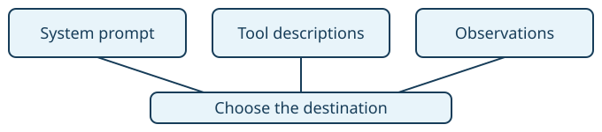

# Destination-first navigation

> Markdown twin of [destination-first-navigation-v1.html](../destination-first-navigation-v1.html), generated from the HTML by `just explainer-twins`. The HTML is the source; edit it, not this file.

Choose where to go. Let the existing navigation tools handle the steps.

## One policy across three surfaces

All three surfaces describe the same tool choice. This switch changes guidance; existing movement, stride limits and stop checks still execute the actions.

## Which tool?

| Intent | Tool |
|---|---|
| Reach a currently listed person, object, warp or exit | `navigate_to_target`, including nearby targets. It handles approach, facing and activation. |
| Reach another tile on the current map | `navigate_to`, including a nearby tile. |
| Use menus, dialogue, confirmations, a facing adjustment or a required manual action | `press`. |

## Before and after

**OFF:** previous system prompt, descriptions, connection wording and every-third-press reminder are preserved exactly.

**ON:** removes the broad “single-tile steps” exception, makes warp activation a manual fallback, puts a listed connection target before its activation mechanics, and provides destination guidance immediately after a direction press that returns to a verified free field.

The reminder does not choose a destination, invent a route, press another button or forbid manual movement. Menu, battle, locked and unknown results retain their original text. Dialogue-history tools are unchanged.

## Evidence and configuration

In Qwen run `2026-10-28T12-26-58_qwen36-gpu0_9c88`, turns 94–125 contained 27 press calls and five navigation calls. Turn 95 already used completed navigation strides; turn 98 received the old reminder and later turns continued manual routing. These observations motivate the policy; they do not establish that this change improves gameplay.

`destination-first-navigation-v1` is registered default OFF. The operator explicitly requested ON in both current arms on October 28, 2026. The shared current recipe enables it for future launches. Running trials and historical recordings retain their pinned configuration.

## Implementation and verification

The existing prompt factory and final game-tool wrapper apply the policy. Native state, screenshots, button execution, route planners, running and stride behavior are unchanged. Tests compare OFF with the recorded Qwen prompt and check the production tool factory, contextual controls and shared arm recipe.

Implementation candidate. Review, repository gates and landing are recorded separately in the destination-first navigation worklog. No model-benefit experiment is included.
