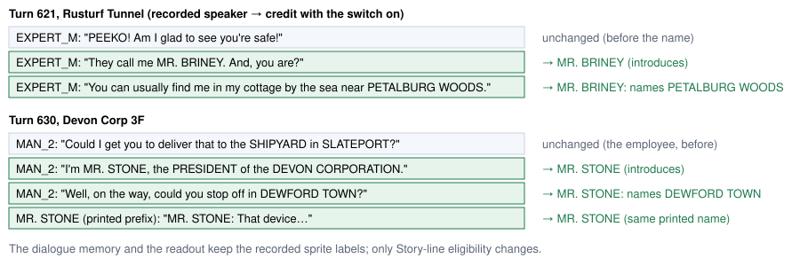
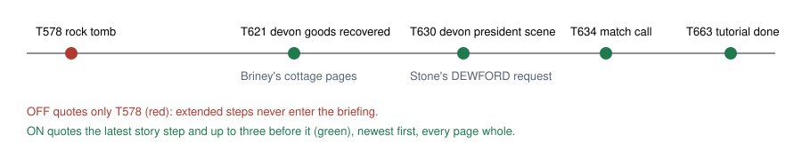
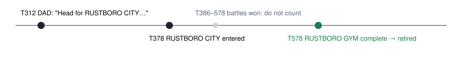

# Dewford readout fixes

> Markdown twin of [dewford-readout-fixes.html](../dewford-readout-fixes.html), generated from the HTML by `just explainer-twins`. The HTML is the source; edit it, not this file.

Three switches, each default OFF, fix readouts that misled bundle run `2026-10-27T17-35-16_qwen36-gpu0_a702` after it received Mr. Stone's letter (turn 630):

- `self-named-speaker-v1`
- `story-briefing-native-milestones-v1`
- `retire-reached-story-line-v1`

Every example below is a recorded a702 page, or the text the production classes print when a702's events are replayed through them offline. No model was called.

## 1. self-named-speaker-v1: who said the place

The Story line only counts pages spoken by a listed story character (Birch, May/Brendan, Mom, Norman/DAD, Wally, Roxanne, Steven). a702's recorder credited Briney's and Stone's pages to sprite kinds, so neither could ever become the goal.



The forms it reads are "They call me NAME", "I'm NAME", "I am NAME" and "My name is NAME", with NAME in capitals. A credit lasts for the rest of that conversation, for that sprite kind and for that printed name. Pages before the introduction stay unattributed.

### Result header, replayed (turns 631–717)

```
OFF: Story line heard (DAD, turn 312): "Head for RUSTBORO CITY beyond this town." Reached: RUSTBORO CITY (map 0/3), first entered at turn 378.
ON:  Story goal: "Well, on the way, could you stop off in DEWFORD TOWN?" (MR. STONE, turn 630) -> "DEWFORD TOWN" = DEWFORD TOWN (map 0/11). No direct entrance to this destination is listed on the current map; consult the current exits.
```

From turn 622 to 629, Briney's line would be the goal. With a702's stale-story-goal-v1, though, the checklist's "Petalburg Woods Aqua event complete" retires any line that resolves only to PETALBURG WOODS, so that window shows no goal. That retirement rule is unchanged here and is recorded as a follow-up.

## 2. story-briefing-native-milestones-v1: what the stall briefing quotes

The briefings skipped every milestone in the extended campaign catalog: DEVON GOODS RECOVERED, STEVEN LETTER RECEIVED, POKENAV RECEIVED and MATCH CALL. As a result, a702's briefings at turns 690, 693 and 704 quoted ROXANNE's turn-578 pages.



| Briefing line (T704) | OFF (identical to the recorded one) | ON |
|---|---|---|
| Dialogue shown with your latest story step… | (rock tomb received at turn 578): ROXANNE's badge pages | (match call tutorial complete at turn 663) …; earlier, newest first: match call unlocked (634), devon president scene complete (630), with "Well, on the way, could you stop off in DEWFORD TOWN?", then devon goods recovered (621), with "You can usually find me in my cottage by the sea near PETALBURG WOODS." |
| Story steps the game confirms are done | ends at "route104 cindy defeated" | adds "rusturf aqua grunt defeated; devon goods recovered; devon goods return reported; steven letter received; pokenav received; devon president scene complete; match call unlocked; match call tutorial complete" |

The ON briefing at T704 grows from 10,846 to 15,932 characters. No page is clipped; the cap is four steps, not characters.

## 3. retire-reached-story-line-v1: a reached place stops being the goal



```
OFF (T579–T717): Story line heard (DAD, turn 312): "Head for RUSTBORO CITY beyond this town." Reached: RUSTBORO CITY (map 0/3), first entered at turn 378.
ON, with stale-story-goal-v2 (a702): the line is omitted.
ON, without v2: Story goal: none. DAD's line from turn 312 ("Head for RUSTBORO CITY beyond this town.") is done: RUSTBORO CITY (map 0/3), first entered at turn 378, then rustboro gym complete at turn 578. It is not where to go.
```

A line retires when the player has entered every place it names since the line, and the game then observes a story milestone or a step of the extended campaign catalog: a place reached, such as DEWFORD TOWN, or an event, such as STEVEN LETTER RECEIVED (the operator, 2026-10-28). Arriving in DEWFORD TOWN therefore retires MR. STONE's turn-630 line, because the game records its DEWFORD_TOWN step right after the arrival. Battles won (trainers, the rival, leaders), other measurement-only steps and optional activities do not count, and scoring is unchanged. Needs unfinished-activity-v1, which records the arrivals.

## Wiring

| Switch | Reads | Changes |
|---|---|---|
| self-named-speaker-v1 | dialogue_auto_advance pages | `StoryDestinations.storyLines` eligibility (harness-trust header and story-destinations block) |
| story-briefing-native-milestones-v1 | milestone events (extended catalog) | `SupervisorBriefing`: done list, quoted story-step dialogue |
| retire-reached-story-line-v1 | milestone events, arrivals | `StoryDestinations.goal`: returns the existing "done" result |

## Status

Each switch is default OFF. Targeted tests are built from a702's own events (`test-support/a702-dewford.json.gz`), and the offline replay diff covers turns 579–717. Not done yet: the review lanes and measured probes (post-letter save, N=8 per arm). Activation in both arms waits for operator confirmation.
