POKEBENCH · FEATURE EXPLAINER · dialogue-auto-advance-v1 (default OFF)

# Dialogue reads itself to the next decision

> Markdown twin of [dialogue-auto-advance-v1.html](../dialogue-auto-advance-v1.html), generated from the HTML by `just explainer-twins`. The HTML is the source; edit it, not this file.

About half of Think Fast's turns are a single A or B press through dialogue. Worse, batches of A re-open the conversation they just closed: the live finals run `2026-10-15T14-21-06_think-fast_6684` has sent A×8 at the lab scientist since turn 494, so every turn ends mid-print in the same two-page line. With this switch on, once a press or `navigate_to` opens or continues a field message, the harness presses B itself, page by page, until the game asks the model for a decision. Leftover buttons from the model's batch are dropped, and the model gets every page it passed, whole.

## Before and after: A×8 at the scientist



*The same request with the switch off and on. Off, every button is sent and the extra A presses restart the conversation. On, the first A opens it, the harness advances it with B, and the conversation's close drops the remaining seven A presses.*

## When it stops



*The order in which each state read is classified. The first matching row decides. Stops at a menu, naming, battle or screen change leave the decision to the model.*

| Bound | Value | Stop reason recorded |
|---|---|---|
| Automatic presses per call | 50 | `press_cap`: "AUTO-ADVANCE CAP: stopped after 50 automatic presses; the message is still open" |
| Time per call | 90 s | `time_cap` |
| Locked with no message | 10 s | `locked_no_message` |
| Interface not ready | 10 s | `interface_not_ready` |
| Message never ready | 10 s | `message_not_ready` |
| Poll interval while waiting | 100 ms | (none) |

## How pages are cut

The game holds the whole message in its buffer (`world_context.dialogue`). When a page reaches a wait phase, the printer cursor (`world_context.message.cursor`) marks where that page ends; the page is the text from the previous cut to the last line break before the cursor. When the message closes, whatever remains is recorded too, because closing passes the last page. A new buffer (new identity) starts a new message. Nothing is clipped. Stops at a cap, a never-ready message or an error record only pages already shown.

Speaker: the game's own `NAME:` prefix when the message starts with one (MOM:), carried over to later pages of the conversation; otherwise the object the player faces, from the readout: a person's sprite kind labelled "sprite kind, not a name" (SCIENTIST_1 is not Birch), or a named object such as the PC or Notebook labelled "faced object".

## Recorded example (real game server, CLOCK_SET save)

From an isolated smoke on port 8871 in this worktree's runs/ (not a measured run). The model asked for A×8 facing the notebook in the player's bedroom.

```
pressed A
Press result: unchanged world position/facing (batch or non-direction input; intermediate effects unknown)
Dialogue auto-advance: the harness pressed B 4 times to advance the dialogue; stopped: the conversation closed and field controls are free.
dialogue closed; 7 remaining inputs not sent: A, A, A, A, A, A, A.
Dialogue shown during this call (4 pages, in order, whole):
1. turn 1 · LITTLEROOT TOWN BRENDANS HOUSE 2F (map 1/1) · at 1,2 · Notebook (faced object): "AAA flipped open the notebook."
2. turn 1 · LITTLEROOT TOWN BRENDANS HOUSE 2F (map 1/1) · at 1,2 · Notebook (faced object): "ADVENTURE RULE NO. 1
Open the MENU with START."
3. turn 1 · LITTLEROOT TOWN BRENDANS HOUSE 2F (map 1/1) · at 1,2 · Notebook (faced object): "ADVENTURE RULE NO. 2
Record your progress with SAVE."
4. turn 1 · LITTLEROOT TOWN BRENDANS HOUSE 2F (map 1/1) · at 1,2 · Notebook (faced object): "The remaining pages are blank…"

<the ordinary screenshot and readout follow>
```

The same smoke at the PC stopped at its menu: `stopped: menu pc_player_menu is open: options ITEM STORAGE, MAILBOX, DECORATION, TURN OFF; highlighted ITEM STORAGE.` with `dialogue reached a decision point; 2 remaining inputs not sent: A, A.` Mom's post-clock talk (four pages after the one already on screen) was read with the speaker MOM from her `MOM:` prefix and stopped once field control returned; she had left the room by then.

## What is recorded

```
{"type":"dialogue_auto_advance","turn":1,"tool_call_id":"…","tool":"press" | "navigate_to",
 "requested":["A",…],"sent":["A"],"dropped":["A",…],"auto_presses":4,
 "pages":[{"state_seq":12,"map":"…","map_id":[1,1],"position":{"x":1,"y":2},
           "speaker":"Notebook","speaker_source":"name_prefix" | "faced_sprite" | "faced_target" | null,"text":"…whole page…"}],
 "stop":"field_free" | "menu" | "naming" | "battle" | "screen_change" | "locked_no_message" | "interface_not_ready" | "message_not_ready" | "press_cap" | "time_cap" | "error",
 "detail":"…","duration_ms":16697}
```

Every automatic B is an ordinary `button_press` under the same tool call, so replay and the native input history see it. Each page's `state_seq` points at the recorded state it was cut from. The viewer shows the event in the timeline (a tool-lane marker), the agent trace and Activity History (all pages, whole), and `just tail-run` prints a DIALOGUE line. `get_dialogue` searches the same pages by speaker, words, map name or id, newest first (default 10), never clipped.

## Wiring



*The one box that changes behavior is highlighted. OFF returns the tool list unchanged: the same press tool object, prompt and tool names.*

- Needs `active-field-message-buffer-v1` (the text) and `field-dialogue-phase-v1` (the wait phase); presets missing either are refused.
- Works with `dialogue-safe-batches-v1`: that switch still submits only the first input outside free walking, then this one advances any dialogue it opened. Inputs either switch held back are listed in `dropped`, so `requested` = `sent` + `dropped`.
- With `transition-press-result-v1` the Press result line is each sent input's own result, computed on the shared observe/press tracker (several inputs read `LEFT: … | then A: …`), so a carried-over warp or a restarted conversation is still named.
- The loop supervisor and stall briefing grade an auto-advanced call from its pages (`dialogue shown (N pages, advanced automatically)`, or `restarted a conversation already shown (…)` for the same first page at the same map and tile), and the pages count as dialogue shown for the supervisor, `recall_dialogue` and the instruction ledger (each page cites its own state event).
- Refused with `state-only-decisions-v1`, which has no press tool to wrap.
- A free-field walking batch is sent whole as before; any other batch is sent one input at a time so the harness can stop the moment a conversation opens.

## Pre-launch fixes F6 and F8 (bundle run 3f21)



*F8, from the recorded states of run `3f21` T95. Replayed in `bundle-3f21-fixes.test.ts`; the same five pages are recorded.*

F6: the status line of `navigate_to` and the box notes in `Press result` were computed before the harness advanced the dialogue. They now describe the state after it.

| Case (3f21) | Before | After |
|---|---|---|
| navigate_to, T98 seq 1776 (also T132 seq 2609, T146 seq 2902) | `Navigation: a message is waiting for A or B; dismiss it with B, then call navigate_to again; 0 ordinary button attempts.` | `Navigation: a message was open, so navigate_to did not walk; after auto-advance: the conversation closed and field controls are free; call navigate_to again; 0 ordinary button attempts.` |
| press A, T56 seq 901 | `Press result: dialogue advanced (message box still open; it locks field controls until it closes)` | `Press result: dialogue advanced; after auto-advance: the conversation closed and field controls are free` |
| press RIGHT,RIGHT,DOWN,DOWN, T95 seq 1671 | `Press result: RIGHT: dialogue opened (the message box locks field controls until it closes) \| then RIGHT: dialogue advanced (message box still open; it locks field controls until it closes)` | `Press result: dialogue opened; after auto-advance: the conversation closed and field controls are free` |

Only the stale box notes are replaced ("locks field controls until it closes", "still open", "field controls are still locked"); other press-result wording, which the control arm shares, is unchanged. When the advance stops at a menu the status names it and does not say "call navigate_to again". Off: no wrapper, so nothing changes.

## Status

Agent and viewer tests, lint, build and both coverage gates pass; one live smoke against the real game server (above). Not done: the multi-model review, and any measured runs. Pending experiment `experiments/dialogue-auto-advance.json` (activation NEW_GAME_CREATED) joins the strong-bundle cohort only with the operator's approval. The Birch intro speech and battle text are separate screens and are not advanced.
