Feature switch · dialogue-context-kept-v1 · guidance · default off

# Dialogue kept in context

> Markdown twin of [dialogue-context-kept-v1.html](../dialogue-context-kept-v1.html), generated from the HTML by `just explainer-twins`. The HTML is the source; edit it, not this file.

Older tool results still shrink to one line, but the dialogue they showed stays, whole. The supervisors also quote the dialogue that came with the last story step, not only the three newest pages.

## What went wrong in run 3f21

In bundle run `2026-10-15T23-47-41_qwen36-gpu1_3f21`, Mom's instruction arrived at turn 98 (tool_result seq 1776): "He lives right next door, so you should go over and introduce yourself." The context window keeps only the newest 4 to 6 tool results whole and collapses older ones to one line. Mom's pages were shown whole only on turns 99 to 103. At the turn 107 decision the result read only its stale first line, and the model went to the lab. The context then held about 6,750 of 65,536 tokens.



*Rebuilt from the recorded events with `slideWindow`: 33 messages and 4 frames, the same counts the run recorded at seq 1949 (turn_start 107). The window and its chunk boundaries do not change with the switch.*

## The collapsed turn 98 result, off and on

Off (today)

```
Navigation: a message is waiting for A or B; dismiss it with B, then call navigate_to again; 0 ordinary button attempts. · LITTLEROOT TOWN BRENDANS HOUSE 1F (X=4, Y=5, facing left) [older screenshot omitted]
```

On

```
Navigation: a message is waiting for A or B; dismiss it with B, then call navigate_to again; 0 ordinary button attempts. · LITTLEROOT TOWN BRENDANS HOUSE 1F (X=4, Y=5, facing left) [older screenshot omitted]
Dialogue shown during this call (8 pages, in order, whole):
1. turn 98 · LITTLEROOT TOWN BRENDANS HOUSE 1F (map 1/0) · at 8,3 · MOM: "MOM: Oh! RED, RED!
Quick! Come quickly!"
2. turn 98 · LITTLEROOT TOWN BRENDANS HOUSE 1F (map 1/0) · at 5,5 · MOM: "MOM: Look! It's PETALBURG GYM!
Maybe DAD will be on!"
3. turn 98 · LITTLEROOT TOWN BRENDANS HOUSE 1F (map 1/0) · at 4,5 · INTERVIEWER: "INTERVIEWER: …We brought you this
report from in front of PETALBURG GYM."
4. turn 98 · LITTLEROOT TOWN BRENDANS HOUSE 1F (map 1/0) · at 4,5 · MOM: "MOM: Oh… It's over."
5. turn 98 · LITTLEROOT TOWN BRENDANS HOUSE 1F (map 1/0) · at 4,5 · MOM: "I think DAD was on, but we missed him.
Too bad."
6. turn 98 · LITTLEROOT TOWN BRENDANS HOUSE 1F (map 1/0) · at 4,5 · MOM (sprite kind, not a name): "Oh, yes.
One of DAD's friends lives in town."
7. turn 98 · LITTLEROOT TOWN BRENDANS HOUSE 1F (map 1/0) · at 4,5 · MOM (sprite kind, not a name): "PROF. BIRCH is his name."
8. turn 98 · LITTLEROOT TOWN BRENDANS HOUSE 1F (map 1/0) · at 4,5 · MOM (sprite kind, not a name): "He lives right next door, so you should
go over and introduce yourself."
```

Recorded text, copied byte for byte from the full result; the highlighted part is what the switch adds. The first line is today's summary unchanged (its "a message is waiting" wording is a separate bundle fix, F6).

## What counts as dialogue

| Kept unit | Where it comes from | Arm |
|---|---|---|
| `Dialogue shown during this call (N pages, in order, whole):` and its N numbered pages | dialogue auto-advance result block, each page with turn, map, position and speaker | bundle |
| `Dialog: "…"` line | readout: every page of the open message, " \| " between pages, the speaker prefix as the game prints it | both |
| a whole `get_dialogue` or `recall_dialogue` result | the dialogue record tools: all of it is quoted dialogue | where those tools are on |

Not kept: `Dialog: none`, `Dialog: detailed menu text unprovided`, and the "Active field-message buffer" block. Whenever the box is open the buffer block holds the same pages as the Dialog line (checked on 2919). In 130 runs from 2026-10-13 to 2026-10-16, 23 of 12,342 results with a buffer block had `Dialog: none`: leftover buffer text of a box that had already closed.

On, control arm (run 2919 seq 1862, turn 134, collapsed)

```
pressed A · LITTLEROOT TOWN BRENDANS HOUSE 1F (X=4, Y=5, facing left) [older screenshot omitted]
Dialog: "Oh, yes. One of DAD's friends lives in town. | PROF. BIRCH is his name. | He lives right next door, so you should go over and introduce yourself."
```

## Supervisor briefings cite the last story instruction

The loop supervisor, the stall briefing and the text-only supervisor share one helper. With the switch on they add one line before "Recent dialogue": every page recorded after the previous story milestone and before the latest story milestone the game confirmed (kind `story`, not present at start), bounded by event order, not by turn. At turn 166 that is Mom's five 2F pages after CLOCK_SET (turn 95) and her eight 1F pages (turn 98). If the latest one came with no dialogue, it walks back to the one before. The three-newest line is unchanged.

On: stall briefing at turn 166 (3f21 seq 3310), the added line

```
- Dialogue you were shown leading up to the last story step the game confirmed (mom rival instruction at turn 98), oldest first: turn 95, LITTLEROOT TOWN BRENDANS HOUSE 2F (map 1/1): "MOM: RED, how do you like your new room?" | turn 95, LITTLEROOT TOWN BRENDANS HOUSE 2F (map 1/1): "Good! Everything's put away neatly!" | turn 95, LITTLEROOT TOWN BRENDANS HOUSE 2F (map 1/1): "They finished moving everything in downstairs, too." | turn 95, LITTLEROOT TOWN BRENDANS HOUSE 2F (map 1/1): "POKéMON movers are so convenient!" | turn 95, LITTLEROOT TOWN BRENDANS HOUSE 2F (map 1/1): "Oh, you should make sure that everything's all there on your desk." | turn 98, LITTLEROOT TOWN BRENDANS HOUSE 1F (map 1/0): "MOM: Oh! RED, RED! Quick! Come quickly!" | turn 98, LITTLEROOT TOWN BRENDANS HOUSE 1F (map 1/0): "MOM: Look! It's PETALBURG GYM! Maybe DAD will be on!" | turn 98, LITTLEROOT TOWN BRENDANS HOUSE 1F (map 1/0): "INTERVIEWER: …We brought you this report from in front of PETALBURG GYM." | turn 98, LITTLEROOT TOWN BRENDANS HOUSE 1F (map 1/0): "MOM: Oh… It's over." | turn 98, LITTLEROOT TOWN BRENDANS HOUSE 1F (map 1/0): "I think DAD was on, but we missed him. Too bad." | turn 98, LITTLEROOT TOWN BRENDANS HOUSE 1F (map 1/0): "Oh, yes. One of DAD's friends lives in town." | turn 98, LITTLEROOT TOWN BRENDANS HOUSE 1F (map 1/0): "PROF. BIRCH is his name." | turn 98, LITTLEROOT TOWN BRENDANS HOUSE 1F (map 1/0): "He lives right next door, so you should go over and introduce yourself."- Recent dialogue you were shown, newest first: turn 164, LITTLEROOT TOWN PROFESSOR BIRCHS LAB (map 1/4): "things than read about them here." | turn 164, LITTLEROOT TOWN PROFESSOR BIRCHS LAB (map 1/4): "rather go outside and experience" | turn 164, LITTLEROOT TOWN PROFESSOR BIRCHS LAB (map 1/4): "The PROF isn't one for doing desk work. He's the type of person who would"
```

*Off, the briefing is the recorded seq 3310 text byte for byte (a test replays the recorded events and compares). The stall briefing is bundle-only; its own F5 change (untried warps on other maps) is on another branch.*

## Wiring


*Both paths read only the FeatureSet. The play wiring passes `contextWindow(features)` to the loop, and the decision probe rebuilds contexts with the same window.*

## Token cost

Measured by rebuilding every turn's window from the recorded events (chars ÷ 4, the recorder's estimate; frames counted separately). The rebuilt OFF context matches the recorded `turn_start` estimate within 10 tokens on 195 of 198 turns (3f21) and 242 of 247 (2919); the other turns carried an appended loop-guard note (up to about 720 tokens), which this rebuild leaves out and which the switch does not change.

| Run | Turns | Max OFF | Max ON | Mean OFF → ON | Largest added |
|---|---|---|---|---|---|
| 3f21 (bundle) | 199 | 11,544 | 11,685 | 6,199 → 6,408 | 985 |
| 2919 (control) | 248 | 11,266 | 11,315 | 5,268 → 5,445 | 1,224 |

Both stay under 18% of the 65,536-token window. Growth is bounded because the turn window (20 turns, chunk 10) still drops whole turns. All dialogue shown in the whole run adds up to about 4,150 tokens (3f21) and 4,010 tokens (2919).

## Limits and status

- The turn window is unchanged: a turn older than 11 to 20 turns leaves the context with its dialogue. In 3f21, Mom's pages are in the context on turns 99 to 111 with the switch on (99 to 103 off); in 2919 on turns 135 to 151. The supervisor line covers later stalls such as turn 166. Keeping all dialogue for the whole run would add about 4,000 tokens at 200 turns; that would be a separate switch.
- Readout pages from a box that already closed (the 23 leftover-buffer cases) are not kept.
- Unmerged. ON in both arms of bundle-v-control by operator decision (2026-10-16 12:46 AM EDT); wired into the definition by M6. No measured runs.
