Harness switch · guidance · `dialogue-log-v1` · needs `active-field-message-buffer-v1`

# Dialogue log and recall_dialogue

> Markdown twin of [dialogue-log-v1.html](../dialogue-log-v1.html), generated from the HTML by `just explainer-twins`. The HTML is the source; edit it, not this file.

The harness writes down every dialogue page the model was actually shown, in order, for the whole run. The model can search it with the `recall_dialogue` tool when it forgets what someone said or wants to check where it heard something. Off by default.

## Why

Recent runs lose instructions to context pruning. By the time a run has been wandering Littleroot for 300 turns, Mom's line about the neighbors is long gone from the model's context. Navigation evidence memory pins the newest few pages (at most 5, each quoted whole). This log keeps all of them and lets the model ask.

## What gets recorded



***Only what the model saw.** A page is logged only when a tool result delivered that exact state to the model. Consecutive copies of the same page in the same room collapse to one entry. The same words later, after other dialogue, are logged again, so repeated conversations stay visible.*

| Field | Meaning |
|---|---|
| `#seq` | Event number of the delivered state. It can be checked in the run log and replay. |
| turn | Model turn when the page was delivered. |
| room | Location line from the readout, or "unknown room". With bounded navigation on, the map id the readout already shows is added, for example "(map 1/0)". Identity always uses location plus map id, so two maps with the same label never merge. |
| at x,y | Player tile, only with `live-player-position-v1`. |
| facing NAME at x,y | The named object on the tile the player faces, only with named interactions and position on. It is who the player was facing, which is usually but not always the speaker (a TV or a cutscene can talk too). |
| text | The active field-message buffer, quoted. It can include pages not yet shown on screen. |

## The tool

Arguments are all optional: `contains` (words, up to 80 characters, case-insensitive), `room` (location text, up to 80 characters) and `last` (1 to 20, default 8). Every matching page is returned whole (no clipping since 2026-10-15; operator rule: nothing sent to the model is truncated). The reply says how many pages matched and how many it shows; last picks how many of the newest matches to return.

Illustrative reply shape (not from a recorded run yet):

```
DIALOGUE LOG: quoted game text you were shown, newest first. Past text; the current screen overrides it. 2 of 41 entries match.
#3120 turn 286 · LITTLEROOT TOWN BRENDANS HOUSE 1F · at 8,4 · facing MOM at 8,5: "…"
#2901 turn 275 · LITTLEROOT TOWN BRENDANS HOUSE 1F · at 8,4 · facing MOM at 8,5: "…"
2 shown.
```

Every call and reply is an ordinary `tool_call` / `tool_result` pair in the run log, so it shows up in the timeline, Activity History and replay like any other tool. Harness Config documents the tool's inputs and outputs.

## Status

| Item | State |
|---|---|
| Default | OFF in v1 flag presets, v2 presets that omit it and the viewer next-run draft |
| Tests | Delivered-only capture, repeats, filters, reply bound, honest fallbacks when position, facing or names are missing, argument limits, switch, tool and prompt wiring |
| Measured runs | none yet One step of the rival-house push |
