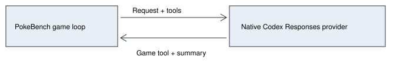

# Direct Codex provider

> Markdown twin of [direct-codex-provider-v1.html](../direct-codex-provider-v1.html), generated from the HTML by `just explainer-twins`. The HTML is the source; edit it, not this file.

## One game loop

The existing PokeBench loop sends its normal observations and tools directly through pi’s Codex Responses provider. The model returns a game tool call. There is no outer Codex session, polling, chunked observation reading or reply file.

## Capture stays passive

Each request body and the complete raw response stream are saved under provider-transcript with a game-turn number, attempt number, byte counts and SHA-256 hashes. Original image payloads and opaque encrypted reasoning remain in those files. Available reasoning summaries also reach the existing assistant thinking events, Activity History and replay. Summaries are not raw private reasoning. Authentication headers are never recorded.

Capture writes each stream chunk before delivering it to the parser. Write failures stop forwarding. An interrupted response is labelled incomplete. Provider retries have separate attempt numbers; capture adds no model requests.

## Opt-in connection

ON requires a Codex provider file plus direct-codex-provider-v1 in the run preset. The model name and context window come from the installed Codex catalog. Authentication is reread from the selected local login file before each model call. Expired credentials fail explicitly; this connection does not refresh or rewrite the shared login.

OFF preserves the existing Chat Completions connection and rejects direct-provider configuration. Tools, prompts and emulator actions remain owned by the existing game harness. This first version supports ordinary play, not restored-history or state-only runs.

## Verification

Pure tests cover selection, default-off behavior, credential validation, native summary settings, exact byte capture, failure before sending and interrupted response capture. Recorded boot requests are used for real-provider latency and capture checks before a new boot run. Model-only timing checks do not establish gameplay quality.
