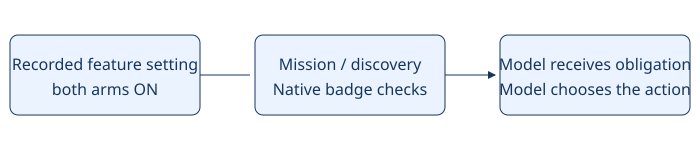

# Discovered gym checklist

> Markdown twin of [discovered-gym-checklist-v1.html](../discovered-gym-checklist-v1.html), generated from the HTML by `just explainer-twins`. The HTML is the source; edit it, not this file.

**discovered-gym-checklist-v1** · Default OFF · Current recipe ON in both arms (the operator 2026-11-01). Candidate implementation; gameplay benefit unmeasured.

A gym becomes an obligation only when its identity appears in a successful delivered location, entrance, sign or field-dialogue observation. A town-only mention, hidden object template, historical summary or model claim is insufficient.

```
DISCOVERED GYM CHECKLIST — harness-owned obligations, not a chosen route.
Native badges earned: 1/8.
DEWFORD TOWN GYM — unfinished; discovered at result 66304.
```

This example is illustrative output for the recorded GLM discovery; the feature was absent from that historical run. Unfinished gyms stay visible through travel, context pruning, memory lookups and failed calls. Rendered field dialogue can discover a gym with dialogue auto-advance OFF. Existing decision reminders retain their ordering. Only a native badge in a successful state-bound observation completes one. Unknown state never proves completion. A gym may be deferred, so Petalburg does not force an early battle or block travel.

At most eight gym records and eight earned badges are retained. Pending dialogue is limited to 64 calls. A bounded ledger_context receipt fires on discovery, when entering or leaving a town that still has an unfinished discovered gym, and when a native badge completes one — not on every decision. There are no new timeline marks or tools.

The checklist is reconstructed from delivered historical events when the existing runtime replays them. It does not infer earlier discoveries from a checkpoint alone.

## How the switch works



Arrows carry configuration and verified evidence into the next model decision. No game inputs are automated.

## Evidence and limits

Game reference: pret/pokeemerald 731ad5bfd6e6f265508d0efcca0ba42f9dcf5881. Town map.json files identify gym entrances; include/constants/flags.h FLAG_BADGE01_GET through FLAG_BADGE08_GET and the existing native badge decoder qualify completion. Native grading is unchanged. This feature does not solve battles or navigation.

Off: preserves the previous mission, context, tools and execution exactly. Existing runs retain their original source and settings; changing the recipe does not retrofit them.

Validation status is recorded in docs/worklogs/active/2026-10-28_gym-campaign.md. No measured probe or full-game benefit is claimed.
