Harness switch · observation · `displayed-place-names-v1` · off by default

# Displayed place names

> Markdown twin of [displayed-place-names-v1.html](../displayed-place-names-v1.html), generated from the HTML by `just explainer-twins`. The HTML is the source; edit it, not this file.

Signs and the Littleroot buildings they name used to be labelled from the game's source code: the script symbol `LittlerootTown_EventScript_MaysHouseSign` became `Mays House Sign`, and the map constant became `LITTLEROOT TOWN MAYS HOUSE 1F`. With this switch on they carry the text the game actually prints for this save. For a boy, the house next door is `PROF. BIRCH'S HOUSE`.

## Why it exists

Mom says Prof. Birch "lives right next door, so you should go over and introduce yourself". Nothing in the readout tied "Birch" to the house next door: the only Birch-named thing in town was `Birchs Lab Sign`, and the house was `Mays House`. Both qualification runs (control `…_2919`, bundle `…_3f21`) walked to the lab instead. Forensics: `runs/reviews/2026-10-16-qualification-forensics/control-2919.md` bug 3, `bundle-3f21.md` bug 1.

## Littleroot, off and on



*One claim: on, the sign and the door next door both say Birch, which is what the game shows a boy who reads the sign.*

## Exact readout from the real game

Recorded probes from the fast-text CLOCK_SET save, player AAA (boy): down the stairs, through Mom's TV scene and her "next door" line, out of the front door. Same presses in both runs. Everything else in the readout was identical except the play-time clock.

```
OFF  runs/2026-10-16T01-15-26_probe_1094 seq 166
Warps: (5,8) -> LITTLEROOT TOWN BRENDANS HOUSE 1F (map 1/0) [door: approach from below and press UP toward door]
Warp to LITTLEROOT TOWN MAYS HOUSE 1F (map 1/2) at (14,8), elevation 0; movement; activation depends on metatile (see local map); conditional; destination LITTLEROOT TOWN MAYS HOUSE 1F (map 1/2) warp 1
Warp to LITTLEROOT TOWN BRENDANS HOUSE 1F (map 1/0) at (5,8), …; destination LITTLEROOT TOWN BRENDANS HOUSE 1F (map 1/0) warp 1
Warp to LITTLEROOT TOWN PROFESSOR BIRCHS LAB (map 1/4) at (7,16), …; destination LITTLEROOT TOWN PROFESSOR BIRCHS LAB (map 1/4) warp 0
Town Sign at (15,13), elevation 0; A; conditional
Birchs Lab Sign at (6,17), elevation 0; A; conditional
Brendans House Sign at (7,8), elevation 3; A; conditional
Mays House Sign at (12,8), elevation 3; A; conditional
Warp destination at (14,8): LITTLEROOT TOWN MAYS HOUSE 1F

ON   runs/2026-10-16T01-13-43_probe_6aac seq 163
Warps: (5,8) -> AAA's HOUSE 1F (map 1/0) [door: approach from below and press UP toward door]
Warp to PROF. BIRCH'S HOUSE 1F (map 1/2) at (14,8), elevation 0; movement; activation depends on metatile (see local map); conditional; destination PROF. BIRCH'S HOUSE 1F (map 1/2) warp 1
Warp to AAA's HOUSE 1F (map 1/0) at (5,8), …; destination AAA's HOUSE 1F (map 1/0) warp 1
Warp to PROF. BIRCH'S POKéMON LAB (map 1/4) at (7,16), …; destination PROF. BIRCH'S POKéMON LAB (map 1/4) warp 0
Sign text "LITTLEROOT TOWN | “A town that can't be shaded any hue.”" at (15,13), elevation 0; A; conditional
Sign text "PROF. BIRCH'S POKéMON LAB" at (6,17), elevation 0; A; conditional
Sign text "AAA's HOUSE" at (7,8), elevation 3; A; conditional
Sign text "PROF. BIRCH'S HOUSE" at (12,8), elevation 3; A; conditional
Warp destination at (14,8): PROF. BIRCH'S HOUSE 1F

Same ON run, seq 203: standing at (12,9) facing the sign and pressing A, the game shows
Dialog: "PROF. BIRCH'S HOUSE"
```

The lines above are as the bundle arm (named interactions, named warp destinations, world destinations all on) receives them. The control arm has named warp destinations and world destinations off, so its warps stay `Warp to map 1/2 at (14,8)`; only its four sign lines change (checked by re-rendering the same raw RAM). Inside the houses the Location line follows: `Location: AAA's HOUSE 2F` in the bedroom.

## How the text is read


*The label is whatever text the script at the event's own pointer prints for this save. Anything else keeps today's label.*

| Thing | Source (pret/pokeemerald 731ad5b) | Value used |
|---|---|---|
| Gender sign scripts | `data/maps/LittlerootTown/scripts.inc` 386–416 | MaysHouseSign: MALE → ProfBirchsHouse, FEMALE → PlayersHouse; BrendansHouseSign the reverse |
| Sign texts | same file 939–950 | "PROF. BIRCH'S POKéMON LAB", "{PLAYER}'s HOUSE", "PROF. BIRCH'S HOUSE" |
| Opcodes | `data/script_cmd_table.inc`, `asm/macros/event.inc` | end 02, return 03, call_if 07, callstd 09, loadword 0F, compare_var_to_value 21, lockall 69, releaseall 6B, checkplayergender A0; MSGBOX_SIGN 3, MSGBOX_DEFAULT 4; VAR_RESULT 0x800D |
| Player gender | `include/global.h` struct SaveBlock2 | offset 0x08; MALE 0, FEMALE 1; anything else = unknown, nothing changes |
| Buildings | map constants of the Littleroot indoor group | BRENDANS_HOUSE 1F/2F, MAYS_HOUSE 1F/2F, PROFESSOR_BIRCHS_LAB take their sign's text for this gender, plus the floor |

Lines inside one text box are joined with ` | `, as the dialogue readout does. A verified catalog name that is not a sign (Notebook, GameCube, Wall clock, PC, lab Book/Bookshelf/Machine) keeps its name. Signs with no catalog identity, such as the Route 101 sign, now get their text too: re-rendering run `…_c406`'s raw RAM on Route 101 turns `background (identity unavailable) at (5,9)` into `Sign text "ROUTE 101 | ↑ OLDALE TOWN" at (5,9)`.

## Girl's save

| Map | Boy (name AAA) | Girl (name MAY) |
|---|---|---|
| BRENDANS HOUSE 1F / 2F | AAA's HOUSE 1F / 2F | PROF. BIRCH'S HOUSE 1F / 2F |
| MAYS HOUSE 1F / 2F | PROF. BIRCH'S HOUSE 1F / 2F | MAY's HOUSE 1F / 2F |
| PROFESSOR BIRCHS LAB | PROF. BIRCH'S POKéMON LAB |  |

## Wiring


*The highlighted box is the only place behavior changes. The sign label also reaches the loop supervisor's lists through the JSON target name; the JSON `location` (which milestones read) is unchanged.*

## One name everywhere (2026-10-16 fix)

Cook run `2026-10-16T02-23-17_qwen36-gpu1_sh02` showed the gap: at turn 113 one tool result said `warped … -> LITTLEROOT TOWN MAYS HOUSE 1F [map 1/2]` and `Location: PROF. BIRCH'S HOUSE 1F`, and at turn 115 every auto-advance page header still said `LITTLEROOT TOWN MAYS HOUSE 1F`.

With the switch on, the state JSON now carries `location_display` beside `location` whenever the readout renames the current map. Every model-facing place name uses it:

- press results and transition press results (`warped during this press: LITTLEROOT TOWN [map 0/9] (14,9) -> PROF. BIRCH'S HOUSE 1F [map 1/2] (2,8)`);
- dialogue auto-advance page headers, which record it as `map_display`, and `get_dialogue`'s map filter;
- dialogue log rooms and the `recall_dialogue` room filter, and through them the loop supervisor, stall briefing and instruction ledger;
- navigation memory rooms;
- objective evidence, where a location condition matches either name.

The JSON `location` is still the source name, so milestones, room identity and dedupe keys are unchanged. With the switch off, `location_display` and `map_display` are absent and every text is byte-identical to before.

## Not changed (audit of the CLOCK_SET → RIVAL_MET → early-route path)

| Name the model sees | What the game shows | Status |
|---|---|---|
| Route Location and connections: `ROUTE101` | map popup "ROUTE 101" | unchanged, cosmetic |
| `OLDALE TOWN POKEMON CENTER 1F`, `OLDALE TOWN MART` | signs: "POKéMON CENTER", "POKéMON MART" (their sign lines now carry that text) | building names unchanged, not misleading |
| `OLDALE TOWN HOUSE1`, `HOUSE2` | never named | unchanged |
| Sprite kinds (`TWIN`, `FAT_MAN`, the rival's mother `WOMAN_4`) | no names | unchanged; already labelled as sprite kinds |

## Status

Merged to main; completed by a working branch (2026-10-16), which carries the name into every model-facing place name. Python and TypeScript tests, OFF goldens rendered by the previous commit, and the real-ROM probes above. Oldale, Route 102 and Route 103 signs use the same single-text shape but no recorded run has reached them, so they are shape-checked, not seen on the real ROM. No measured runs; the experiment entry is pending.
