Harness switch · guidance · `disproved-beliefs-v1` · needs story-state-v1 · off by default

# Disproved beliefs ledger

> Markdown twin of [disproved-beliefs-v1.html](../disproved-beliefs-v1.html), generated from the HTML by `just explainer-twins`. The HTML is the source; edit it, not this file.

In run sh02 the model kept acting on beliefs the game had already contradicted: it looked for Professor Birch on the lab's tiles while every lab readout said he was not on the map and the scientist said he was away, and it pressed UP into the twin's script 15 times and LEFT into Birch's "Don't leave me" script 47 times. This switch keeps a short, factual ledger of such contradictions and shows it before every decision until the game state changes.

## What the model sees

Off, the model's context at turn 147 ends with its last tool result. On, one more message follows it. This is the exact text the switch adds at turn 147 of sh02, replayed from the recorded events:

```
Things the game has contradicted (from this run's own readouts and dialogue; an entry is dropped when a story flag changes or the game shows otherwise):
- PROF. BIRCH on LITTLEROOT TOWN PROFESSOR BIRCHS LAB (map 1/4): you wrote at turn 88: "Prof. Birch is at (7,1)." and called navigate_to (7,1) (you placed PROF. BIRCH on this map at turns 82, 83, 84, 85, 86, 87, 88). The readout on that map said at turn 87: "Story characters here (from this map's own object list): none. Not on this map: PROF. BIRCH, MAY, BRENDAN, MOM, NORMAN, WALLY, ROXANNE, STEVEN. Sprite kinds such as SCIENTIST_1 or FAT_MAN are not these characters." On that map at turn 98 you were shown: SCIENTIST_1 (sprite kind, not a name): "Hunh? PROF. BIRCH?" | SCIENTIST_1 (sprite kind, not a name): "The PROF's away on fieldwork.
Ergo, he isn't here." | SCIENTIST_1 (sprite kind, not a name): "Oh, let me explain what fieldwork is." | SCIENTIST_1 (sprite kind, not a name): "It is to study things in the natural
environment, like fields and mountains," | SCIENTIST_1 (sprite kind, not a name): "instead of a laboratory." | SCIENTIST_1 (sprite kind, not a name): "The PROF isn't one for doing desk work.
He's the type of person who would" | SCIENTIST_1 (sprite kind, not a name): "rather go outside and experience" | SCIENTIST_1 (sprite kind, not a name): "things than read about them here."
- Moving UP from (11,1) in LITTLEROOT TOWN (map 0/9): you tried it 3 times, at turns 142, 144, 146 (latest: press UP). Each time a script moved you back to (11,2); the latest time (turn 146) it showed: TWIN (sprite kind, not a name): "Um, um, um!" | TWIN (sprite kind, not a name): "If you go outside and go in the grass,
wild POKéMON will jump out!" | TWIN (sprite kind, not a name): "It's dangerous if you don't have
your own POKéMON."
```

Nothing in an entry is shortened: every quote, every page and every turn is whole. The ledger names no goal and no route; it only pairs what the model went for with what the game showed.

## Where entries come from


*Each source gives both sides of an entry from recorded data. While a field message is open the harness presses only A or B, so a move from Q to R during the pages is the game's own, not the model's.*

The push-back rule, on the twin's tile: the model pressed UP at (11,1); the pages began with the player at Q = (11,1); the call ended at R = (11,2). The step Q→R is DOWN, the opposite of UP, the call's first direction, and the pages began on the tile the call started from, so the entry is "Moving UP from (11,1)". A press is bound to the first direction the harness actually sent (inputs requested after a message opened are dropped and do not count): the script must have met that first step on the starting tile, or the first step must have landed on the tile where the pages began (Birch's Route 101 batch LEFT, LEFT, LEFT, UP, UP, UP: the first LEFT reached (6,15), the pages began there, and the call ended back at (7,15)). A batch whose first direction differs is not recorded. For navigate_to the walk's last step before the pages must be the direction pushed back, and R must be closer than Q to where the walk began (Birch's Route 101 script: the walk began at (11,15), pages at (6,15), the call ended at (7,15)). Mom's TV cutscene, which moves the player while it talks but after a press of A only, is not a push-back.

The text rule is deliberately narrow. Names are only the readout's own story-character names, written in the readout's spelling or in title case (`MAY` or `May`, never the word `may`), where the game's `PROF.` also matches `Prof.` and `Professor`. The sentence must open with the name (or `The` and the name) as its subject, followed directly by `is`, `stands`, `sits` or `waits` (optionally `standing`, `sitting` or `waiting`) and then `at (x,y)`, and the sentence must end at the tile (only a full stop or exclamation mark may follow); so "I doubt …", "Suppose …", "Professor Birch, I think, is at …" or "I will go to Professor Birch at (4,13)" never count. A reply in which any sentence negates, hedges or asks yields no claim at all ("Professor Birch is at (7,7). Actually, he isn't here."). Most important, the same reply must act on the claim: its navigate_to must go to exactly the claimed tile on the same map. Words alone are never the pursuit; on sh02 every counted claim (T82–T88) walked to the tile it named. And the sentence must hold no negation, hedge or question mark anywhere (`not`, `cannot`, `n't`, `never`, `no longer`, `away`, `might`, `maybe`, `perhaps`, `probably`, `possibly`, `likely`, `if`, `whether`, `unsure`, `unclear`, `could`, `would`, `should` in any case, `may` in lower case, `?`). It must not be possessive, part of a sprite kind or inside parentheses.

| Sentence in sh02 | Entry? | Why |
|---|---|---|
| "Prof. Birch is at (7,7)." (T82) | yes | the lab readout says Not on this map: PROF. BIRCH |
| "Prof. Birch is at (7,1) which is a 'Book' tile (background object, not walkable)." (T89) | no | "not" in the sentence (a true belief this rule gives up) |
| "Professor Birch may be at (7,7)." | no | a hedge; and the word "may" is never MAY |
| "Professor Birch is standing next to the red carpet at (7,8)." (T81) | no | words between the verb and the tile (a true belief this rule gives up) |
| "May is in her house at (14,8)." / "Prof. Birch was at (7,7) in his lab." / "May is at (14,8), in her house." | no | another place, the past tense, or anything after the tile |
| "Professor Birch is at (9,8) and the scientist is at (9,9)." (T124) | no | words after the tile (a true belief this rule gives up) |
| "The scientist (Prof. Birch) is at (8,3)." (T91) | no | in parentheses (a true belief this rule gives up) |
| "I see a woman (MOM) at (8,7)." (T177) | no | in parentheses: a label for May's mother, not the readout's MOM |
| "A RIVAL_MAY_NORMAL has appeared at (2,5)." (T221) | no | part of a sprite kind |
| "I will go to Professor Birch's lab …" | no | possessive, and no tile |

## Leaving the ledger

An entry is dropped as soon as it may no longer hold, so the switch needs the story state: any story flag in the recorded state changes (the game's own flags and variables, not the model's words), that map's readout lists the character as here, or the player is seen on the tile the push-back refused.



*The four entries the ledger would have made on sh02 (snapshot to turn 1009), and when each left. The x axis is turn number (1.35 px per turn from x = 150).*

## Measured on sh02

- Entries: 4, all true contradictions (precision 4/4). Delivered on 205 model calls.
- Would have been shown before the second lab trip (T117–T122) and through both push-back stalls.
- Missed: the third lab trip (T225–T228). The story had changed at T213, so the Birch entry was gone, and the model then wrote no tile for Birch.
- Rejected candidates: the parenthetical "(MOM)" and "(Prof. Birch)" sentences and the sprite kind above.

## Wiring


*The green box is the only one that changes behavior. The decision probe replays the same chain, so a recorded run can be re-read with the switch on.*

The viewer shows each delivery in Activity History ("Disproved beliefs ledger delivered", whole text), in the agent trace as memory and in the raw-event inspector. It adds nothing to the timeline, which is closed to new marks.

## Off

No message, no event, no tool. Tests replay the sh02 fixture through the production context chain with the switch off and get the chain's own messages back byte for byte; the decision probe's T117 context with the switch on equals the off context plus exactly the ledger message.

## Status

- Default off; meant for the bundle arm of bundle-v-control (that file is edited elsewhere).
- Gates: test, lint (mypy's known `mgba._pylib` worktree error only), build, coverage ≥ 90 in both stacks.
- Not done: no measured runs. Pending experiment entry `experiments/disproved-beliefs.json`.
