Harness switch · guidance · `double-context-window-v1` · default OFF

# Doubled context window

> Markdown twin of [double-context-window-v1.html](../double-context-window-v1.html), generated from the HTML by `just explainer-twins`. The HTML is the source; edit it, not this file.

The model only sees its most recent play. This switch doubles how much: up to 40 turns instead of 20, and 12 full tool results with their screenshots instead of 6. Nothing else in the prompt changes.

## How many turns the model sees

*Old turns drop in whole chunks (10 OFF, 20 ON), so the start of the prompt stays the same for several turns and the inference server can reuse its prompt cache. After the first drop, OFF shows 11 to 20 turns and ON shows 21 to 40.*

## What the prompt holds at turn 50

*Each cell is one turn, oldest on the left. At turn 50, OFF keeps the last 20 turns with 5 full results. ON keeps the last 30 turns with 8 full results. The full-result count moves in its own chunks (3 OFF, 6 ON), between 4 and 6 OFF and between 7 and 12 ON.*

## The numbers

|  | OFF (incumbent) | ON |
|---|---|---|
| Most turns kept | 20 | 40 |
| Turns dropped at a time | 10 | 20 |
| Most full tool results (with screenshot) | 6 | 12 |
| Results collapsed at a time | 3 | 6 |
| Older results | collapse to one line, for example `pressed A · LITTLEROOT TOWN (X=5, Y=8) [older screenshot omitted]` |  |

Cost: in the six finished 2×2 Think Fast runs, the input tokens divided by turns were 3,800 to 8,600 per turn. ON adds more turns and twice the screenshots, so expect prompts close to twice that, slower turns and fewer turns in a 30-minute run. That has not been measured.

## Wiring

*The switch is read once, from the run's FeatureSet, and picks which window piLoop slides. Pinned blocks (navigation memory, ledger, hint) and the loop warning are added after the slide, so they appear either way. State-only decisions send no history, so a preset with state-only ON must have this switch OFF.*

## Status

OFF reproduces the incumbent window exactly. Tests cover both windows, piLoop using the window it is given, the wiring, preset defaults and the state-only rule. No measured runs yet. It is registered as a pending experiment: incumbent against incumbent with this switch ON, eight runs each, measuring furthest milestone and loop-guard firings per run.
