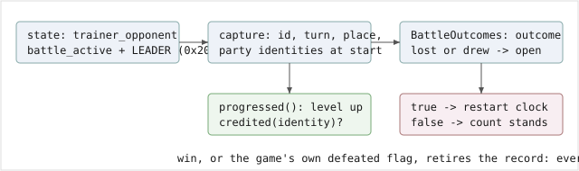

# drought-progress-credit-v2

> Markdown twin of [drought-progress-credit-v2.html](../drought-progress-credit-v2.html), generated from the HTML by `just explainer-twins`. The HTML is the source; edit it, not this file.

guard

default OFF

**One line:** while the last GYM LEADER battle this run is still a loss, a level-up restarts the `turn-drought-clock-v1` drought clock only when it lands on a POKéMON that battle saw. A POKéMON caught after the loss can level all it likes; the clock keeps counting.

Needs `turn-drought-clock-v1`. Nothing else in the readout, the prompt, the tools or the other briefings changes.

## Why

Recorded run `2026-11-02T14-53-03_hyperqwen-gpu0_de7a` (qwen3.8-27b, 560 turns, 5h20m, operator abort). The bot lost to ROXANNE at turn 342 with a TORCHIC at Lv14 and never re-entered the gym (no `battle_choice` on map 11/3 after turn 342). In the 218 actions that followed it gained one level on the starter and levelled a WINGULL it caught after the loss from Lv4 to Lv7.

Every one of those level-ups restarted the action drought clock, so the supervisor spoke once in 2h45m:

| Action | Recorded event | Drought clock, today | With this switch on |
|---|---|---|---|
| loss | turn 342, whited out | open loss recorded | open loss recorded |
| catch | WINGULL Lv4 at turn 392 | no reset (not a level) | no reset |
| +180 | WINGULL 4→5, 18:24 | **restart** | keeps counting |
| +90 | full heal, 18:37 | restart | restart (a heal still counts) |
| +40 | TORCHIC 14→15, 19:00 | restart | restart (the loss saw it) |
| +30 | WINGULL 5→6, 19:07 | **restart** | keeps counting |
| +60 | WINGULL 6→7, 19:25 | **restart** | keeps counting |

## Before and after

### OFF (today)

Any identified level-up is progress, whoever it is.

```
state: party [TORCHIC Lv15, WINGULL Lv6]
level up: WINGULL 5 -> 6
progressed() -> true
restart(): actions = 0
=> 30 more actions before any briefing
```

### ON

A level-up counts only when the open loss saw that identity.

```
openLoss.identities = {t1}      // TORCHIC at the loss
state: party [TORCHIC Lv15, WINGULL Lv6]
level up: WINGULL 5 -> 6, identity w1
credited("w1") -> false
progressed() -> false
=> the clock keeps its count
```

## The mechanism



## Exact rules

- An *attempt* starts at a state whose `trainer_opponent.battle_active` is true and whose `trainer_class` is `LEADER_CLASS` (0x20, `gym-readiness.ts`). The readout's `identity` for each party member is what is kept.
- The record opens when `BattleOutcomes` finishes that battle with `lost` or `drew` (the same rule `unfinished-activity-v1` uses).
- The record retires on a later finished battle with the same trainer id and outcome `won`, or on a state where the game shows that trainer `defeated`.
- Only the level-up branch changes: `up`. Trainer wins and the below-full-to-full heal still restart the clock, and milestone restarts are untouched.
- A party member without an `identity`, or whose HP the readout cannot read, still counts as neither, as before.

## Wiring

```
experiments/feature-configs/current.json   (bundle switch list)
  -> packages/agent/src/features.ts        SWITCHABLE_FEATURES, FEATURES, playHarnessFeatures
  -> packages/agent/src/play-preset.ts     schema, normalizeFeatures (??false), flagFeatures (false)
  -> packages/viewer/src/next-run.ts       DEFAULT_NEXT_RUN: false
  -> packages/agent/src/stall-briefing.ts  credited() in progressed()   <-- the one box that changes behavior
```

## Status

Branch `main`. Tests: `stall-briefing.test.ts` cases "credits a level-up toward an open leader loss only for a POKéMON the loss saw" (ON vs OFF, four presses apart) and "keeps crediting a level-up by the POKéMON that lost"; deleting the `credited()` call turns the first red. **ON in the bundle arm since the 2026-11-02 recipe revision** (appended to `experiments/feature-configs/current.json` `switches`); the control arm keeps it off and the pinned control base still matches. Not yet measured: a running trial materializes its preset once, at launch, so the trial that carries it is the next fixed-run launch.
