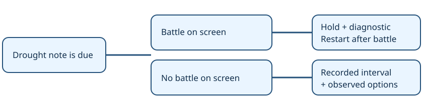

# Factual drought briefing

> Markdown twin of [drought-progress-facts-v1.html](../drought-progress-facts-v1.html), generated from the HTML by `just explainer-twins`. The HTML is the source; edit it, not this file.

A quiet clock is evidence about recorded milestones. It cannot establish that a player's plan is failing.

## What changes

Drought note is due ↓

Battle on screen → hold the note, record a diagnostic, restart the clock after battle.

No battle on screen → send the recorded interval and observed options.

`drought-progress-facts-v1` defaults OFF. It needs the existing stall briefing, and does not depend on the heal-trip hold or turn clock.

## Facts without forced strategy

| OFF: existing behavior | ON: factual drought |
|---|---|
| “You are stalling … the game is not moving forward.” | “No new milestone counted by the active drought clock for 5 minutes of play.” |
| “What you have been trying is not working … do not try it again.” | Current position, dialogue, attempted interactions, and observed exits stay available. The model chooses its next action. |

This switch changes drought notes produced by `stall-briefing-v1`. Other loop and interface-dwell policies, including the separate `milestone-stall-stop-v1` timer, keep their own switches. It never sends game inputs or ends a run.

## Reuse earned progress

The separately switchable `campaign-progress-clock-v1` already resets time and action droughts once on earned Devon, letter, Dewford, cave and Steven milestones. Checkpoint baselines, duplicates and optional achievements cannot keep resetting the clock. No second clock or milestone catalog is added here.

Briney's trip is credited by the earned arrival, not a claim inferred from boarding. Source: clean pret/pokeemerald revision `731ad5bfd6e6f265508d0efcca0ba42f9dcf5881`; `RustboroCity_DevonCorp_3F_EventScript_MeetPresident`, `GraniteCave_StevensRoom_EventScript_Steven` and Dewford sailing scripts.

## Evidence and activation boundary

GLM 0d5d received drought claims during battles (seq 26728 / 43858) and after earned postbadge progress. Qwen ee12 broke out at turn 429 after a drought note at seq 11919 exposed an untried south exit. The offline regression preserves that entire note byte for byte with the switch OFF, and preserves every fact line with it ON.

On 24 October, Operator authorized bundle ON and control OFF in the two future recipes bundle-v-control-2h and bundle-v-control, and waived the separate safety probe. The switch still defaults OFF elsewhere. The single-arm CLI paths are rehearsed through an injected fake runner. No probes, launches or active-run changes are part of this implementation.

Recording and OFF invariance

A held note is an existing `loop_guard` diagnostic in Activity History and raw events, with the two sequence endpoints. It is not sent to the model and adds no timeline mark. A delivered factual note uses the existing supervisor model-context path. Historical OFF replay and production-wiring tests guard those boundaries.

