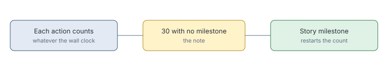

# Drought counts turns only

> Markdown twin of [drought-turns-only-v1.html](../drought-turns-only-v1.html), generated from the HTML by `just explainer-twins`. The HTML is the source; edit it, not this file.

`drought-turns-only-v1` times the "no new story milestone" note by the model's actions, not the wall clock.

## Why it exists

The note fired after 5 minutes of play, which is about 11 DeepSeek turns. In five DeepSeek runs, 41 of 165 drought notes came while the model was making normal progress through menus, battles and travel. The older turn clock, `turn-drought-clock-v1`, went the other way: it let level-ups, wins and heals restart it, so it stayed silent for 171 turns of a 306-turn gym stall.

## The rule

*A level-up, trainer win or full heal does not restart it. A note that comes due during a battle or heal trip is dropped and the count starts again when that ends, as it did before.*

## Measured

Replayed through the real stall code on five DeepSeek runs, against 29 real stalls: 11 false notes instead of 41, and the same 18 real stalls caught.

## Off

The drought clock is whatever `turn-drought-clock-v1` sets: 5 minutes of wall time, or 30 actions with credits.
