# Effectiveness heard

> Markdown twin of [effectiveness-heard-v1.html](../effectiveness-heard-v1.html), generated from the HTML by `just explainer-twins`. The HTML is the source; edit it, not this file.

`effectiveness-heard-v1` · agent switch · bundle-only, default off · needs `battle-text-auto-advance-v1` · approved by Operator 2026-10-21

At ROXANNE, run `2026-10-20T20-26-22_qwen36-gpu1_97a0` used EMBER on her GEODUDE calling it super effective against ROCK, although the game had printed "It's not very effective…" right after the previous EMBER. This switch keeps a record of what the game printed right after each of the player's moves this run, by move and the foe it hit, with turns, and shows it at battle decisions and move-learning prompts. Only the game's words: nothing is computed from a type chart and nothing advises.

## The block as delivered (97a0, the ready battle decision at turn 716)

What the game said right after your moves this run (its own words): - EMBER on GEODUDE: "It's not very effective…" (turns 715, 716)

Exact text from `effectiveness-heard.test.ts` on the recorded events of run 97a0. The same block shows at the turn-781 evolution move-learning box. "turns" are the run's agent turns, one per event that carried the pages.

## How battle pages become a record

*Pages and battle turns ("bt") are the recorded fixture `packages/agent/src/fixtures/move-learn-97a0.json`. Line breaks in page text are joined with a space. The player side is each battler at an even position, by species and by its party nickname; the foe side is the odd positions, from the state event the page names (`state_seq`; the last 512 state events are kept).*

## When the block shows

| State of the tool result | Block |
|---|---|
| Battle decision: game started, in battle, battle ready | yes |
| Evolution move confirmation box (evolution_move_confirmation) | yes |
| Summary forget-a-move list (summary_move_forget) | yes |
| Battle prompt learn_move or stop_learning_move, ready | yes |
| Battle not ready, field, anything else | no |
| Nothing recorded yet this run | no |

A no-effect line keeps the game's words, for example (test-modified page, not recorded): `- EMBER on GEODUDE: "It doesn't affect Foe GEODUDE…" (turn 900)`.

## What the model receives (97a0, battle_action at the turn-716 decision)

Off: the tool result's content

\[text\] readout

On: the same readout, then the block as its own text part

\[text\] readout \[text\] What the game said right after your moves this run (its own words): - EMBER on GEODUDE: "It's not very effective…" (turns 715, 716)

From the wrapper test: on, a `battle_action` result gains the block as a second text part; a non-game tool (`get_dialogue`) is unchanged; off, the tool list is returned as is.

## Where the block comes from

*`packages/agent/src/effectiveness-heard.ts`. The block reads the state in the tool result's details to decide whether to show.*

## Status

Tests: `packages/agent/src/effectiveness-heard.test.ts` (player-only attribution, foe move ignored, other battle turn ignored, doubles skipped, no-effect wording, decision screens, wrapper on/off) and the production wiring test in `game-said-goals.test.ts`. Gates passing (module 100% covered). Not yet reviewed or landed. Pending experiment `experiments/effectiveness-heard-v1.json`. On in the bundle arm of bundle-v-control, bundle-cook-1h and whole-map-cook-1h; off in control. No measured runs.
