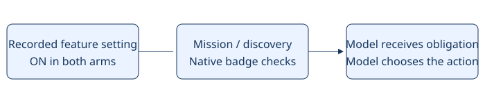

# Eight badge mission

> Markdown twin of [eight-badge-mission-v1.html](../eight-badge-mission-v1.html), generated from the HTML by `just explainer-twins`. The HTML is the source; edit it, not this file.

**eight-badge-mission-v1** · Default OFF · Current recipe ON in both arms since 2026-11-02 by operator directive. Raises the control arm's objective by operator directive; gameplay benefit unmeasured.

The untargeted mission explicitly includes all eight Gym Badges. Story tasks remain necessary steps; the model chooses the plan. Explicit milestone targets retain precedence.

```
Your mission is: Progress through Pokémon Emerald and collect all eight Gym Badges. Complete story tasks needed to advance. Discovered gyms remain unfinished until you earn their badges; you may return later when necessary.
```

The same goal reaches the system prompt, scene-scoped prompts and initial task, including checkpoint starts. No route, future leader identity or Rayquaza objective is added.

## How the switch works



Arrows carry configuration and verified evidence into the next model decision. No game inputs are automated.

## Evidence and limits

Game reference: pret/pokeemerald 731ad5bfd6e6f265508d0efcca0ba42f9dcf5881. Town map.json files identify gym entrances; include/constants/flags.h FLAG_BADGE01_GET through FLAG_BADGE08_GET and the existing native badge decoder qualify completion. Native grading is unchanged. This feature does not solve battles or navigation.

Off: preserves the previous mission, context, tools and execution exactly. Existing runs retain their original source and settings; changing the recipe does not retrofit them.

Validation status is recorded in docs/worklogs/active/2026-10-28_gym-campaign.md. No measured probe or full-game benefit is claimed.
