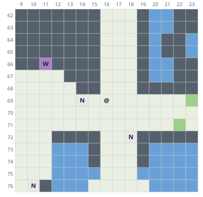
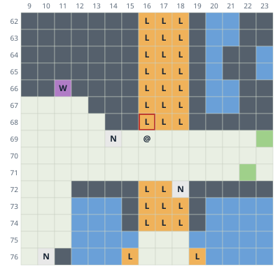
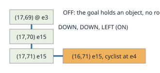

# Elevation-aware map

> Markdown twin of [elevation-aware-map-v1.html](../elevation-aware-map-v1.html), generated from the HTML by `just explainer-twins`. The HTML is the source; edit it, not this file.

`elevation-aware-map-v1` · default OFF · bundle arm ON in the current fixed definitions · control unchanged

## What went wrong

GLM run 0d5d, turns 1094 to 1106 on ROUTE110 (12:48 to 1:16 PM New York, 23 October). The player stood at elevation 3 on bridge tiles (elevation 15) under the Seaside Cycling Road. The road above, x 16 to 18 and rows 68 and up, is at elevation 4. The map drew it `.`, Next tiles said `up (17,68) clear (.)`, and three UP presses got:

```
turned right -> up but did not move: UP ×3 left you at (17,69), now facing up. The readout shows nothing blocking the tile above, (17,68); what stopped you is not known.
```

pokeemerald's `IsElevationMismatchAt` refuses that step: tiles at elevation 0 or 15 accept any walker, but any other tile must match the walker's elevation. The same run's GRANITE CAVE B1F slope got the same "nothing blocking" answer (seq 96996).

## The map, OFF and ON

Both maps are re-rendered by the production server code from raw RAM archive 21953 (seq 129029, the player at (16,69)) with the run's own switches. Only this switch differs.



*OFF: the raised road looks like the floor the player stands on.*



*ON: tiles at elevation 4 (and the elevation 1 tiles on the beach) draw L. The red square is the tile UP tries to enter.*

Under the ON map the readout adds:

```
Next tiles: up (16,68) another level (L), elevation 4 (yours is 3), cannot be entered from here; ...
Other levels (L): tiles at elevation 1, 4, while you are at elevation 3. The game refuses a step onto a tile at an elevation other than yours; tiles at elevation 0 or 15 accept any elevation.
```

Water, ledges, special terrain, objects, warps and the player keep their own glyphs. Nothing draws L while surfing, since the game turns that refusal into a dismount there.

## Refused presses name the reason

| Recorded press | OFF (what GLM got) | ON |
|---|---|---|
| seq 127086, UP ×3 | The readout shows nothing blocking the tile above, (17,68); what stopped you is not known. | The tile above, (17,68), is at elevation 4 while you are at elevation 3 (L on the local map), and the game refuses a step onto a tile at another elevation, so UP cannot move you from here. |
| seq 129030, one UP | blocked or unavailable (no movement/turn observed; snapshots cannot distinguish collision from ignored input) | blocked: UP did not move you; you are still at (16,69) facing up. The tile above, (16,68), is at elevation 4 ... |
| seq 96996, UP ×2 in GRANITE CAVE B1F | The readout shows nothing blocking the tile above, (9,10); what stopped you is not known. | The tile above, (9,10), is a muddy slope, which slides a walker back down, so UP cannot move you from here. |

A single press only gains a reason when the terrain cause is certain; otherwise it keeps the old text.

## Objects on another level do not block



*State 127085: the CYCLING_TRIATHLETE_F rides the road at elevation 4 over (16,71). The game's DoesObjectCollideWithObjectAt only blocks when AreElevationsCompatible holds (either is 0, or both match).*

With the switch ON the server sends each loaded object's elevation, and navigate_to's planner checks it against the walker's elevation before each step. An object whose elevation is not known still blocks. The tile rule (0 and 15 accept anyone) and the object rule (0 matches anyone) stay separate.

## Wiring

Game server: `elevation_view.py` draws L, adds the note and reads object elevations; `adjacent_tiles.py` names L tiles. Agent: `blocked-batch.ts` names elevation and slope refusals; `navigation.ts` uses `actorElevation` from `withNavigation`. Navigation's tile rule was already the game's and is unchanged.

OFF: the map draws those tiles `.` or `g`, there is no Other levels line, Next tiles calls them clear, press results are byte for byte today's, and every object blocks its tile. Tests replay the recorded 0d5d results 127086, 129030 and 96996 byte for byte with the switch off.

## Status

Not measured: no run has used it yet. Merging does not launch anything.
