POKEBENCH · FEATURE EXPLAINER

# navigate_to now climbs stairs and crosses bridges

> Markdown twin of [elevation-transitions.html](../elevation-transitions.html), generated from the HTML by `just explainer-twins`. The HTML is the source; edit it, not this file.

Every map tile has an elevation from 0 to 15, and the player carries one too. The game refuses a step onto a tile at a different height. `planNavigation` had two rules wrong: it kept the old height on stairs, and it took on height 15 on bridges. It now copies the game's two rules exactly. It applies inside `bounded-navigation-v1` and now has its own switch, `elevation-transitions-v1` (ON by default; see section 6).

## 1. The game's rules

|  | pokeemerald (731ad5b) | Before | After |
|---|---|---|---|
| **Can I step there?** | `IsElevationMismatchAt`, event_object_movement.c:7673. Allowed if you are at 0, or the tile is 0 or 15, or the heights match. | Allowed if you or the tile were 0, or heights matched. **A 15 tile was refused** unless you were already 15. | Same as the game. |
| **What height am I after the step?** | `ObjectEventUpdateElevation`, :7725, runs again when the step finishes, after `ShiftStillObjectEventCoords` (:5093) makes the tile you left equal to the tile you are on. So you end at the new tile's height, **including 0**, unless the new tile is 15; then your height does not change. | Took the new tile's height, but **kept the old height on a 0 tile**. | Same as the game. |
| **Start height** | Player object byte 0x0B, low nibble (`currentElevation`). | `navigation_grid.elevation`, read at game_state.py:253. Unchanged. |  |
| **Ledge landings** | A jump updates height mid-air on the ledge tile (`InitJump`, then `JUMP_HALFWAY` in `UpdateJumpAnim`, :5437) and finishes like a step (:5446). So the landing tile decides, unless it is 15; then the ledge tile's update stands. | Used the old stair rule. | Same as the game. The planner still also refuses a landing at a different height, which the game does not check. |

*Before is main at a8cbcff. After is a working branch.*

## 2. Stairs: the Route 104 pier

elevation 3elevation 40 = stairs (transition)15 = multi-level (bridge)collisionwater● start ○ goal━ planned route┅ refused

### Before: no path



### After: RIGHT ×4


*Real tiles from Route104 map.bin. Walking off the elevation-4 pier, the old planner kept height 4 on the stair tile (15,51), so the elevation-3 beach at (16,51) looked like a wall. The game resets you to 0 on the stair, so the next step can go anywhere. Test: player at (13,51) height 4, goal (17,51) gives RIGHT, RIGHT, RIGHT, RIGHT. The reverse climb, (17,52) to (12,52), gives LEFT ×5.*

## 3. Multi-level tiles: Littleroot Town

### Before: detour, and (11,10) unreachable



### After: RIGHT, RIGHT


*Littleroot has two height-15 tiles in its height-3 street, at (2,10) and (11,10). The old planner refused them, so it walked around and could never stop on one. If it had stepped on, it would have taken height 15 and then refused every height-3 tile around it. The game keeps your height on a 15 tile. Tests: (10,10) to (11,10) is RIGHT; (10,10) to (12,10) is RIGHT, RIGHT; from (11,10) to (11,12) is DOWN, DOWN.*

## 4. Under a bridge: Route 110


*The walkway under the Cycling Road is height 15; the deck above it is height 4. Walking under at height 3, you stay at 3 (green). Turning north onto the deck at (17,68) is refused (red), because you are still 3 and the deck is 4. The test also starts on the crossing at height 4, as a cyclist coming off the deck would be: the deck is reachable and the height-3 path is not. These walkway tiles use bridge behaviors 0x70 and 0x7f, which `navigate_to` still treats as walls; making them walkable belongs to the walkability thread, so the test overrides them to plain floor.*

## 5. The code change

```
const MULTI_LEVEL=15;
const mismatch=(walker,tile)=>walker!==0&&tile!==0&&tile!==MULTI_LEVEL&&tile!==walker;
const entered=(walker,tile)=>tile===MULTI_LEVEL?walker:tile;
```

*Each search node is a tile plus the walker's height, as before; a test proves a tile can be reachable at one height and not another. For ledge jumps a `jumped` helper also looks at the take-off and ledge tiles. Review round 1 caught an earlier version that looked at the tile you leave on ordinary steps; that only matters halfway through a step, so it was removed.*

## 6. The switch: elevation-transitions-v1

The rule is now behind a switch so it can be A/B tested. It is ON by default, so runs and presets keep today's behavior, and a preset written before the switch existed counts as ON. OFF brings back the rule from before this change. Nothing the model reads changes in either state; only `navigate_to`'s planner does.

### ON (default): the game's rule



### OFF: the earlier rule



*The same three tiles with the switch ON and OFF, as in the test "elevation-transitions-v1 off restores the pre-transition rule on both geometries". With it OFF, height 15 also blocks like any other height, and a ledge landing on 0 keeps the walker's height.*


*The switch travels from the run's feature set through the production factory to the one place behavior changes: the planner's elevation rule. A factory test removes this wiring and fails.*

## 7. Status

- Merged with main 9f111d1 (includes ledge hops).
- Tests: agent 899, viewer 476, Python 1803 pass. Coverage agent 97.2 / 93.3 / 97.9, Python 96.7 / 91.8 / 100 (floor 90). Lint and build clean.
- Test fixtures are real 15×15 windows decoded from pokeemerald map.bin: `packages/agent/test-support/elevation-maps.json`.
- Review: Claude, Codex and Grok all LGTM after three rounds (round 1 fixed leaving a 15 tile; round 2 added the search-identity and ledge-onto-15 tests).
- Not done: no live run on the pier or Route 110; no measured benchmark runs; not merged to main.
- 2026-10-14: switch added on a working branch (default ON, planner-only). It is queued as an A/B experiment, position 2, waiting for Operator’s approval. No measured runs yet.
- Still open elsewhere: sand, cave and bridge behaviors are walls to the planner; the model's text map does not show elevation.
