POKÉBENCH · HARNESS CONFIG

# Explicit evolution decision

> Markdown twin of [evolution-decision-v1.html](../evolution-decision-v1.html), generated from the HTML by `just explainer-twins`. The HTML is the source; edit it, not this file.

The model chooses whether to evolve or cancel. The game waits for that choice.

## What changes



1. Evolution animation: neutral input only.
2. Game waits for `choose_evolution`.
3. **evolve**: continue neutrally.<br>
   **cancel**: native B input.

Both choices belong to the model. No wall-clock timeout picks an answer.

## The observation defect

Previously the harness invented `selected CANCEL` during an animation and combined “Hold B to stop” with “A confirms; B declines.” The retained trace shows Qwen pressing B to “decline stopping the evolution.”

With the switch on, there is no selected cursor. The readout names a pending evolution decision and directs the model to the explicit tool. After the explicit choice, the harness acknowledges a native waiting evolution result message with A. Actual move-learning prompts retain their own native choices.

Observations can capture the waiting decision while the screen is fading or black. The game stays held until a choice; the capture receipt says `input_hold` and records only frames the game actually advanced. Operator pause remains separate.

```
choose_evolution({decision: "evolve"})
choose_evolution({decision: "cancel"})
```

## Move-learning result pages

After the model accepts or declines a move, the game prints its result in the battle-text buffer. The evolution frame gate now acknowledges that waiting page too, with one A press followed by a release. It requires the ordinary evolution task, a result state (15, 20 or 21), the move-learning task bit for battle text, and active printer 0 waiting on window 0 without auto-scroll.

**Model chooses a move or declines it** → game prints the result → harness acknowledges the waiting page → game continues to its next choice or returns to the field.

The readout names `evolution_result`, says input is ready, and includes the printed result when it comes from the battle-text buffer. A YES/NO question stays a model choice. OFF keeps the previous native buttons and readout.

Failure evidence: run `2026-10-22T00-22-02_qwen36-gpu0_d951`, turn 430, state seq 16513 and result seq 16514. The model explicitly declined DOUBLE KICK. The old gate then discarded A and B on “COMBUSKEN did not learn DOUBLE KICK.” This correction adds no advice about which move to choose.

## Native grounding

pret/pokeemerald revision `731ad5bfd6e6f265508d0efcca0ba42f9dcf5881`, `src/evolution_scene.c`, `Task_EvolutionScene`. Cancellation requires held B, state 8 (WAIT_CYCLE_MON_SPRITE), CAN_STOP and an active evolution graphics task. The frame gate reads those native owners and stops before advancing a cancellation-window frame. It also suppresses inputs queued before the transition.

Trade and uncancellable evolution do not acquire this decision. Move learning is a separate boundary. The pending move is read from the game’s actual gMoveToLearn owner, verified against the ROM instruction that writes it. The old decoder used the wrong address. No RAM writes, save repair, predicted moves or strategic advice are added.

## Switch and evidence

`evolution-decision-v1` defaults OFF. The operator requested it ON in the fixed bundle; since 2026-10-20 it is on in both arms (the control model cancelled an evolution with a stray B). OFF preserves the previous tools, observation and input behavior.

Historical source: `2026-10-19T01-08-57_qwen36-gpu1_petalburg-wholemap-probe-a`, observation seq 10270, stated interpretation seq 10298, B call seq 10299 and subsequent cancellation. Historical records are unchanged.

Evidence: both evolution choices and the separate DOUBLE KICK learning prompt were verified in an excluded real-ROM probe. The result-page correction is checked against the retained d951 native archive, production state/readout and native input hooks. Review and landing receipts are recorded in docs/worklogs/active/2026-10-22_evolution-result-page.md. No performance benefit has been established.
