# Exit labels v2

> Markdown twin of [exit-labels-v2.html](../exit-labels-v2.html), generated from the HTML by `just explainer-twins`. The HTML is the source; edit it, not this file.

`exit-labels-v2` · observation · game server · bundle arm only · default off · needs `named-warp-destinations-v1`

Every warp in the readout names the map it leads to the way the game's location popup names that map when you arrive, with its map ID. When two or more exits of the map you are on lead to the same name, each one also says where it lands and which exits can be walked to from there. Map facts only: no goal and no route.

## Why: b300, turns 581–596

Run `2026-10-20T13-54-28_qwen36-gpu0_b300` whited out at the Rustboro Gym, woke in Littleroot, and by 3:06 PM was back on south ROUTE104. It then walked into PETALBURG WOODS and straight back out at least six times. The Warps line, the interaction candidates and the Warp destination lines printed `map 24/11` and `map 0/19`, and the model quoted those IDs. named-warp-destinations-v1 names a map only when a sign has shown its name, so almost nothing got a name. And every woods exit leads to ROUTE104, so a name alone cannot say which mouth comes out where RUSTBORO CITY can be walked to.

*Each line joins a woods mouth to the ROUTE104 warp it lands on (the warp's `warpId` on the destination map). Areas and labels are the server's flood of the ROM layouts, as printed below.*

## What the model reads at seq 18814 (inside PETALBURG WOODS at (17,38))

OFF (today, re-rendered from the run's raw RAM; matches what the model got)

Warps: (14,5) -&gt; map 0/19 \[directional exit: stand on tile, then press UP\], … (37,38) -&gt; map 0/19 \[directional exit: stand on tile, then press DOWN\] Warp to map 0/19 at (14,5), elevation 0; movement; activation depends on metatile (see local map); conditional; destination map 0/19 warp 2 … Warp destination at (14,5): map 0/19 Warp destination at (15,5): map 0/19 Warp destination at (16,38): map 0/19 Warp destination at (17,38): map 0/19 Warp destination at (36,38): map 0/19 Warp destination at (37,38): map 0/19

ON (re-rendered from the same raw RAM; … marks lines left out here)

Warps: (14,5) -&gt; ROUTE 104 (map 0/19) \[directional exit: stand on tile, then press UP\], … (37,38) -&gt; ROUTE 104 (map 0/19) \[directional exit: stand on tile, then press DOWN\] Warp to ROUTE 104 (map 0/19) at (14,5), elevation 0; movement; activation depends on metatile (see local map); conditional; destination ROUTE 104 (map 0/19) warp 2 … Warp destination at (14,5): ROUTE 104 (map 0/19), arriving at (10,30); from there, on foot: (5,18) -&gt; ROUTE 104 (map 17/1); (10,30) or (11,30) -&gt; this map at (14,5) or (15,5); NORTH edge -&gt; RUSTBORO CITY (map 0/3) Warp destination at (15,5): ROUTE 104 (map 0/19), arriving at (11,30); from there, on foot: (5,18) -&gt; ROUTE 104 (map 17/1); (10,30) or (11,30) -&gt; this map at (14,5) or (15,5); NORTH edge -&gt; RUSTBORO CITY (map 0/3) Warp destination at (16,38): ROUTE 104 (map 0/19), arriving at (10,38); from there, on foot: (17,50) -&gt; ROUTE 104 (map 17/0); (10,38) or (11,38) -&gt; this map at (16,38) or (17,38); EAST edge -&gt; PETALBURG CITY (map 0/0) Warp destination at (17,38): ROUTE 104 (map 0/19), arriving at (11,38); from there, on foot: (17,50) -&gt; ROUTE 104 (map 17/0); (10,38) or (11,38) -&gt; this map at (16,38) or (17,38); EAST edge -&gt; PETALBURG CITY (map 0/0) Warp destination at (36,38): ROUTE 104 (map 0/19), arriving at (32,42); from there, on foot: (17,50) -&gt; ROUTE 104 (map 17/0); (10,38) or (11,38) -&gt; this map at (16,38) or (17,38); (32,42) or (33,42) -&gt; this map at (36,38) or (37,38); EAST edge -&gt; PETALBURG CITY (map 0/0) Warp destination at (37,38): ROUTE 104 (map 0/19), arriving at (33,42); from there, on foot: (17,50) -&gt; ROUTE 104 (map 17/0); (10,38) or (11,38) -&gt; this map at (16,38) or (17,38); (32,42) or (33,42) -&gt; this map at (36,38) or (37,38); EAST edge -&gt; PETALBURG CITY (map 0/0)

## What the model reads at seq 18834 (south ROUTE104 at (11,39))

OFF (today)

Warps: (17,50) -&gt; map 17/0 \[step onto tile\], (5,18) -&gt; map 17/1 \[step onto tile\], (10,30) -&gt; map 24/11 \[step onto tile\], … (33,42) -&gt; map 24/11 \[step onto tile\] … Warp destination at (17,50): map 17/0 Warp destination at (5,18): map 17/1 (not reachable on foot from where you stand) Warp destination at (10,30): map 24/11 (not reachable on foot from where you stand) Warp destination at (11,30): map 24/11 (not reachable on foot from where you stand) Warp destination at (10,38): map 24/11 Warp destination at (11,38): map 24/11 Warp destination at (32,42): map 24/11 (not reachable on foot from where you stand) Warp destination at (33,42): map 24/11 (not reachable on foot from where you stand)

ON (re-rendered from the same raw RAM; … marks lines left out here)

Warps: (17,50) -&gt; ROUTE 104 (map 17/0) \[step onto tile\], (5,18) -&gt; ROUTE 104 (map 17/1) \[step onto tile\], (10,30) -&gt; PETALBURG WOODS (map 24/11) \[step onto tile\], … (33,42) -&gt; PETALBURG WOODS (map 24/11) \[step onto tile\] … Warp destination at (17,50): ROUTE 104 (map 17/0), arriving at (5,8); from there, on foot: (5,8) or (6,8) -&gt; this map at (17,50) Warp destination at (5,18): ROUTE 104 (map 17/1) (not reachable on foot from where you stand), arriving at (2,8); from there, on foot: (2,8) or (3,8) -&gt; this map at (5,18) Warp destination at (10,30): PETALBURG WOODS (map 24/11) (not reachable on foot from where you stand), arriving at (14,5); from there, on foot: (14,5) or (15,5) -&gt; this map at (10,30) or (11,30); (16,38) or (17,38) -&gt; this map at (10,38) or (11,38); (36,38) or (37,38) -&gt; this map at (32,42) or (33,42) Warp destination at (11,30): … arriving at (15,5); (same list) Warp destination at (10,38): PETALBURG WOODS (map 24/11), arriving at (16,38); from there, on foot: (14,5) or (15,5) -&gt; this map at (10,30) or (11,30); (16,38) or (17,38) -&gt; this map at (10,38) or (11,38); (36,38) or (37,38) -&gt; this map at (32,42) or (33,42) Warp destination at (11,38): … arriving at (17,38); (same list) Warp destination at (32,42): PETALBURG WOODS (map 24/11) (not reachable on foot from where you stand), arriving at (36,38); (same list) Warp destination at (33,42): … arriving at (37,38); (same list)

On ROUTE104 the two buildings both read ROUTE 104 (their popup section is the route's), so they share a name and get arrival notes too. "this map at (10,30)" is a tile of the map you are on; the same readout's exit-reachability-v1 note already says (10,30) cannot be walked to from (11,39).

## Where the names and reach come from

*Green boxes are the new code (`env/pokebench_env/exit_labels.py`). Everything is read from the ROM; nothing comes from a walkthrough.*

- **Name.** `ShowMapNamePopUpWindow` (src/map_name_popup.c, pret/pokeemerald 731ad5b) prints `GetMapName(gMapHeader.regionMapSectionId)`, which copies `gRegionMapEntries[mapsec].name` (src/region_map.c). The server reads the destination's header byte at +0x14 and that table. A building already named on its sign (displayed-place-names-v1: the Littleroot houses and the lab) keeps that name. A warp to the map you are on (the PETALBURG CITY GYM's room doors) reads `this map`. A map whose popup prints blanks (`MAPSEC_DYNAMIC`: the cable club's UNION ROOM and TRADE CENTER; `MAPSEC_NONE`) reads `a map with no location name`, with its ID. The secret base section (needs the player's base name) is treated the same. Dynamic warps (127/127) and unset dynamic warps keep their existing rules.
- **Same name.** Exits of the current map are counted by name: adjacent warp tiles to one map are one doorway, one exit; map connections count by their destination's name. Unnamed maps never count as sharing a name.
- **Landing tile.** The destination map's warp event number `warpId` (WarpEvent `{s16 x, y; u8 elevation, warpId, mapNum, mapGroup}`). An out-of-range `warpId` or an unreadable layout gives the name only.
- **Reach.** The destination's ROM layout (block bits: metatile 0–9, collision 10–11, elevation 12–15; behavior = metatile attribute & 0xFF, 512 metatiles in the primary tileset) is flooded from the landing tile with exit-reachability-v1's rules: no collision, no surfable water, a ledge hops one way, elevation and people ignored. A warp counts when it or a neighbour is reached. A map connection counts when a reached edge tile can be crossed into the connected map's ROM layout under the same crossing rule connection-edge-tiles-v1 uses on the live map (`topology.crossable`, now shared). Run-time metatile changes (`setmetatile`) are not seen: this is the map as it loads.

## Audit: Littleroot to the Dewford Gym

Every map in story order (Littleroot, Route 101, Oldale, Route 103, Route 102, Petalburg, Route 104, Petalburg Woods, Rustboro and its buildings, Route 116, Rusturf Tunnel, Route 104's beach and Mr. Briney's house, Routes 105 and 106, Dewford and its gym) with every building interior: 59 maps, 134 exits, read from the ROM with the switch on (player RED, male). **No exit prints a bare map ID.** The only exits that had no popup name were the eight cable club doors on the four POKéMON CENTER 2F maps (UNION ROOM 25/60, TRADE CENTER 25/25: `MAPSEC_DYNAMIC`), now `a map with no location name (map 25/60)`.

Names the player may not have seen yet still print, because the popup name is what the game shows on arrival: TERRA CAVE (two Route 116 warps whose tiles are not cave mouths in a normal game), ALTERING CAVE, ISLAND CAVE, GRANITE CAVE and VERDANTURF TOWN.

Full audit table (134 exits)

| Map (id) | Exit tiles | Destination (id, map table name) | Printed name | Arrival reach |
|---|---|---|---|---|
| LITTLEROOT TOWN 0/9 | (14,8) | 1/2 LITTLEROOT TOWN MAYS HOUSE 1F | PROF. BIRCH'S HOUSE 1F | no |
| LITTLEROOT TOWN 0/9 | (5,8) | 1/0 LITTLEROOT TOWN BRENDANS HOUSE 1F | RED's HOUSE 1F | no |
| LITTLEROOT TOWN 0/9 | (7,16) | 1/4 LITTLEROOT TOWN PROFESSOR BIRCHS LAB | PROF. BIRCH'S POKéMON LAB | no |
| LITTLEROOT TOWN BRENDANS HOUSE 1F 1/0 | (9,8) or (8,8) | 0/9 LITTLEROOT TOWN | LITTLEROOT TOWN | no |
| LITTLEROOT TOWN BRENDANS HOUSE 1F 1/0 | (8,2) | 1/1 LITTLEROOT TOWN BRENDANS HOUSE 2F | RED's HOUSE 2F | no |
| LITTLEROOT TOWN BRENDANS HOUSE 2F 1/1 | (7,1) | 1/0 LITTLEROOT TOWN BRENDANS HOUSE 1F | RED's HOUSE 1F | no |
| LITTLEROOT TOWN MAYS HOUSE 1F 1/2 | (1,8) or (2,8) | 0/9 LITTLEROOT TOWN | LITTLEROOT TOWN | no |
| LITTLEROOT TOWN MAYS HOUSE 1F 1/2 | (2,2) | 1/3 LITTLEROOT TOWN MAYS HOUSE 2F | PROF. BIRCH'S HOUSE 2F | no |
| LITTLEROOT TOWN MAYS HOUSE 2F 1/3 | (1,1) | 1/2 LITTLEROOT TOWN MAYS HOUSE 1F | PROF. BIRCH'S HOUSE 1F | no |
| LITTLEROOT TOWN PROFESSOR BIRCHS LAB 1/4 | (6,12) or (7,12) | 0/9 LITTLEROOT TOWN | LITTLEROOT TOWN | no |
| OLDALE TOWN 0/10 | (5,7) | 2/0 OLDALE TOWN HOUSE1 | OLDALE TOWN | yes |
| OLDALE TOWN 0/10 | (15,16) | 2/1 OLDALE TOWN HOUSE2 | OLDALE TOWN | yes |
| OLDALE TOWN 0/10 | (6,16) | 2/2 OLDALE TOWN POKEMON CENTER 1F | OLDALE TOWN | yes |
| OLDALE TOWN 0/10 | (14,6) | 2/4 OLDALE TOWN MART | OLDALE TOWN | yes |
| OLDALE TOWN HOUSE1 2/0 | (3,8) or (4,8) | 0/10 OLDALE TOWN | OLDALE TOWN | no |
| OLDALE TOWN HOUSE2 2/1 | (3,7) or (4,7) | 0/10 OLDALE TOWN | OLDALE TOWN | no |
| OLDALE TOWN POKEMON CENTER 1F 2/2 | (7,8) or (6,8) | 0/10 OLDALE TOWN | OLDALE TOWN | yes |
| OLDALE TOWN POKEMON CENTER 1F 2/2 | (1,6) | 2/3 OLDALE TOWN POKEMON CENTER 2F | OLDALE TOWN | yes |
| OLDALE TOWN POKEMON CENTER 2F 2/3 | (1,6) | 2/2 OLDALE TOWN POKEMON CENTER 1F | OLDALE TOWN | no |
| OLDALE TOWN POKEMON CENTER 2F 2/3 | (5,1) | 25/60 UNION ROOM | a map with no location name | no |
| OLDALE TOWN POKEMON CENTER 2F 2/3 | (9,1) | 25/25 TRADE CENTER | a map with no location name | no |
| OLDALE TOWN MART 2/4 | (3,7) or (4,7) | 0/10 OLDALE TOWN | OLDALE TOWN | no |
| ROUTE103 0/18 | (45,6) | 24/106 ALTERING CAVE | ALTERING CAVE | no |
| PETALBURG CITY 0/0 | (10,19) | 8/2 PETALBURG CITY HOUSE1 | PETALBURG CITY | yes |
| PETALBURG CITY 0/0 | (7,5) | 8/0 PETALBURG CITY WALLYS HOUSE | PETALBURG CITY | yes |
| PETALBURG CITY 0/0 | (15,8) | 8/1 PETALBURG CITY GYM | PETALBURG CITY | yes |
| PETALBURG CITY 0/0 | (20,16) | 8/4 PETALBURG CITY POKEMON CENTER 1F | PETALBURG CITY | yes |
| PETALBURG CITY 0/0 | (20,24) | 8/3 PETALBURG CITY HOUSE2 | PETALBURG CITY | yes |
| PETALBURG CITY 0/0 | (25,12) | 8/6 PETALBURG CITY MART | PETALBURG CITY | yes |
| PETALBURG CITY WALLYS HOUSE 8/0 | (3,7) or (4,7) | 0/0 PETALBURG CITY | PETALBURG CITY | no |
| PETALBURG CITY GYM 8/1 | (4,111) or (5,111) | 0/0 PETALBURG CITY | PETALBURG CITY | no |
| PETALBURG CITY GYM 8/1 | (1,105) | 8/1 PETALBURG CITY GYM | this map | yes |
| PETALBURG CITY GYM 8/1 | (7,85) or (6,85) | 8/1 PETALBURG CITY GYM | this map | yes |
| PETALBURG CITY GYM 8/1 | (7,105) | 8/1 PETALBURG CITY GYM | this map | yes |
| PETALBURG CITY GYM 8/1 | (1,98) or (2,98) | 8/1 PETALBURG CITY GYM | this map | yes |
| PETALBURG CITY GYM 8/1 | (1,79) | 8/1 PETALBURG CITY GYM | this map | yes |
| PETALBURG CITY GYM 8/1 | (7,79) | 8/1 PETALBURG CITY GYM | this map | yes |
| PETALBURG CITY GYM 8/1 | (7,46) or (6,46) | 8/1 PETALBURG CITY GYM | this map | yes |
| PETALBURG CITY GYM 8/1 | (1,59) or (2,59) | 8/1 PETALBURG CITY GYM | this map | yes |
| PETALBURG CITY GYM 8/1 | (1,92) | 8/1 PETALBURG CITY GYM | this map | yes |
| PETALBURG CITY GYM 8/1 | (7,92) | 8/1 PETALBURG CITY GYM | this map | yes |
| PETALBURG CITY GYM 8/1 | (7,59) or (6,59) | 8/1 PETALBURG CITY GYM | this map | yes |
| PETALBURG CITY GYM 8/1 | (1,72) or (2,72) | 8/1 PETALBURG CITY GYM | this map | yes |
| PETALBURG CITY GYM 8/1 | (7,40) | 8/1 PETALBURG CITY GYM | this map | yes |
| PETALBURG CITY GYM 8/1 | (1,53) | 8/1 PETALBURG CITY GYM | this map | yes |
| PETALBURG CITY GYM 8/1 | (7,53) | 8/1 PETALBURG CITY GYM | this map | yes |
| PETALBURG CITY GYM 8/1 | (1,66) | 8/1 PETALBURG CITY GYM | this map | yes |
| PETALBURG CITY GYM 8/1 | (1,20) or (2,20) | 8/1 PETALBURG CITY GYM | this map | yes |
| PETALBURG CITY GYM 8/1 | (7,20) or (6,20) | 8/1 PETALBURG CITY GYM | this map | yes |
| PETALBURG CITY GYM 8/1 | (1,33) or (2,33) | 8/1 PETALBURG CITY GYM | this map | yes |
| PETALBURG CITY GYM 8/1 | (7,33) or (6,33) | 8/1 PETALBURG CITY GYM | this map | yes |
| PETALBURG CITY GYM 8/1 | (7,14) | 8/1 PETALBURG CITY GYM | this map | yes |
| PETALBURG CITY GYM 8/1 | (1,27) | 8/1 PETALBURG CITY GYM | this map | yes |
| PETALBURG CITY GYM 8/1 | (1,7) or (2,7) | 8/1 PETALBURG CITY GYM | this map | yes |
| PETALBURG CITY GYM 8/1 | (7,7) or (6,7) | 8/1 PETALBURG CITY GYM | this map | yes |
| PETALBURG CITY HOUSE1 8/2 | (3,8) or (4,8) | 0/0 PETALBURG CITY | PETALBURG CITY | no |
| PETALBURG CITY HOUSE2 8/3 | (3,7) or (4,7) | 0/0 PETALBURG CITY | PETALBURG CITY | no |
| PETALBURG CITY POKEMON CENTER 1F 8/4 | (7,8) or (6,8) | 0/0 PETALBURG CITY | PETALBURG CITY | yes |
| PETALBURG CITY POKEMON CENTER 1F 8/4 | (1,6) | 8/5 PETALBURG CITY POKEMON CENTER 2F | PETALBURG CITY | yes |
| PETALBURG CITY POKEMON CENTER 2F 8/5 | (1,6) | 8/4 PETALBURG CITY POKEMON CENTER 1F | PETALBURG CITY | no |
| PETALBURG CITY POKEMON CENTER 2F 8/5 | (5,1) | 25/60 UNION ROOM | a map with no location name | no |
| PETALBURG CITY POKEMON CENTER 2F 8/5 | (9,1) | 25/25 TRADE CENTER | a map with no location name | no |
| PETALBURG CITY MART 8/6 | (3,7) or (4,7) | 0/0 PETALBURG CITY | PETALBURG CITY | no |
| ROUTE104 0/19 | (17,50) | 17/0 ROUTE104 MR BRINEYS HOUSE | ROUTE 104 | yes |
| ROUTE104 0/19 | (5,18) | 17/1 ROUTE104 PRETTY PETAL FLOWER SHOP | ROUTE 104 | yes |
| ROUTE104 0/19 | (10,30) or (11,30) | 24/11 PETALBURG WOODS | PETALBURG WOODS | yes |
| ROUTE104 0/19 | (10,38) or (11,38) | 24/11 PETALBURG WOODS | PETALBURG WOODS | yes |
| ROUTE104 0/19 | (32,42) or (33,42) | 24/11 PETALBURG WOODS | PETALBURG WOODS | yes |
| ROUTE104 MR BRINEYS HOUSE 17/0 | (5,8) or (6,8) | 0/19 ROUTE104 | ROUTE 104 | no |
| ROUTE104 PRETTY PETAL FLOWER SHOP 17/1 | (2,8) or (3,8) | 0/19 ROUTE104 | ROUTE 104 | no |
| PETALBURG WOODS 24/11 | (14,5) or (15,5) | 0/19 ROUTE104 | ROUTE 104 | yes |
| PETALBURG WOODS 24/11 | (16,38) or (17,38) | 0/19 ROUTE104 | ROUTE 104 | yes |
| PETALBURG WOODS 24/11 | (36,38) or (37,38) | 0/19 ROUTE104 | ROUTE 104 | yes |
| RUSTBORO CITY 0/3 | (27,19) | 11/3 RUSTBORO CITY GYM | RUSTBORO CITY | yes |
| RUSTBORO CITY 0/3 | (13,30) | 11/8 RUSTBORO CITY FLAT1 1F | RUSTBORO CITY | yes |
| RUSTBORO CITY 0/3 | (16,45) | 11/7 RUSTBORO CITY MART | RUSTBORO CITY | yes |
| RUSTBORO CITY 0/3 | (16,38) | 11/5 RUSTBORO CITY POKEMON CENTER 1F | RUSTBORO CITY | yes |
| RUSTBORO CITY 0/3 | (27,34) | 11/4 RUSTBORO CITY POKEMON SCHOOL | RUSTBORO CITY | yes |
| RUSTBORO CITY 0/3 | (11,15) or (12,15) | 11/0 RUSTBORO CITY DEVON CORP 1F | RUSTBORO CITY | yes |
| RUSTBORO CITY 0/3 | (33,19) | 11/10 RUSTBORO CITY HOUSE1 | RUSTBORO CITY | yes |
| RUSTBORO CITY 0/3 | (9,38) | 11/11 RUSTBORO CITY CUTTERS HOUSE | RUSTBORO CITY | yes |
| RUSTBORO CITY 0/3 | (30,28) | 11/12 RUSTBORO CITY HOUSE2 | RUSTBORO CITY | yes |
| RUSTBORO CITY 0/3 | (5,51) | 11/13 RUSTBORO CITY FLAT2 1F | RUSTBORO CITY | yes |
| RUSTBORO CITY 0/3 | (26,46) | 11/16 RUSTBORO CITY HOUSE3 | RUSTBORO CITY | yes |
| RUSTBORO CITY DEVON CORP 1F 11/0 | (5,8) or (6,8) | 0/3 RUSTBORO CITY | RUSTBORO CITY | yes |
| RUSTBORO CITY DEVON CORP 1F 11/0 | (14,1) | 11/1 RUSTBORO CITY DEVON CORP 2F | RUSTBORO CITY | yes |
| RUSTBORO CITY DEVON CORP 2F 11/1 | (14,1) | 11/0 RUSTBORO CITY DEVON CORP 1F | RUSTBORO CITY | yes |
| RUSTBORO CITY DEVON CORP 2F 11/1 | (2,1) | 11/2 RUSTBORO CITY DEVON CORP 3F | RUSTBORO CITY | yes |
| RUSTBORO CITY DEVON CORP 3F 11/2 | (2,1) | 11/1 RUSTBORO CITY DEVON CORP 2F | RUSTBORO CITY | no |
| RUSTBORO CITY GYM 11/3 | (5,19) or (6,19) | 0/3 RUSTBORO CITY | RUSTBORO CITY | no |
| RUSTBORO CITY POKEMON SCHOOL 11/4 | (5,10) or (6,10) | 0/3 RUSTBORO CITY | RUSTBORO CITY | no |
| RUSTBORO CITY POKEMON CENTER 1F 11/5 | (7,8) or (6,8) | 0/3 RUSTBORO CITY | RUSTBORO CITY | yes |
| RUSTBORO CITY POKEMON CENTER 1F 11/5 | (1,6) | 11/6 RUSTBORO CITY POKEMON CENTER 2F | RUSTBORO CITY | yes |
| RUSTBORO CITY POKEMON CENTER 2F 11/6 | (1,6) | 11/5 RUSTBORO CITY POKEMON CENTER 1F | RUSTBORO CITY | no |
| RUSTBORO CITY POKEMON CENTER 2F 11/6 | (5,1) | 25/60 UNION ROOM | a map with no location name | no |
| RUSTBORO CITY POKEMON CENTER 2F 11/6 | (9,1) | 25/25 TRADE CENTER | a map with no location name | no |
| RUSTBORO CITY MART 11/7 | (3,7) or (4,7) | 0/3 RUSTBORO CITY | RUSTBORO CITY | no |
| RUSTBORO CITY FLAT1 1F 11/8 | (6,7) or (7,7) | 0/3 RUSTBORO CITY | RUSTBORO CITY | yes |
| RUSTBORO CITY FLAT1 1F 11/8 | (2,1) | 11/9 RUSTBORO CITY FLAT1 2F | RUSTBORO CITY | yes |
| RUSTBORO CITY FLAT1 2F 11/9 | (2,1) | 11/8 RUSTBORO CITY FLAT1 1F | RUSTBORO CITY | no |
| RUSTBORO CITY HOUSE1 11/10 | (5,7) or (6,7) | 0/3 RUSTBORO CITY | RUSTBORO CITY | no |
| RUSTBORO CITY CUTTERS HOUSE 11/11 | (5,8) or (6,8) | 0/3 RUSTBORO CITY | RUSTBORO CITY | no |
| RUSTBORO CITY HOUSE2 11/12 | (5,8) or (6,8) | 0/3 RUSTBORO CITY | RUSTBORO CITY | no |
| RUSTBORO CITY FLAT2 1F 11/13 | (2,8) or (3,8) | 0/3 RUSTBORO CITY | RUSTBORO CITY | yes |
| RUSTBORO CITY FLAT2 1F 11/13 | (3,1) | 11/14 RUSTBORO CITY FLAT2 2F | RUSTBORO CITY | yes |
| RUSTBORO CITY FLAT2 2F 11/14 | (3,1) | 11/13 RUSTBORO CITY FLAT2 1F | RUSTBORO CITY | yes |
| RUSTBORO CITY FLAT2 2F 11/14 | (1,1) | 11/15 RUSTBORO CITY FLAT2 3F | RUSTBORO CITY | yes |
| RUSTBORO CITY FLAT2 3F 11/15 | (1,1) | 11/14 RUSTBORO CITY FLAT2 2F | RUSTBORO CITY | no |
| RUSTBORO CITY HOUSE3 11/16 | (5,8) or (6,8) | 0/3 RUSTBORO CITY | RUSTBORO CITY | no |
| ROUTE116 0/31 | (47,8) | 24/4 RUSTURF TUNNEL | RUSTURF TUNNEL | yes |
| ROUTE116 0/31 | (38,8) | 21/0 ROUTE116 TUNNELERS REST HOUSE | ROUTE 116 | no |
| ROUTE116 0/31 | (65,10) | 24/4 RUSTURF TUNNEL | RUSTURF TUNNEL | yes |
| ROUTE116 0/31 | (59,13) | 24/104 TERRA CAVE ENTRANCE | TERRA CAVE | yes |
| ROUTE116 0/31 | (79,6) | 24/104 TERRA CAVE ENTRANCE | TERRA CAVE | yes |
| ROUTE116 TUNNELERS REST HOUSE 21/0 | (4,8) or (5,8) | 0/31 ROUTE116 | ROUTE 116 | no |
| RUSTURF TUNNEL 24/4 | (4,10) | 0/31 ROUTE116 | ROUTE 116 | yes |
| RUSTURF TUNNEL 24/4 | (29,16) | 0/14 VERDANTURF TOWN | VERDANTURF TOWN | no |
| RUSTURF TUNNEL 24/4 | (18,20) | 0/31 ROUTE116 | ROUTE 116 | yes |
| ROUTE105 0/20 | (9,20) | 24/67 ISLAND CAVE | ISLAND CAVE | no |
| ROUTE106 0/21 | (48,16) | 24/7 GRANITE CAVE 1F | GRANITE CAVE | no |
| DEWFORD TOWN 0/11 | (3,3) | 3/4 DEWFORD TOWN HALL | DEWFORD TOWN | yes |
| DEWFORD TOWN 0/11 | (2,10) | 3/1 DEWFORD TOWN POKEMON CENTER 1F | DEWFORD TOWN | yes |
| DEWFORD TOWN 0/11 | (8,17) | 3/3 DEWFORD TOWN GYM | DEWFORD TOWN | yes |
| DEWFORD TOWN 0/11 | (17,14) | 3/0 DEWFORD TOWN HOUSE1 | DEWFORD TOWN | yes |
| DEWFORD TOWN 0/11 | (8,8) | 3/5 DEWFORD TOWN HOUSE2 | DEWFORD TOWN | yes |
| DEWFORD TOWN HOUSE1 3/0 | (3,7) or (4,7) | 0/11 DEWFORD TOWN | DEWFORD TOWN | no |
| DEWFORD TOWN POKEMON CENTER 1F 3/1 | (7,8) or (6,8) | 0/11 DEWFORD TOWN | DEWFORD TOWN | yes |
| DEWFORD TOWN POKEMON CENTER 1F 3/1 | (1,6) | 3/2 DEWFORD TOWN POKEMON CENTER 2F | DEWFORD TOWN | yes |
| DEWFORD TOWN POKEMON CENTER 2F 3/2 | (1,6) | 3/1 DEWFORD TOWN POKEMON CENTER 1F | DEWFORD TOWN | no |
| DEWFORD TOWN POKEMON CENTER 2F 3/2 | (5,1) | 25/60 UNION ROOM | a map with no location name | no |
| DEWFORD TOWN POKEMON CENTER 2F 3/2 | (9,1) | 25/25 TRADE CENTER | a map with no location name | no |
| DEWFORD TOWN GYM 3/3 | (5,27) or (6,27) | 0/11 DEWFORD TOWN | DEWFORD TOWN | no |
| DEWFORD TOWN HALL 3/4 | (5,8) or (6,8) | 0/11 DEWFORD TOWN | DEWFORD TOWN | no |
| DEWFORD TOWN HOUSE2 3/5 | (3,8) or (4,8) | 0/11 DEWFORD TOWN | DEWFORD TOWN | no |

## OFF

Switch off, the readout and the typed state are byte for byte today's: `test_off_is_todays_readout_byte_for_byte` compares both b300 seqs against readouts rendered before the switch existed, and the state JSON gains no field either way.

## Status

- Tests: `env/tests/env/test_exit_labels.py` (b300 raw-RAM fixtures 7745 and 7751 plus a synthetic ROM).
- Not measured. A pending experiment entry is registered; only the operator approves runs.
