Feature switch · observation · `exit-reachability-v1` · default OFF · bundle arm only · pending experiment

# Exit reachability

> Markdown twin of [exit-reachability-v1.html](../exit-reachability-v1.html), generated from the HTML by `just explainer-twins`. The HTML is the source; edit it, not this file.

One reachability check, made once by the game server, decides for every exit list and every navigate_to message whether the player can walk there from where they stand. Exits nobody can walk to stop being offered as exits, and navigate_to stops telling the model to keep going toward a goal it cannot reach.

## Why

- Runs 0e05 and 93eb (2026-10-17, ROUTE104): from the south half, the readout listed `NORTH edge -> RUSTBORO CITY` and the PETALBURG WOODS north mouths as untaken exits, and navigate_to said `call navigate_to again to continue to (12,0)`. Rows 31 to 37 are solid wall; the north half is reached only through PETALBURG WOODS.
- Run 4198 (2026-10-16, ROUTE103): navigate_to told the model, 11 times, that none of MAY's free neighbouring tiles could be reached from here. That was true only inside the 15x15 local map; the way to her runs west, outside it. The model gave up on her.
- The operator asked for one DRY mechanism for leaving out exits that are not available (the operator, 2026-10-17). This switch is it: `exitReach(features, state)` in `packages/agent/src/surf-gate.ts`, fed by the server's `exit_reach`.

## What the server computes

From the player's tile, the server floods the whole current map (`surf_gate.reachable`, the same flood surf-gated-exits-v1 already used). On foot a tile is entered when its collision is 0 and it is not surfable water; a ledge (MB_JUMP\_\*) is hopped one tile on, in its arrow direction only (pokeemerald GetCollisionAtCoords). A second flood also opens water. Every warp and walking map connection then gets one label:

| Label | Warp | Map connection |
|---|---|---|
| `foot` | it or a tile next to it is in the foot flood | one of its walk-off edge tiles is in the foot flood |
| `water` | not on foot, but with water open | not on foot, but an edge tile crossable with water is reached with water open |
| `none` | neither | neither |

The flood leaves out heights (elevation), one-way tiles and people on purpose. Each of those can only take tiles away from what the player can walk to, so the flood reaches every tile the player can walk to and maybe more. A tile outside it cannot be walked to, so saying `none` is safe. An exit the server could not read (no whole map, an unreadable edge, a dive connection) has no label and stays listed. If the player's own tile is not on the map read, there is no `exit_reach` at all.

## ROUTE104 from the south half



reached on foot from (18,42): 546 tileswatersolidwalkable but not reached

*Run 0e05, raw-RAM archive 11268 (state 22579), drawn from the committed fixture with the production flood. No tile above y=38 is reached; rows 31 to 37 are wall from x=0 to 39. The NORTH edge, the flower shop (5,18), the woods' north mouths (10,30)/(11,30) and the woods' east mouth (32,42)/(33,42) (above south-only ledges) are `none`; Briney's house (17,50), the woods' south mouth (10,38)/(11,38) and the EAST edge are `foot`; the SOUTH edge is `water`.*

## Before and after on that readout (0e05 tool result 22580)

OFF, as recorded:

```
Navigation: command limit: stopped at (18,42) after 8 ordinary button attempts, the most one navigate_to call makes; call navigate_to again to continue to (12,0); 8 ordinary button attempts.
- NORTH -> RUSTBORO CITY (map 0/3), offset 0; walk off the map from any tile from (12,0) to (19,0) or (33,0): stand on one of these edge tiles and press UP
```

ON:

```
Navigation: command limit: stopped at (18,42) after 8 ordinary button attempts, the most one navigate_to call makes; (12,0) cannot be reached on foot from where you stand: no walkable way on this map leads from your tile to it or to a tile next to it, so calling navigate_to again will not get there; 8 ordinary button attempts.
- NORTH -> RUSTBORO CITY (map 0/3), offset 0; not reachable on foot from where you stand: no walkable way on this map leads from your tile to this edge
Warp to ROUTE104 PRETTY PETAL FLOWER SHOP (map 17/1) at (5,18), ...; not reachable on foot from where you stand: no walkable way on this map leads from your tile to it
Warp destination at (5,18): ROUTE104 PRETTY PETAL FLOWER SHOP (not reachable on foot from where you stand)
```

The untaken-exits line (fresh history, no names read yet) goes from

```
Exits here you have not taken: (17,50) -> map 17/0; (5,18) -> map 17/1; (10,30) -> map 24/11; (11,30) -> map 24/11; (10,38) -> map 24/11; (11,38) -> map 24/11; (32,42) -> map 24/11; (33,42) -> map 24/11; NORTH edge -> map 0/3; EAST edge -> map 0/0
```

to

```
Exits here you have not taken: (17,50) -> map 17/0; (10,38) -> map 24/11; (11,38) -> map 24/11; EAST edge -> map 0/0
```

A doorway with several tiles prints only the tiles not labelled `none`. Every note states only the fact, never a guessed cause: the game shows nothing when the player cannot get somewhere, so the harness says the plain fact (pokebench-game-state skill, "Harness messages use the game's own words"). When nothing is left it says why: `none you can walk to (no exit listed on this map can be reached on foot from where you stand)`, or with water exits also left out (surf-gated-exits-v1 on, no Surf) `none you can walk to (every exit listed on this map is across water you cannot Surf yet or cannot be reached on foot from where you stand)`. The supervisor's three exit lists and its ways-off line drop the same exits. No Surf or badge wording appears for a land case.

## MAY on ROUTE103: the local map is not the map


reached on foot from (16,7)watersolid (the row-5 and row-12 ledges are solid tiles hopped south only)walkable but not reached

*Run 4198, state 23325, the west part of ROUTE103. The dashed square is the 15x15 local map navigate_to plans over, top-left (9,0). Inside it the ledges at row 5 cut the player off from MAY at (10,3); the foot flood reaches all four tiles next to her by the west path through x=2 to 5 at row 5, outside the local map.*

```
(10,3) is RIVAL_MAY_NORMAL (person or object), which navigate_to cannot stand on, and none of its free neighbouring tiles can be reached from here; choose a reachable waypoint nearer to it
```

```
(10,3) is RIVAL_MAY_NORMAL (person or object), which navigate_to cannot stand on; none of its free neighbouring tiles can be reached inside the 15x15 local map navigate_to plans over, but this map's walkable area reaches (10,4) next to it, so the way there leaves that local map; walk to (9,6) on its west edge first, then call navigate_to (10,3) again
```

The waypoint is the one navigation-refusal-reasons-v2 would pick: the reachable tile on the local map's edge, with an unseen neighbour inside the map, nearest the goal. The neighbour named is one nobody stands on, nearest the player. If the flood inside the local map already reaches that neighbour, the way does not leave the local map; then it says the plan found no route right now. If no neighbour is reached on foot at all: `none of its neighbouring tiles can be reached on foot from where you stand: no walkable way on this map leads there; choose another target`.

## Whole-map navigation (full-map-navigation-v1)

With the whole map there is no 15x15 window, and nothing here mentions one. The whole-map plan reaches MAY from (16,7), so the refusal never happens and the reply offers the tiles to talk from, ON as OFF. When the plan fails but the flood reaches a tile next to the person, the reply is `navigate_to finds no route on this map to a free tile next to it right now, though this map's walkable area reaches (x,y) next to it`. "Call navigate_to again" can only follow a whole-map plan to the goal, which the flood also reaches, so it reads as before; a 512-press serpentine test pins that.

## Data: `exit_reach` in the state

Present only with the switch on. Recorded example (0e05 state 22579, rows abbreviated):

```
"exit_reach": {
  "warps": [{"x":17,"y":50,"reach":"foot"}, {"x":5,"y":18,"reach":"none"}, {"x":10,"y":30,"reach":"none"}, {"x":11,"y":30,"reach":"none"},
            {"x":10,"y":38,"reach":"foot"}, {"x":11,"y":38,"reach":"foot"}, {"x":32,"y":42,"reach":"none"}, {"x":33,"y":42,"reach":"none"}],
  "connections": [{"direction":"NORTH","destination":[0,3],"offset":0,"reach":"none"},
                  {"direction":"SOUTH","destination":[0,20],"offset":0,"reach":"water"},
                  {"direction":"EAST","destination":[0,0],"offset":50,"reach":"foot"}],
  "foot": {"width":40, "height":80, "rows":["0000000000", ... 80 rows of 10 hex digits ...]}
}
```

Each row is one hex digit per four tiles; the high bit of a digit is the leftmost tile. Tile (x,y) is reached on foot when bit `3 - x%4` of digit `x/4` of row `y` is set. A 40x80 map costs 800 characters. The schema (`packages/agent/src/events.ts`) allows labels `foot`, `water`, `none`, directions NORTH/SOUTH/EAST/WEST, at most 255 warps, 16 connections and 256 rows of 1 to 64 lowercase hex digits. Each connection is named by its direction, destination map and offset, because a map can have two on one side (Route 111 two WEST, Route 124 two EAST), and each is labelled and looked up on its own. A mask that does not have exactly `height` rows of `ceil(width/4)` digits, or whose size differs from the map's, is treated as unknown: every exit stays listed and nothing is called unreachable.

## Wiring


*The switch travels from the run's FeatureSet to the server (as the off-list) and to every agent consumer; the two highlighted boxes are the only places the decision is made. `withNavigation` passes it to navigate_to; `playGameTools` and `loopSupervisor` pass it to the untaken-exits line and the briefing. Tests break this wiring once and watch the factory tests go red.*

With surf-gated-exits-v1 also on and Surf unusable, `exitReach` also leaves out `water` exits, exactly as surf-gated-exits-v1 does today; on its own this switch never hides a water exit (the finals incumbent has surf-gated-exits-v1 off).

## Off

Every exit is listed whether or not it can be walked to; connection lines tell you to walk off edges you cannot reach; navigate_to says "call navigate_to again to continue" whenever the field is free; the person refusal says none of the neighbouring tiles can be reached from here; the state has no `exit_reach`. Tests replay the recorded 0e05 and 4198 results and the 4caa and 0e05 readouts byte for byte with the switch off.

## Status

- Gates: `just test`, `just lint`, `just build`, `just coverage` (90% floor) pass.
- Landed on local main at 7235ae56 (2026-10-17, operator-approved after two review rounds). Not done yet: any measured run. Registered as a pending experiment (`experiments/exit-reachability.json`), bundle arm only (operator decision 2026-10-17); not queued or approved.
