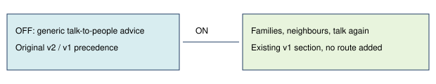

# Family and repeat conversations

> Markdown twin of [explorer-family-guidance-v1.html](../explorer-family-guidance-v1.html), generated from the HTML by `just explainer-twins`. The HTML is the source; edit it, not this file.

Default OFF; bundle ON; control OFF. No experiment launched or gameplay benefit established.

## The missing question

The October 22 report found repeated searches for MAY without re-talking to her family after the story changed. Delivered memory kept the instruction to find her, but that sentence did not name a place.

This treatment selects the existing explorer v1 section independently, so only one feature differs in an experiment. It does not change the historical v1/v2 switches, which still use their original precedence when OFF.

## What remains the model's decision

No person, destination, objective or action is selected. The section names no story character or location. The model chooses whether and whom to talk to.

Production tests prove exact replacement text and unchanged OFF precedence. The report's proposed May-search benefit is unmeasured. Pending entry is unqueued and unapproved.
