Harness switch · guidance · `explorer-guidance-v1`

# Talk to people

> Markdown twin of [explorer-guidance-v1.html](../explorer-guidance-v1.html), generated from the HTML by `just explainer-twins`. The HTML is the source; edit it, not this file.

A short system-prompt section saying that in this game, people tell you where to go next. After each story event, and whenever the model is unsure where to go, it should talk to everyone in the room before leaving, talk again to people it met before, and treat a short remark as a direction. It names no character, place or story step. Off by default.

## Why

Operator, 2026-10-16: the point of Pokémon is exploring, talking to people and finding things out, and then those hints help you move forward. The model was doing the opposite: it moved on after one conversation and treated hints as small talk.

## The failure it targets

Recorded run `2026-10-16T00-34-26_qwen36-gpu1_show`, with dialogue auto-advance on, so opening a conversation took one press and the harness paged it to the next decision.

| Turn | What the game showed | What the model did |
|---|---|---|
| 407 | PROF. BIRCH: "…don't you think it might be a good idea to go see MAY?" | Went to MAYS HOUSE 1F (turn 417). |
| 418–425 | Two people on the map. One (NINJA_BOY sprite at 10,5) said "Hi, neighbor! Do you already have your own POKéMON?" | Talked to that one person at turn 424, then at turn 425 headed for the door (back outside in LITTLEROOT TOWN by turn 429). It never spoke to the second person. The forensics identify her as May's mom, the only source of where May went next. |
| 580 | OLDALE TOWN milestone. | Last story progress for the rest of the run. |
| 655–656 | PROF. BIRCH: "MAY? Gone home, I think." | Called it "generic advice" and headed off by memory toward Rustboro. It spent 15+ minutes with no goal the game had given it. |

## Before and after



***What the section asks for.** With the switch on, the habit is to talk to people before moving on, return to people after the story moves, and act on what they say. The section does not say who to talk to or where anyone is; the game's own dialogue supplies that.*

## Where it plugs in


***Prompt-only change.** The game server, readout, tools and loop guard are untouched. The section goes after every other prompt section and before the objective rules. The "talking is cheap" sentence is added only when dialogue auto-advance is on, because only then does the harness page a conversation for the model, up to its next decision point (a menu, a battle or free control). Off reproduces main's prompt byte for byte: a test hashes every prompt main built from the shared incumbent, and from the incumbent with each of main's 57 switches flipped, for no target and for RIVAL_HOUSE_ENTERED. State-only decisions, which use their own prompt, refuse the switch ON. It is recorded last in `harness_features` on `run_start`.*

## Exact text added

Copied from `packages/agent/src/play-config.ts`. A test checks it names no character, place or story step. It does say "families and neighbours", as the approved design asked.

```
Talk to people: in this game, people tell you where to go next. After each story event, and whenever you are unsure where to go, talk to everyone in the room you are in before you leave, including the families and neighbours of characters you have met. People often say something new once the story has moved on, so talk again to people you spoke to before. A short remark, such as where someone has gone, is a direction to follow, not small talk.
```

With dialogue auto-advance also on, the same paragraph ends with:

```
Talking is cheap: face the person and press A; the harness reads the conversation until your next decision.
```

It agrees with `game-evidence-priority-v1`: that section says what people told you outranks memory; this one says to go and ask them.

## Status

| Item | State |
|---|---|
| Default | OFF in v1 flag presets, in v2 presets that omit it, and in the viewer's next-run draft |
| Tests | OFF golden over main's prompts, ON placement, auto-advance sentence, no story names, preset factory path, registry entry, state-only refusal, explainer link |
| Experiment | `experiments/explorer-guidance.json`, pending, no queue position. Bundle membership is decided by the readiness thread. |
| Measured runs | none yet |
