# Give a promising run more time

> Markdown twin of [extend-run.html](../extend-run.html), generated from the HTML by `just explainer-twins`. The HTML is the source; edit it, not this file.

EXTEND adds **30 minutes** or **1 hour** to the current run's active-time limit. The model session, game state and GPU stay with that run. Every extension still has a finite deadline.

## One request, one recorded confirmation

The dialog waits for the recorded acknowledgement. An HTTP success alone means the request was queued.

## Example: two minutes left

Illustrative example: a run has used 1 hour 58 minutes of its 2-hour cap. Adding 30 minutes changes the cap to **2 hours 30 minutes**, leaving **32 minutes**. Adding another hour later increases the cap by another hour. Pauses remain excluded.

The 20,000-turn limit is unchanged. Stop, Abort, model errors and other existing guards still apply. An extension cannot revive an ended run.

## Automation keeps waiting

The fixed runner waits for the agent process to exit, including when it adopts a child from a previous runner. It does not launch the next trial on that GPU merely because the original time cap passed.

The original evaluation horizon remains in `run_start`. Experiment metrics retain that cutoff; later milestones belong to Operator-extended continuation. Activity History records the old and new caps, and replay shows the effective cap.

## Availability

EXTEND appears only for agent runs started with a build that advertises extension support. Updating the viewer cannot add this control to an older running agent.

If a request cannot be confirmed, the dialog keeps it pending to avoid an accidental duplicate extension. Check Activity History. The agent can reject a request if the run is ending or has already reached its deadline.

Implementation and test status: see `docs/worklogs/active/2026-10-19_extend-run.md`. No benchmark-performance improvement is claimed.
