# Faced interaction history

> Markdown twin of [faced-interaction-history-v1.html](../faced-interaction-history-v1.html), generated from the HTML by `just explainer-twins`. The HTML is the source; edit it, not this file.

`faced-interaction-history-v1` keeps the loop supervisor’s exploration ledger consistent with dialogue the run actually recorded.

**Turn 84**the television was read

**Turn 93**it was called untried

**1 source**explicit faced-target attribution

## The recorded contradiction

Run `2026-10-18T01-30-48_qwen36-gpu1_cdb1` sent `LEFT, LEFT, LEFT, UP, A`. Its first dialogue page was attributed to the faced television at (4,1): “MOM might like this program.” The next loop note listed that same television under “not tried yet.”

OFF reproduces this behavior exactly. The raw event log was correct; only the supervisor’s derived ledger was inconsistent.

## The switched rule

ON trusts the recorder’s explicit attribution and the referenced state. It does not guess from the first position in the batch or merely from the presence of an A button.

## Scope and status

The switch starts off by default, stays off in the fixed control, and is appended to the `bundle-v-control` bundle arm. It changes loop-supervisor, stall-briefing, and text-only-supervisor history because those surfaces share the same ledger.

Prepared as a correctness-tier repair. The recorded replay proves the classification. No standalone run is approved or launched.
