# Field call input

> Markdown twin of [field-call-input-v1.html](../field-call-input-v1.html), generated from the HTML by `just explainer-twins`. The HTML is the source; edit it, not this file.

`field-call-input-v1`. A POKéNAV call that rings on the field stops at the end of each page and waits for A. The readout called that "input not ready; text printing: YES", so a model that trusted it waited. In run 7442 Dad's call on Mr. Briney's boat took 36 turns (439 to 474). With this switch the readout says the text box is waiting for A, and the harness presses A through the call.

## Same memory, before and after

*Recorded raw RAM from 7442 at archive 8429, turn 439, read both ways. The Interface lines are the reader's real output.*

## What the game does

pret/pokeemerald 731ad5b, `src/match_call.c` and `src/text.c`. `pokenavcall` in `Route104_EventScript_SailToDewfordDadCalls` starts the `ExecuteMatchCall` task. Its states 4 and 5 run the printer of the call window every frame.

*Green boxes take a button. The first page of dots needs a press too, which is why turns 439 to 441 stalled on a phase named transition.*

| Printer | Reads as | Why |
|---|---|---|
| active, state 1, 2 or 3, auto-scroll off | `waiting`, input ready | RENDER_STATE_WAIT, CLEAR, SCROLL_START hold until `JOY_NEW(A_BUTTON \| B_BUTTON)`. No sound check. |
| active, state 0, 4, 5 or 6 | `printing`, not ready | Writing a character, scrolling, or pausing on its own. |
| active with auto-scroll on | `printing`, not ready | `TextPrinterWaitAutoMode` moves on without a button. |
| inactive in state 5, no sound | `finished`, input ready | `MatchCall_PrintMessage` takes A or B when `!IsSEPlaying()`. |
| printer of another window, cursor outside the call text, a fade, sound after the last page | `unavailable`, not ready | Not verified, so nothing is claimed. |

The dots are `sText_PokenavCallEllipsis` at 0x0860EF70 in the US ROM. In state 4 gStringVar4 is never quoted: a random call fills it only after the dots.

## Why auto-advance covers it

It is the same mechanism as a call inside the POKéNAV: one call text, one printer, the same A or B, and no choice for the player. `withPokenavCallAutoAdvance` gains a field entry and `fieldCallDecision`, and keeps its checked press, limits and `dialogue_auto_advance` record.

50 presses

90 seconds per call

10 seconds of waiting per step

It stops when the call ends, or when the map, the caller or the interface changes, a battle starts or the reader's text state is unknown. A message after the call, such as the registration box, stays with dialogue auto-advance and the model.

The model sees one added sentence in the tool descriptions and the system prompt: "A call that rings while you are on the field advances automatically too: the harness presses A through the verified call text and returns it. Unknown states stop automation."

## Replay from raw RAM

Read-only, through the production reader with each run's own switches. The OFF reader matched the recorded `active_ui` exactly on all 477 archives.

| Run | Archives in the call | Press | Wait | Recorded |
|---|---|---|---|---|
| 7442, turns 439 to 474 | 142 (8429 to 8570) | 136 | 6 | 133 of the 136 read input not ready; the 3 on the last page already read ready |
| 5f0f, turns 319 to 323 | 103 (11422 to 11524) | 69 | 34 | 66 of the 69 read input not ready; same last page |

Both runs walk the same ten pages, from the dots to "… Click!". 7442 was parked on page waits, so nearly every sample says press. 5f0f pressed A in batches, so it also caught the printer writing: all 34 of its waits are state 0 or the slide in, and none of them reads as ready. That is the proof the reader tells a page wait from a character in progress, on real memory.

The advance decision here is `fieldCallDecision` on each sample. Nothing was pressed: this replays recorded memory, not a live emulator.

## Wiring

Preset or recipe → `FeatureSet` → `POKEBENCH_FEATURES_OFF` → `read_state` → `read_field_people_menu(call_input=True)`. The agent side reads the same id in `withPokenavCallAutoAdvance` and `playSystemPrompt`. Registered default off, on in both arms of `current.json` and `rayquaza-lane.json`, true in both plain presets, off in human play.

Off: the Interface line is unchanged, and the model has to press A itself.

## Status

Focused tests, tsc and eslint pass. Not landed. Full suites and a live emulator call have not been run, and no measured comparison exists.
