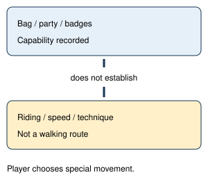

# Field move gates

> Markdown twin of [field-move-gates-v1.html](../field-move-gates-v1.html), generated from the HTML by `just explainer-twins`. The HTML is the source; edit it, not this file.

Correction approved 23 October 2026. Registry default remains OFF. Eleven current future-run definitions enable this feature in both control and bundle arms. Historical runs and pinned control bases keep their recorded provenance.

## The map and the tool must agree

### OFF — previous behavior

```
 .  goal
 .  slope drawn clear
 .  slope drawn clear
 @  player
```

Next tile: clear (.). Navigation can reject it without explaining why.

### ON — walking contract

```
 .  goal
 s  muddy slope
 s  muddy slope
 @  player
```

Next tile: muddy slope; slides south on foot. The walking route cannot climb north.

## Capability is not an executed route



In JSON, capabilities describe item/move availability. A terrain obstacle’s open value describes the walking gate. Owning or riding a bike cannot establish a safe walking route over bike terrain. Unknown capability retains the existing unknown/open convention; it is not affirmative proof of access.

## Live terrain visibility

Local and whole-map readouts mark slopes, cracked floors, existing holes, rails, ice, spin/forced movement and currents. Adjacent-tile words use the same terrain meaning. Player, object and warp symbols keep priority. A separate terrain line explains any special terrain underneath those symbols. Closed sandstorm boundaries are marked only when the native gate is closed.

Closed terrain is named even when no exit lies beyond it. The walking planner avoids closed terrain gates; downhill slope slides retain their existing supported behavior. All new presentation and walking restrictions are behind field-move-gates-v1.

## Game grounding

`ForcedMovement_MuddySlope` requires northward movement and `GetPlayerSpeed() >= PLAYER_SPEED_FASTEST`. `CrackedFloorPerStepCallback` schedules floor changes after three callback frames; slow entry can trigger a fall. `Route111_EventScript_ViciousSandstormTrigger` checks the item and native temporary variable. Map-name guesses do not override live metatile behaviors.

Source: pret/pokeemerald `731ad5bf`, verified US Emerald ROM `f3ae0881…`. No undiscovered bike, move or badge name is injected by the new terrain descriptions.

## Existing object gates remain

The Rusturf Tunnel example remains: BREAKABLE_ROCK at (24,4) and (24,5) close every way on foot to the east exits while the move is unavailable. The readout says it needs a field move you cannot use yet and quotes the game: “It's a rugged rock, but a POKéMON may be able to smash it.”

## Limits and proof

Native archive reparse confirms GLM’s two slope tiles and corrected delivered-readout generation. Focused tests cover switch wiring, OFF behavior, both-arm configuration and terrain/gate visibility. This is a correctness repair, not a measured gameplay-benefit claim.

Remaining audit findings include default-ROM destination labels versus dynamic layouts, optimistic elevation/edge/current floods, warp adjacency, move activation versus object removal, and unmodeled Dive transitions. See the full audit delivered beside this explainer. Review and landing status are reported separately in the worklog and chat; this page does not imply activation in the current run.
