# Cleared obstacles come back

> Markdown twin of [field-obstacle-respawn-v1.html](../field-obstacle-respawn-v1.html), generated from the HTML by `just explainer-twins`. The HTML is the source; edit it, not this file.

`field-obstacle-respawn-v1`. Registered default off; on in both arms of the current recipe as a correctness fix. Needs `field-move-gates-v1`. Agent and game server.

A rock you smash or a tree you cut is gone only until the map loads again. Leaving the map, or whiting out, brings it back. In run 6056 the model smashed Route 111's two rocks at turns 993-995, lost a battle at 1068, woke in Mauville and spent about 45 minutes failing to walk north. The readout said the rocks were "last talked to on turn 993", and `navigate_to` said only that no path existed. The model decided the rocks were gone and blamed the sandstorm.

## What the game does

| Fact | pret/pokeemerald 731ad5bf |
|---|---|
| Route 111's rocks are objects 15 and 16, hidden by FLAG_TEMP_11 and FLAG_TEMP_12 (ROM: 0x11, 0x12) | `data/maps/Route111/map.json` |
| Smashing or cutting ends in `removeobject`, which sets that flag | `EventScript_SmashRock`, `EventScript_CutTreeDown` |
| Every map load clears the temp flags and FLAG_SYS_USE_STRENGTH; a whiteout loads the map too | `LoadMapFromWarp`, `ClearTempFieldEventData`, `CB2_WhiteOut` |
| A battle returns without loading the map, so a smashed rock stays gone after a battle | `ReturnToFieldLocal` |
| Rusturf Tunnel's two rocks use permanent flags and never come back | FLAG_HIDE_RUSTURF_TUNNEL_ROCK_1/2 |
| The question when the party can clear it | `Text_WantToSmash` "Would you like to use ROCK SMASH?", `Text_WantToCut`, `Text_WantToStrength` |

## Route 111 at turn 1089



*The recorded turn-1089 map (run 6056, state seq 84185), cropped to the corridor north of the player.*

## Off and on, at turn 1090

### People list

```
Off: - object 16, sprite BREAKABLE_ROCK, at (19,100): last talked to on turn 993 (96 turns ago; 0 story milestones since)
On:  - object 16, sprite BREAKABLE_ROCK, at (19,100): back since you left the map; ROCK SMASH it: navigate_to_target target {"kind":"object","local_id":16}, answer YES
```

Only for an object the run saw cleared on an earlier visit to this map, and only when the party can clear it now. Otherwise the line stays as it was, and a rock the party cannot smash keeps "it needs a field move you cannot use yet".

### navigate_to (14,96)

```
Off: no supported path on the current map; choose a reachable waypoint
On:  no supported path on the current map; choose a reachable waypoint; BREAKABLE_ROCK object 15 at (18,101) stands in the way: ROCK SMASH it: navigate_to_target target {"kind":"object","local_id":15}, answer YES
```

The walker's own planner runs again with the clearable rocks and trees taken off its object list. It names the nearest one whose clearing alone gives a route, or the nearest one when clearing them all does.

### Field obstacles block

```
On adds: - every way on foot to WEST edge -> ROUTE 112 (...) passes BREAKABLE_ROCK object 15 at (18,101) or BREAKABLE_ROCK object 16 at (19,100): the game asks "This rock appears to be breakable. Would you like to use ROCK SMASH?"; for object 15, ROCK SMASH it: ...; for object 16, ROCK SMASH it: ...
```

The existing exit survey runs a second time with the clearable rocks and trees closed. An exit it now cuts off, that the first survey reaches on foot, is named. Exit lists and the state JSON do not change.

## Wiring

The switch reaches three places from the run's FeatureSet: `withPeopleLedger` (an `ObstacleRespawn` tracker fed by recorded states), `withNavigation` (the `obstacleRespawn` port) and the game server's `POKEBENCH_FEATURES_OFF` (`FieldObstacles.clearable_lines` in the readout).

## Status

Focused agent and env tests pass; full suites, review and merge not done. Not run on the emulator: the tracker is tested on states built from the recorded turn-1089 state, not on a live whiteout.
