# Field ownership feedback

> Markdown twin of [field-ownership-feedback-v1.html](../field-ownership-feedback-v1.html), generated from the HTML by `just explainer-twins`. The HTML is the source; edit it, not this file.

`field-ownership-feedback-v1` · guard · default OFF · proposed for both arms

Field tools walk the player on the overworld. When another screen or an open interface owns the buttons (an evolution, a move-learning box, the POKéMON summary, a menu), they cannot act. With this switch on, `navigate_to_target`, the stall briefing and auto-talk say which interface owns input and what its controls are, and press nothing.

## What went wrong

Control run `2026-10-21T13-33-36_qwen36-gpu1_d548` won a trainer battle at turn 555 (seq 20434); then TORCHIC began to evolve on ROUTE116. The model called `navigate_to_target` on object 21 for 85 turns. Every refusal said only:

```
Semantic navigation: target is not listed in the current verified state. Selected map object 21.
```

with no Screen or Interface line (seq 20511, 20531). At turn 662 (seq 22321) the run was still at the evolution decision. Three harness paths hid the screen:

- `navigate_to_target` resolved its target before any free-field check (`semantic-navigation.ts`); `navigate_to` already had one.
- The stall briefing printed "in battle": `interfaceOf` returned nothing whenever `in_battle` was set.
- Auto-talk refused with `not_free` every turn, silently.

## Why the battle flag is still set



*pokeemerald runs the post-battle evolution before it returns to the overworld, so the readout reads `in_battle: true` while the evolution screen owns input. Every check of the battle flag alone hid the evolution.*

## navigate_to_target, OFF and ON



*ON, the free-field check runs before the target is resolved, with `navigate_to`'s own refusal wording. A screen that is not a battle screen is named before the battle flag.*

ON, the result on the d548 state (fixture `packages/agent/test-support/evolution-owned-d548.json`, from seq 20530) starts:

```
Semantic navigation: refused because the game is not on the field (screen: evolution); navigate_to_target walks only on the field; nothing was pressed. Selected map object 21.
…
Location: ROUTE116
Screen: evolution
Dialog: none
Menu: no selectable menu is open
Interface: evolution_decision; input ready; Evolution is waiting for choose_evolution: evolve or cancel. Ordinary button input is blocked.
Battle details: TRAINER single · turn 3 · finishing (outcome won)
…
```

The readout is the one `observe` returns, uncut. Other owners get their own reason:

| State | Reason (ON) |
|---|---|
| screen `summary` | the game is not on the field (screen: summary); navigate_to_target walks only on the field |
| overworld, `field_yes_no` open | a menu or other interface is open (field_yes_no); close it before calling navigate_to_target |
| battle screen | a battle is in progress; navigate_to_target walks only on the field |

## Stall briefing and auto-talk

|  | OFF | ON |
|---|---|---|
| Stall briefing, "Where you are" | `- Where you are: ROUTE116 (map 0/31) in battle at 37,13` | `- Where you are: in the evolution decision interface (screen evolution); your last field position was ROUTE116 (map 0/31) at 37,13`, then `controls the game shows: Evolution is waiting for choose_evolution: evolve or cancel. Ordinary button input is blocked.` |
| Auto-talk when due and the field is not free | records `not_free`; the model gets nothing | once per interface episode: `SUPERVISOR: Your last 8 turns made the same call and the game state stayed the same. The harness did not walk or press anything: the game is showing the evolution decision (screen evolution), not the field. Controls the readout lists for it: Evolution is waiting for choose_evolution: evolve or cancel. Ordinary button input is blocked.` |

The auto-talk message is recorded as the `auto_talk` event's text, which Activity History already prints; there is no new timeline mark. A free overworld state ends the episode, so the next owned interface is named again. Neither path chooses an answer.

## Status

- RED 9446ca607, GREEN 516cf378c. Not merged into main.
- Default OFF. ON in both arms of the fixed bundles (Operator, 2026-10-21 10:44 PM ET).
- Tests: `packages/agent/src/field-ownership-feedback.test.ts` (production `playGameTools`, stall briefing, auto-talk; OFF keeps today's text). Multi-model review: not run yet.
- Not measured in runs. Pending experiment: `experiments/field-ownership-feedback-v1.json`.
