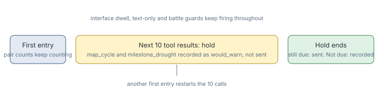

# First visit cycle credit

> Markdown twin of [first-visit-cycle-credit-v1.html](../first-visit-cycle-credit-v1.html), generated from the HTML by `just explainer-twins`. The HTML is the source; edit it, not this file.

`first-visit-cycle-credit-v1` stops stall notes from telling a model to give up on a place it has only just found. It holds two notes for 10 calls after a first entry, then sends those still due. It does not change what they say.

## Why it exists

In run ee2a the map_cycle note fired on MT PYRE 1F at turn 370. The model took the untried warp at turn 371 and reached MT PYRE EXTERIOR for the first time. At turn 372, with the summit warp untaken, it walked straight back out. It left a map it had never searched.

An audit of DeepSeek runs found the same pattern. After a note, the model left a map with never-taken exits 10.6% of the time, against 7.8% with no note. After a map_cycle note it was 12.2%.

## Delay, not erase

The first version also reset the map-pair counts on a first entry. That removed most cycle notes: replaying ee2a, map_cycle notes fell from 10 to 2, and the turn-370 note did not fire. An exploratory probe then found that note helped the next decision: 16 of 16 good choices with it, 8 of 16 without, at turn 371. So the counts now keep counting. Replaying ee2a, there are 9 map_cycle notes and the turn-370 note fires on time, because the last first entry was more than 10 calls earlier. The tenth was still held when the run ended. Some drought notes are not sent because they stop being due during a hold: all notes fall from 39 to 34.

## What happens on a first entry

*The call that made the entry does not count as one of the 10.*

## What counts as a first entry

| Case | First entry? |
|---|---|
| A map this run has never been on | Yes |
| A map entered earlier in the run, even before the last story progress | No |
| The map the run starts on | No |
| A map from an earlier run, on a run started from a checkpoint | Yes: the history is this run's own |

## What you see in the viewer

Each held note appears in Activity History and the raw inspector as `Not sent (first-visit-cycle-credit-v1)`, naming the first-visited map. A note that stopped being due when the hold ended gets a second row saying so. Nothing is added to the timeline.

## Off

No note is held for a first entry, exactly as before.
