# Fixed-point breaker

> Markdown twin of [fixed-point-breaker-v1.html](../fixed-point-breaker-v1.html), generated from the HTML by `just explainer-twins`. The HTML is the source; edit it, not this file.

`fixed-point-breaker-v1` · guard · bundle arm only · default off

A fixed point is a turn the model keeps repeating: the same call, and the game state the same afterwards. In the 6h-v2 bundle (`2026-10-20T03-02-13_qwen36-gpu1_f28d`) it called `navigate_to (10,5)` while standing on (10,5) for 400 turns, with the same 1,151 characters of thinking each time, and later sent runs of replies with no tool call. The loop guard sent 67 notes; none broke it. The switch acts in three stages, all from recorded events, with no sleeps.

## When each stage acts

*Thresholds from `FIXED_POINT_TURNS = 3`, `FIXED_POINT_NOTE_TURNS = 4`, `AUTO_TALK_TURNS = 8` and `AUTO_TALK_REPLIES = 3`. A different call, or the same call reaching a new state, starts the count again.*

## Stage 1: duplicate turns collapse to the newest copy

Stage 1 is also its own switch, `duplicate-turn-collapse-v1`, without the note. A 2×2 decision probe at f28d turn 2301 (16 a cell) credits it with nearly all of the effect: the 400-turn loop repeated 16 times with neither, 13 with the note only, 1 with the collapse only, 2 with both. Operator decision 2026-10-20: the collapse goes in both arms, and the note comes off in both.

*Only runs of 3 or more turns that match exactly (thinking, text, tool calls and the state every result left) collapse. Two copies, or copies that differ by one character or one tile, all stay. Thinking is never dropped in general and nothing inside a kept message changes. A reply that called no tool is left out of the request (as `fresh-retry-v1` does); its nudge or supervisor note stays.*

| Decision probe, f28d, 16 samples a side | Off | On |
|---|---|---|
| Turn 2301, inside the 400-turn `navigate_to (10,5)` loop: a different call | 0 of 16 (all copy the thinking) | 14 of 16 (none copy it) |
| Turn 2862, after 3 replies with no tool call: ends with a tool call | 0 of 16 | 16 of 16 with the failed replies left out; 0 of 16 with only the note |

*Raw samples: `runs/decision-probes/2026-10-20_pre-cook/`. The no-tool replies looped inside one reply until the output cap, so no note alone could fix them.*

## Stage 2: a short, positive note with the count

SUPERVISOR: Make one tool call based on the game state and what you observed. Your last 4 turns made the same navigate_to call and the game state stayed the same after each one.

SUPERVISOR: Make one tool call based on the game state and what you observed. Your last 3 replies called no tool.

The first goes at the very end of the request. The second replaces the generic nudge after the reply ("Keep playing: call observe or press…"), also when `fresh-retry-v1` leaves that reply out. The count changes every turn, so the prompt is never the same twice.

## Stage 3: walk to the nearest untalked person and press A

Stage 3 is its own switch, `auto-talk-v1`. When a preset omits it, it takes the preset's `fixed-point-breaker-v1` value; it acts only while the breaker or `duplicate-turn-collapse-v1` is on. Every walk and press it makes is recorded as an `auto_talk` event.

*Illustrative layout. The harness calls the model's own `navigate_to` (at most 6 walks per side, trying the nearest free side first), turns to face the target, and presses A. A wild battle or script mid-walk stops it.*

| Rank | Who | Evidence (99 recorded runs, first talk, story milestone within 30 turns vs nearby turns) |
|---|---|---|
| 1 | Story characters the readout's own Story characters line places on this map, not talked to since the latest story milestone | +21.3 points \[+18.5, +24.1\]; when stuck +16.7 \[+9.8, +24.1\] |
| 2 | Other people not talked to (never item balls, never a trainer the game lists as unbeaten) | −1.4 \[−3.4, +0.7\]; when stuck +2.1 \[−0.5, +5.0\] |
| 3 | Signs | −18.6 \[−26.7, −10.6\]; the readout already prints the whole sign text |

The model then gets one message, kept in the request until a newer game result arrives:

SUPERVISOR: Your last 8 turns made the same call and the game state stayed the same, so the harness walked you to MAY at (10,3) and pressed A. It has not chosen where to go next; this is what they said. pressed A Dialogue shown during this call (… pages, in order, whole): …

The A press's whole result and screenshot follow, unclipped. It never runs in a battle, menu or dialogue, or with controls locked, and it never chooses a destination, exit or map.

## What gets recorded

| Event | When | Where it shows |
|---|---|---|
| `loop_breaker` stage 1 | new turns collapsed (count, run length) | Activity History, raw inspector |
| `loop_breaker` stage 2 | each note delivered, with its text | Activity History, raw inspector |
| `auto_talk` | each stage 3 attempt: talked, unreachable, none or not_free, the target, walks and text | Activity History, raw inspector |

No timeline marks (operator decision 2026-10-16). The decision probe rebuilds stages 1 and 2 from the recorded stream; stage 3 acts on the game, so probes cannot sample it.

## Off

Every turn stays in the request and the nudge and notes are unchanged. `auto-talk-v1` acts only while this switch or `duplicate-turn-collapse-v1` is on; with it off, the harness never walks or presses on its own.

## Status

Tests: `fixed-point-breaker.test.ts`, `auto-talk.test.ts`; wiring deletions go red. Decision probes above. Not yet reviewed or measured in runs.
