# Foe items and League stock-up

> Markdown twin of [foe-items-league-stock.html](../foe-items-league-stock.html), generated from the HTML by `just explainer-twins`. The HTML is the source; edit it, not this file.

Three new switches, plus `supplies-v1` moving into both arms, because Opus planned around foes that the trainer then healed and walked into the Elite Four with ₽130,696 and nothing to heal with.

## What each switch does

| Switch | Where it is on | What the model sees |
|---|---|---|
| `foe-item-recap-v1` | Both arms, the Rayquaza lane and the Opus Rayquaza lane | In an item-using trainer battle, one line after the battle details: *Foe trainer items used this battle: FULL RESTORE ×1* (or *none*). Only items the game has already shown being used. |
| `foe-trainer-items-v1` | The Rayquaza lane and the Opus Rayquaza lane only (game knowledge, so these runs show as heavily assisted) | The items the trainer still carries, read from game memory, each with when its AI may use it, and the rule for using it. |
| `league-stock-up-v1` | The Rayquaza lane and the Opus Rayquaza lane only (game knowledge) | One paragraph on the first field result after each arrival in the POKéMON LEAGUE lobby. It does not say how much to buy. |
| `supplies-v1` (existing) | Now both arms (was bundle only) | Money, balls, healing and status items, and the places that sell things, on arrival where something is sold and when a buy list opens. |

## Before and after: GLACIA, run 67d7, turn 3931



*Left: the recorded turn. Right: the readout the switch adds, rendered from 67d7's raw RAM for that turn. After GLACIA's FULL RESTORE (turn 3934) the lines read "used: FULL RESTORE ×1" and only the second one left.*

## When the trainer AI may use each item

pret `battle_ai_switch_items.c ShouldUseItem`: the first item any turn; item *i* after it only once the trainer has `itemsNo − i + 1` or fewer POKéMON able to fight. A used slot is set to `ITEM_NONE`.

| Trainer (trainers.h) | Items | 1st | 2nd | 3rd | 4th |
|---|---|---|---|---|---|
| SIDNEY, PHOEBE, GLACIA, DRAKE | FULL RESTORE ×2 | any turn | ≤ 2 POKéMON left |  |  |
| Champion WALLACE | FULL RESTORE ×4 | any turn | ≤ 4 left | ≤ 3 left | ≤ 2 left |

| Item kind | Used when |
|---|---|
| FULL RESTORE | its POKéMON in battle is below 1/4 of its max HP (and not fainted) |
| POTION 20, SUPER POTION 50, HYPER POTION 200, MAX POTION 255 | below 1/4 of max HP, or missing more HP than the item restores |
| FULL HEAL, ANTIDOTE, BURN HEAL, ICE HEAL, AWAKENING, PARLYZ HEAL | its POKéMON has a condition the item cures |
| X items, DIRE HIT | its POKéMON's first turn in battle |
| GUARD SPEC. | its POKéMON's first turn in battle, when no MIST is up on its side |

## Where the numbers come from in memory



*The first offsets tried (+0x28/+0x30) read zeros on 67d7's RAM; pret's UsedMoves is 16 bytes, which puts trainerItems at +0x48. The unit test pins that arithmetic.*

**Chosen is not shown.** The AI empties the slot when it *chooses* the item, during action selection while your own menu is open; the game prints "&lt;TRAINER&gt; used FULL RESTORE!" only when that action runs, in turn order. While the foe's chosen action is an item and it has not run yet (selection, or later in the turn order than the current action), the newest empty slot still counts as left, so neither line gives away the coming heal. Run 67d7, GLACIA, turn 3933: the slot was empty at raw RAM 105176 while Opus chose QUICK ATTACK; the item ran at 105187.

## The League lobby paragraph

Run 67d7 at turn 3880 would have read, after its own money and bag:

```
POKéMON LEAGUE: past the north door the ELITE FOUR and then the CHAMPION are fought one after another, with no POKéMON CENTER in between, so until you win or lose the only healing is what is in your BAG. Each ELITE FOUR member carries 2 FULL RESTOREs and the CHAMPION carries 4. A loss sends you back to this lobby, takes half your money, and you start again from the first ELITE FOUR room. Becoming CHAMPION is the end goal of this game, so money kept back now has no later use. This lobby's POKéMON MART sells HYPER POTION ₽1,200, MAX POTION ₽2,500, FULL RESTORE ₽3,000, FULL HEAL ₽600 and REVIVE ₽1,500. You have ₽130,696; BAG healing and status items: none. How much to buy is your call.
```

Prices: pret `EverGrandeCity_PokemonLeague_1F` mart and `items.h`. It speaks once per arrival, on a field screen, never in battle.

## Wiring

| Piece | File |
|---|---|
| Memory read and the two lines | `env/pokebench_env/foe_trainer_items.py`, read in `rerender.read_state` only in battle with a switch on, printed in `readout.py`; state JSON key `foe_trainer_items` only when read |
| League paragraph | `packages/agent/src/league-stock-up.ts`, wrapped beside supplies-v1 in `playGameTools` |
| Heavily-assisted marker | `KNOWLEDGE_SWITCHES` in `packages/viewer/src/custom-lane.ts` |
| Arms and lanes | `experiments/feature-configs/current.json`, `rayquaza-lane.json`, `experiments/presets/current-control-24h-8k.json`, `opus-rayquaza-lane.json` |

Off: every switch leaves the readout, state JSON and tool results byte for byte as before.

## Status

Focused tests pass, and the RAM read was rehearsed on 67d7's recorded RAM. Full gates, review and landing are recorded in the worklog. No measured benefit is claimed; no run has used these switches yet.
