Harness switch · guard · `fresh-retry-v1` · off by default

# Fresh retry

> Markdown twin of [fresh-retry-v1.html](../fresh-retry-v1.html), generated from the HTML by `just explainer-twins`. The HTML is the source; edit it, not this file.

When the model answers without calling a tool, the harness nudges it and asks again. With this switch on, the second ask does not include the failed answer, so the model gets a clean try instead of a copy of what just failed.

## Why it exists

Two of the first six trials in the Think Fast 2×2 ended early as `model_error`. Both were three replies in a row with no tool call. No server error, timeout, malformed call or context overflow was involved. In both, the model was stuck in the game, thought at length, and stopped without acting. Each retry then repeated the failed reply, sometimes word for word.

| Run | Turns | What the three failed replies were |
|---|---|---|
| `…19-30-06_26e0` | 268–270 | Stuck at Littleroot's north exit by the twin. A 4,000-token reply, then two replies whose thinking is cut mid-sentence and reuses passages from the first. |
| `…19-59-09_0c89` | 217–219 | Stuck on May's 2F. Thinking degenerates into "(8,N) is clear" lines. Turns 217 and 218 are byte-identical 1,178-token replies. |
| `…15-23-36_965d` | 219–221 | Stuck in Birch's lab; long thinking cut mid-sentence, then prose only. |
| `…09-50-13_8e5d` | 289–291 | Naming screen; one 221-token reply repeated 14 times over the run. |

Across Think Fast runs since 10-13: 64 text-only replies in 25,085 turns, and 4 runs ended this way, all on 10-14. Sampling is not greedy (first turns differ run to run), so identical replies are copies of the reply left in the context.

## What the retry sees



*The only difference is the red box. Everything else, including the nudge and the three-strike limit, is unchanged.*

## Exact rule

Before each model call, every assistant message with no tool call is removed from the messages sent. Tool results, the task, nudges and pinned memory or ledger messages stay. It runs after the 20-turn window and any loop-guard warning are applied, and before the navigation memory, ledger and hint messages are added, so none of those are removed. This mirrors what the harness already does for a reply that errors at the server, which is dropped before the retry.

```
withoutTextOnlyReplies(messages) =
  messages.filter(m => m.role !== "assistant" || m.content.some(part => part.type === "toolCall"))
```

What does not change: the reply is recorded, it raises a `retry` event, and three in a row still end the run as `model_error`.

## Wiring


*The highlighted box is the one place behavior changes. State-only decision mode does not use this path.*

## Not this switch's job

The root of most failures is the model being stuck and over-thinking. The think-fast server also cuts thinking at 1,024 tokens (`--reasoning-budget 1024` in local-inference-stack's launcher), which leaves replies mid-sentence. That setting belongs to the inference lane and is unchanged here.

## Status

a working branch  default OFF  unmeasured

Unit and wiring tests pass. No measured runs yet; whether it reduces `model_error` endings requires a separately designed, operator-approved fixed-run comparison.
