# Zoom to frontier

> Markdown twin of [frontier-zoom.html](../frontier-zoom.html), generated from the HTML by `just explainer-twins`. The HTML is the source; edit it, not this file.

The story frontier graph on Runs & Comparisons has 36 checkpoints. Agents currently stop near the start, so the full human run squeezes their lines into the left third. A **FRONTIER / FULL BASELINE** control on the graph heading now picks the range. FRONTIER is the default.

## Where the graph ends

*Today's recorded runs: the farthest any plotted agent reached is Rival met, so the graph ends one human checkpoint later, at Route 101. The time axis rescales to only the visible points.*

## The rule

| Situation | Graph ends at |
|---|---|
| Agents reached checkpoint N, human reached a later one | The first checkpoint after N that the human reached |
| No human baseline, or the human has nothing past N | Checkpoint N + 1 |
| No agent has any checkpoint yet | At least the first two checkpoints |
| An agent reached the last checkpoint or the one before it | Full graph, no zoom note |

“Agents” means every agent line on the graph: the filtered overlay runs, the gold agent frontier run, and any live or paused run. The human line never widens the zoom. Changing the Experiment, Model or Overlay filter can move the end.

## What stays the same

- The completion table below the graph still lists all 36 checkpoints.
- Run selection, reference lines, colors and point details are unchanged.
- The choice survives the page polling for new data. Reloading the page returns to FRONTIER.

## Status

Viewer tests, coverage, lint and build pass. Code lives in `packages/viewer/src/frontier.ts` (`zoomEnd`, the `zoom` argument of `frontierPlot`) and `workbench.ts`.
