full-map-navigation-v1 default OFF a working branch

# Whole-Map Navigation

> Markdown twin of [full-map-navigation.html](../full-map-navigation.html), generated from the HTML by `just explainer-twins`. The HTML is the source; edit it, not this file.

A switch that shows the model the entire current map and lets `navigate_to` walk the whole route, plus a faster open list so re-planning before every press stays cheap.

## What the model sees

Today the model and the planner both see a 15×15 window around the player. On a long route that is a small slice, so a far target can only be approached through a "local frontier" a few tiles at a time. With the switch on, the readout carries the whole map, one character per tile, and the planner reads the same geometry.

*Route 119 to scale. The old window is 225 tiles of 5,600 (4%). The new readout and the planner both use all 5,600.*

The map text follows PokeAgent's compact style rather than our padded 3-character cells, with world coordinates kept so "door at 5,1" can still be found. Every tenth column is labelled on the top line and the ones digit runs underneath:

*Turning off the coordinate grid switch drops the labels and leaves bare rows, the same as it does for the local map.*

## How one navigate_to call runs

The loop is the same as before. What changes is the geometry it plans on and how many presses one call may make. Every press still goes through the ordinary checked press, so the map, position and field lock are re-verified right before the button is sent.

*Red exits end the call and hand the final state back to the model. A turn in place (the first press only changes facing) is not a stop. With the switch on, the call also stops as "route not converging" when 16 presses in a row have not made the planned route shorter, for example when a wandering NPC keeps forcing detours.*

## Warps stay goals only

PokeAgent treats doors and exit mats as floor, so a long route can step on one and warp away mid-walk. We keep our rule: the planner never passes over a warp tile unless that tile is the destination, and the per-press map check stops the call if a transition happens anyway.

*Doors keep their existing rule too: the only way in is stepping UP into the door as the final move.*

## Why the heap ships with it

Re-planning before every press is cheap on a 15×15 window and expensive on a whole route with the old open list, which re-sorted the whole array before every pop. The new binary heap orders by (estimate, insertion order). That tie-break reproduces the old stable sort's pop order exactly, so every route the old planner chose is unchanged. A test checks this against a copy of the old code on 200 random grids.

*From the open-list benchmark (22% random walls; \*Route 124 is the unreachable-goal case, the worst one). A 180-step walk on Route 119 would spend about 19 s planning with the array and about 0.25 s with the heap. A test keeps an 80×80 plan under 25 ms.*

## How the map reaches the planner

The game server reads the map from live memory once per observation, one memory read per row. It feeds two outputs: the text the model reads, and a compact `map_grid` in the typed state that the agent's planner decodes. The existing 15×15 `navigation_grid` stays exactly as it was.

*Packing keeps run logs small: an 80×80 map is about 26 KB of map_grid per recorded state, versus roughly 450 KB if every tile were a JSON object like the local grid.*

## Ledges and one-way tiles on the whole map

Both map fixes on main now work on the whole map too. With `ledge-hops-v1` on, a ledge is drawn as an arrow and the planner may hop it in that direction only, landing two tiles on; the per-press check then expects a two-tile move. With `one-way-tiles-v1` on, a `+` tile can be walked on but never crossed through a walled side. Each switch still decides on its own; whole-map planning only widens where the rules apply. The game's elevation rule from main (stairs at elevation 0, bridges at 15) applies the same way on both geometries, checked against the Route 104 pier, Littleroot and Route 110 layouts.

*Both cases are tests in `navigation.test.ts` on whole-map geometry. Ledge behaviors 0x38–0x3B and edge-wall behaviors 0x30–0x37, 0xBE, 0xC0, 0xC1 come from pokeemerald 731ad5b.*

## When the switch is off

- The readout, prompts, tool list and tool description are unchanged, and the state JSON has no `map_grid` key.
- It defaults off in old and new presets, the viewer's next-run draft, the human-play server and the game server's own default.
- It needs `bounded-navigation-v1`; a preset that turns it on without that is rejected.
- A map larger than 256 tiles on a side is not sent; the planner then reports geometry unavailable. No Emerald map comes close.
- It is recorded last in a run's feature list, so older run records keep their order.

## Status

| Check | Result |
|---|---|
| Agent tests | 933 passed · lines 98.8%, branches 93.3% |
| Viewer tests | 478 passed · lines 98.2%, branches 90.6% |
| Python tests | 1,840 passed · lines 96.7%, branches 91.9%, functions 100% (floor 90%) |
| Lint and types | tsc, eslint, ruff, mypy clean |
| Main merged in | Ledge hops, navigation evidence memory, one-way tiles, elevation transitions (stairs, bridges, ledge landings) |
| Planned arms | Both arms set bounded navigation, ledge hops and one-way tiles ON; only full-map-navigation-v1 differs |
| Independent review | See the worklog's review log for the merged branch |
| Real ROM check and benchmark runs | Not run, by design; waiting on operator approval |
