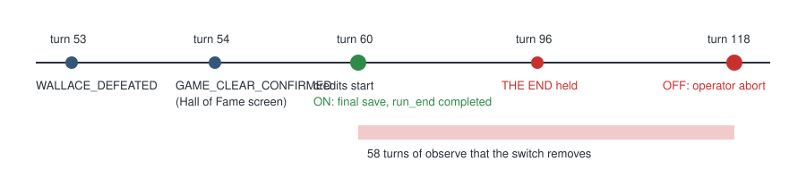
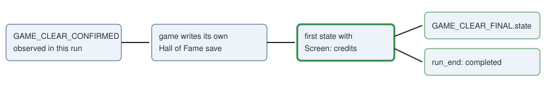

# Game clear ends the run

> Markdown twin of [game-clear-completion-v1.html](../game-clear-completion-v1.html), generated from the HTML by `just explainer-twins`. The HTML is the source; edit it, not this file.

Switch `game-clear-completion-v1`. A correctness fix, ON by default in version 2 presets, OFF in the frozen four-flag contract. It does two things after the Hall of Fame: the credits get a real readout, and the run ends as `completed` once the credits start, with a final save of the finished game.

## Why: run b5a8 kept going after it won

Opus run `2026-11-10T13-52-15_opus-drake-continuation_b5a8` recorded `GAME_CLEAR_CONFIRMED` at turn 54. Its preset named no stop milestone, so nothing ended the run. The credits read as an unknown screen whose readout told the model to observe, and it called observe 62 times until an operator abort at turn 118.



*Recorded b5a8 events. Replaying them through the stop, with the credits states rerendered under the switch, ends the run at event 3024, turn 60 (2:10:15 PM New York time).*

## What the model reads on the credits

### Off (recorded b5a8, turn 117)

```
Screen: unknown (callback2 0x081754DD)
Interface: unsupported; input unavailable; Observe and report this coverage error; do not infer a selection.; STATE COVERAGE ERROR: callback1 0x08085E05; callback2 0x081754DD; active tasks 0x08175C35
```

### On (same RAM, rerendered)

```
Screen: credits
Interface: the_end; input not ready; THE END is shown; the game is over and needs no input
```

Earlier in the credits the same rerender reads `Interface: credits; input not ready; The credits are playing; the game is over and needs no input`. Both lines come from `pokebench_env.rerender` on b5a8's raw-RAM archive (turns 64, 68, 94, 96 and 117).

## When the run ends



*The flag is set by `special GameClear` before `Task_Hof_TrySaveData` saves; the credits start only after the Hall of Fame exits, so waiting for them keeps the game's own save.*

- The proof on `run_end` is `target_proof: {name: GAME_CLEAR_CONFIRMED, milestone_seq, state_evidence: [credits state]}`.
- `checkpoints/GAME_CLEAR_FINAL.json` is written before `GAME_CLEAR_FINAL.state`; a failed save is recorded as a checkpoint failure and the run still ends completed.
- A clear that was present at the start (a run resumed from a cleared save), a replayed source run's clear, or credits with no clear do not end the run.
- A preset that already stops at `GAME_CLEAR_CONFIRMED` still stops at the flag first. A run past its wall limit when the credits start ends on `budget`.
- No new limit: the only new way to end is native game completion, which CLAUDE.md already lists.

## Game grounding

| pret credits.c symbol | US ROM address | How it was checked |
|---|---|---|
| CB2_StartCreditsSequence | 0x08175621 | literal at 0x08174190, in the Hall of Fame exit code |
| CB2_Credits | 0x081754DD | literal at 0x08175734, inside CB2_StartCreditsSequence |
| Task_CreditsTheEnd1 to 6 | 0x08175A9D, AE5, B1D, B91, BD9, C35 | each loaded from the previous task's literal pool |
| Task_CreditsSoftReset | 0x08175CC9 | literal in Task_CreditsTheEnd6's pool |

Screen `credits` needs one of the two callbacks; Interface `the_end` needs an active THE END or soft-reset task. Other callbacks stay unknown with their coverage error.

## With opus-trace-correctness-v1

The Opus preset also turns on `opus-trace-correctness-v1`, which landed its own credits readout on main the same afternoon. When both switches are on, that switch's earlier branch keeps its wording (rerendered b5a8 RAM: `Interface: credits; input not ready; The credits are rolling`, then `credits_the_end; input ready; THE END. A button press restarts the game`). Either way the screen reads `credits`, so this switch's stop and final save fire at the same state. This switch also classifies `CB2_StartCreditsSequence`, which the other does not.

## Harness bug rows

The native action recorder always classifies the credits now, so they log no `harness_bug`. Any other unsupported screen logs one row per callback pair instead of one per task list: b5a8 logged 16 rows for the credits alone. This is recording only; the model never sees these rows.

## Status

Focused tests: 17 pytest, 12 vitest; rerender and replay checked on b5a8. Not yet: full gates, cloud review, landing, a real run that reaches the credits.
