Harness switch · guidance · `game-evidence-priority-v1`

# Game evidence first

> Markdown twin of [game-evidence-priority-v1.html](../game-evidence-priority-v1.html), generated from the HTML by `just explainer-twins`. The HTML is the source; edit it, not this file.

A system-prompt section that tells the model this game's own evidence outranks what it remembers about Pokémon. With bounded navigation on, it also says when and how to use `navigate_to`. It names no destination and no story step. Off by default.

## The failure it targets

Across 24 recent Think Fast runs that left home after setting the clock, 11 walked into Birch's lab and only 2 entered the rival's house. In Mom's dialogue the model had been told to go next door. Its memory of the series ("go see the professor") won. The best run called the rival's house "the lab" even while standing in it. `navigate_to` was about 1% of tool calls, so most walking was done one press at a time.



***What the section asks for.** A destination must be backed by something observed in this game. When memory and the game conflict, the game wins and the model says so. If nothing observed points anywhere, it explores places it has not tried. The section never says what the right destination is.*

## Where it plugs in


***Prompt-only change.** The game server, readout, tools and loop guard are untouched. The sections go after the tool and memory text and before the objective rules, if objectives are on. Off reproduces today's prompt byte for byte. The switch is recorded in `harness_features` on `run_start`.*

## Exact text added

Copied from `packages/agent/src/play-config.ts`. Tests assert the section contains no character, place or story-step name.

```
Game evidence first: this game, as observed, is the source of truth. What characters have told you, the names of people, objects and rooms in the readout, the location line and the story flags outrank what you remember about Pokémon games, guides or walkthroughs. Your memory of the series can be wrong about this moment of this game. Before choosing where to go, name the observed evidence that supports it: who said it, where, and what they said. When your expectation and the game disagree, for example a different person, a different room or unexpected dialogue, believe the game, say so in one sentence, and change your plan. Do not keep pursuing a goal no character or readout in this game has given you; if nothing tells you where to go, explore places you have not tried yet.
```

With bounded navigation also on:

```
Use navigate_to for any walk of two or more tiles on the current map, using coordinates from the readout. To go through a door or stairs, give the warp's own coordinates as the destination; at a directional exit, arrive on its tile, then press the direction its activation describes. When navigate_to stops early, read its reason and pick a reachable tile or a different listed exit instead of falling back to long runs of single presses. Use press for talking, menus, dialogue and short adjustments.
```

The warp advice matches the tool: its planner never routes through a warp unless that warp is the destination, it stops on a map change, and it does not activate a directional exit after arriving, which is why that case ends with a press.

## Status

| Item | State |
|---|---|
| Default | OFF in v1 flag presets, in v2 presets that omit it, and in the viewer's next-run draft |
| Tests | Prompt on/off, navigation-only sentence, no story names, preset default, registry entry, explainer link |
| Measured runs | none yet Planned as one step of the rival-house push, 8 runs per arm from boot |
