# Game-said goals

> Markdown twin of [game-said-goals-v1.html](../game-said-goals-v1.html), generated from the HTML by `just explainer-twins`. The HTML is the source; edit it, not this file.

`game-said-goals-v1` · agent switch · bundle-only, default off · approved by Operator 2026-10-21

When run `2026-10-20T20-26-22_qwen36-gpu1_97a0` faced COMBUSKEN's DOUBLE KICK prompts (turns 779+), it had lost to ROXANNE at turn 716 and had not beaten her since. Operator asked for "a list of its goals or objectives" so it could make an informed choice. This switch adds, at move-learning prompts and the evolution decision, the trainer battles the game has left open: lost (or drawn) and not won since, with what the game showed and said about each. No goal the game has not set, no route, no advice.

## The block as delivered (97a0, the turn-781 evolution move-learning box)

Battles the game has left open (what it recorded and said; not an order or a route): - ROXANNE (trainer 265): you lost to ROXANNE on RUSTBORO CITY GYM (map 11/3) at turn 716, and the game has not recorded a win since. ROXANNE's POKéMON seen in battle this run: GEODUDE Lv12; any others not seen yet. Said on that map: "ROXANNE, the GYM LEADER, is a user of ROCK-type POKéMON." "The ROCK type is very durable, but it can't stand WATER-type and GRASS-type moves."

Exact text from `game-said-goals.test.ts` on recorded events of run 97a0 (the gym guide's page at turn 630, seq 28035, and the ROXANNE battle at turns 714-716).

## How recorded events become the line

*`packages/agent/src/game-said-goals.ts` reuses `BattleOutcomes` (the battle-loss recap's fold) and `GymReadiness` (gym-readiness-readout-v1's fold; its own block is unchanged). Fixture: `packages/agent/src/fixtures/game-said-goals-97a0.json`.*

## When the block shows

| State of the tool result | Block |
|---|---|
| Evolution move confirmation box, summary forget-a-move list, or a ready learn_move / stop_learning_move battle prompt | yes |
| Evolution decision (evolution_decision) | yes |
| Battle decision, field, game not started | no |

## What the model receives (97a0 recorded state at the turn-781 box)

Off: observe, then choose_evolution

\[text\] Screen: evolution \[text\] Evolution decision

On, with effectiveness-heard-v1 (as in the bundle)

\[text\] Screen: evolution \[text\] What the game said right after your moves this run (its own words): - EMBER on GEODUDE: "It's not very effective…" (turns 715, 716) \[text\] Battles the game has left open (what it recorded and said; not an order or a route): - ROXANNE (trainer 265): you lost to ROXANNE on RUSTBORO CITY GYM (map 11/3) at turn 716, … \[text\] Evolution decision \[text\] What the game said right after … (same block) \[text\] Battles the game has left open … (same block)

From the production wiring test (`playGameTools` with stub tool results "Screen: evolution" and "Evolution decision"): ON appends both blocks as separate text parts to observe and choose_evolution; OFF adds nothing. Elided lines (…) are the full lines shown above.

## Where the block comes from

*No ROM trainer parties are read: the leader's POKéMON are only those seen in battle, and the type lines only those printed on that map.*

## Status

Tests: `packages/agent/src/game-said-goals.test.ts` (ROXANNE block exact, evolution decision yes, battle decision and field no, a later win closes it, a non-leader's "sent out", empty, production wiring on/off). Gates passing (module 100% covered). Not yet reviewed or landed. Pending experiment `experiments/game-said-goals-v1.json`. On in the bundle arm of bundle-v-control, bundle-cook-1h and whole-map-cook-1h; off in control. No measured runs.
