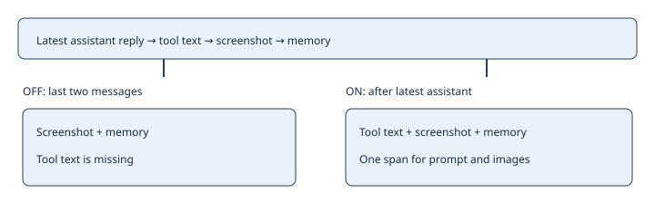

# Complete Claude turn delivery

> Markdown twin of [gateway-current-turn-v1.html](../gateway-current-turn-v1.html), generated from the HTML by `just explainer-twins`. The HTML is the source; edit it, not this file.

`gateway-current-turn-v1` restores the current tool observation when a screenshot and instruction memory follow it. The current recipe enables this correctness fix in both arms. Historical presets that omit the switch retain the old behavior.

## The observation must travel with its attachments

The gateway saves screenshot handles from the same selected messages it renders into the Claude prompt, preserving their order. Nothing selects a game action.

## Recorded example

Opus continuation `f60d`, request 601: a tool result, a screenshot message, then OBSERVED INSTRUCTION MEMORY. The old last-two selection omitted the tool result. Recorded requests and native transcript records establish the omission; replay verifies that the fixed selection includes it. This is delivery proof, not a measured gameplay improvement.

| Input shape | ON selection |
|---|---|
| Assistant reply, tool results, trailing updates | All messages after the latest assistant reply |
| No assistant reply yet | Whole non-system dialogue |
| Ends with assistant reply | Empty span; never resend its own reply |

## Activation and evidence

A compatible Claude session gateway reads the bound run's `run_start.evaluation.features`. It uses the recorded boolean, not the current recipe. Missing or false means OFF. A non-boolean is an error. No extra request fields are sent to other providers. Stateless prompts are unchanged.

`gateway.jsonl` records `session_input` with request number, run ID, selected message count and the applied switch. Raw requests and native streams remain available. A new harness declaration alone cannot upgrade an older gateway binary.

Large observations previously omitted now reach Claude and can increase prompt size and compaction. There is no truncation within a selected message. This change does not restart an existing player, change its reasoning effort or claim token savings.
