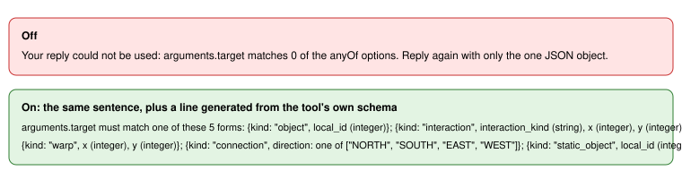

# Claude schema re-ask hint

> Markdown twin of [gateway-schema-hint-v1.html](../gateway-schema-hint-v1.html), generated from the HTML by `just explainer-twins`. The HTML is the source; edit it, not this file.

**Switch:** `gateway-schema-hint-v1`. It's a correctness fix for the Claude Code session gateway, on in both arms of the current recipe. Older presets that omit it stay off. Override: `--schema-hint auto|on|off`.

## The problem

When a reply's arguments fail validation, the gateway re-asks once with the error. For a union parameter the error only said `arguments.target matches 0 of the anyOf options`, which doesn't say what the options are. Opus run f60d (requests 1007 and 1041) answered a re-ask with another wrong shape twice. Each time it used up its one re-ask and cost a counted reply failure.

## How the hint is built

- It's taken from the request's own tool schema, never hand-written. The gateway walks the named tool's parameters (properties, items and nested options) for every `anyOf` and `oneOf`, and keeps the ones whose path the validation error names.
- Each object option is shown with its required keys. A key with a `const` shows its value, an `enum` key shows its choices, and other keys show their type. Optional keys are listed after. Non-object options show their const, enum or type.
- It's only added to the one re-ask that already happens. No extra calls, and the first prompt is unchanged.
- Each re-ask logs a `reask` event with `schema_hint`, `source` and `hint_chars`. An unreadable or non-boolean recorded value is logged as `schema_hint_feature_invalid` and falls back to off.

## Off

The re-ask text is byte-identical to before: just the validation error.
