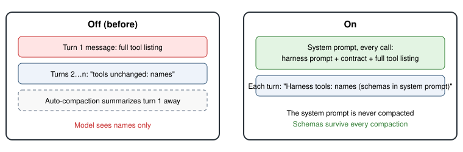

# Claude tool schemas every turn

> Markdown twin of [gateway-tool-schemas-v1.html](../gateway-tool-schemas-v1.html), generated from the HTML by `just explainer-twins`. The HTML is the source; edit it, not this file.

**Switch:** `gateway-tool-schemas-v1`. It's a correctness fix for the Claude Code session gateway (`scripts/claude-gateway`), on in both arms of the current recipe. Older presets that omit it stay off. Override: `--tool-schemas auto|on|off`.

## The problem

In session mode the gateway sent the full tool listing (names, descriptions and JSON parameter schemas) only on a session's first turn, or when the tool set changed. Every later turn said only `Harness tools unchanged: observe, press, …`. Claude Code auto-compacts the session when it nears its window (258K tokens for the Opus runs). The compaction summary drops that early listing, so after the first compaction the model calls tools knowing only their names.

Opus continuation f60d: 24 compactions, and 416 of 478 turns ran after the schemas were gone. Every re-ask (8) and both reply failures came after that point. In both failures it guessed a warp target shape (`index`, `id`, `warp_id`) where the schema needs `x` and `y`.

## What changes

- Session mode appends the same tool listing that stateless mode already sends (`Harness tools: [...]` with each JSON schema) to the system prompt on every call. The gateway passes `--system-prompt-snapshot off`, so Claude Code re-sends the current system prompt each call. It's a cached prefix and costs little.
- The per-turn message no longer carries the listing. It names the tools and points to the system prompt.
- `session_input` records `tool_schemas` and `tool_schemas_source` (`run_features` or `operator_override`).
- The gateway reads the switch from the bound run's recorded `run_start`. An unreadable or non-boolean value is logged as `tool_schemas_feature_invalid` and falls back to off.

## Off

Byte-identical to before: the listing goes only in a session's first turn or when the tools change, and later turns say the tools are unchanged.

## Not changed

Other model gateways, the harness's own prompts and tools, stateless mode (it already lists the tools every call) and which action is chosen.
