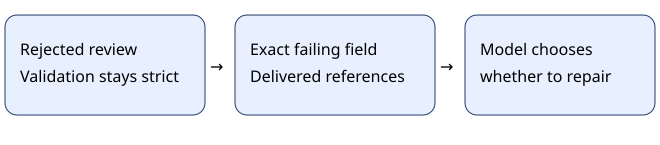

# Goal review repair feedback

> Markdown twin of [goal-review-repair-feedback-v1.html](../goal-review-repair-feedback-v1.html), generated from the HTML by `just explainer-twins`. The HTML is the source; edit it, not this file.

Show the invalid field and real references.

## What changes

With the instruction ledger enabled, validation failures identify the invalid episode, page, observation reference or completion-evidence requirement.

## ON and OFF

OFF: the original rejection messages remain byte-for-byte unchanged.

A delivered reference is not proof that the interpretation or completion is true. Unknown and duplicate episodes remain rejected separately; no references or completion claims are invented.

## Approved configuration

| Setting | Control | Bundle |
|---|---|---|
| goal-review-repair-feedback-v1 | OFF | ON |
| Instruction goal ledger | OFF | OFF |
| Cutscene journal | OFF | ON |

This switch is intentionally inactive while instruction-goal-ledger-v1 is OFF. It can be tested independently after explicitly enabling the ledger in a future configuration. Generic defaults are OFF. Existing runs keep their recorded code and settings.

Evidence and limits

Qwen bundle 9e33 made 883 consecutive rejected goal reviews from 06:44 to 11:18 on October 25, 2026. These switches address bookkeeping behavior; they do not establish improved story progress. No new gameplay experiment was launched. Current screenshots, native evidence and ordinary input validation remain authoritative.

