PokeBench · navigate_to experiment

# Grass Cost Switch

> Markdown twin of [grass-cost-switch.html](../grass-cost-switch.html), generated from the HTML by `just explainer-twins`. The HTML is the source; edit it, not this file.

A new switch, `grass-cost-navigation-v1`, makes the walking planner count each step into grass as 1.5 steps. The idea is to dodge wild battles when going around the grass is cheap. It is off by default.

## When the planner goes around

Same strip of route, same start and goal. The only difference is how much grass sits in the way. The red line is the route the planner picks.

***Five grass tiles.** Walking through costs 5 × 1.5 + 1 = 8.5. Going around costs 8 plain steps. The detour wins.*

***Three grass tiles.** Walking through costs 3 × 1.5 + 3 = 7.5, which still beats the 8-step detour. The planner walks through.*

grass (costs 1.5)path (costs 1)chosen route

## The break-even rule

Each grass tile skipped saves half a step. So a detour wins when half the grass it skips is more than the extra steps it adds. Each cell shows the saving.

*Red cells go around. Grey cells walk through. On a tie, both routes cost the same and either can be picked. Most real detours add at least 2 steps (one off the line, one back), so it takes 5 or more grass tiles in a row before the switch changes anything.*

goes aroundtiewalks through

## How the switch reaches the planner

The model never sees a different tool. Only the step cost inside the planner changes, so runs with the switch on and off are directly comparable.

*Off by default everywhere: run presets, older saved presets and the viewer's next-run draft. Turning it on without bounded navigation is rejected as a dependency error.*

## Which tiles count as grass

| Tile | Game behavior | Our live map | This switch | PokeAgent |
|---|---|---|---|---|
| Tall grass | `0x02` | `g` | 1.5 | 1.5 |
| Long grass | `0x03` | `g` | 1.5 | 1 |

Long grass also triggers wild battles, and our map already draws both as `g`, so the switch prices both. That is the one deliberate difference from PokeAgent.

## Where it stands

**Code**

Merged into main behind the switch, off by default. It works in both the local and whole-map planners, alongside ledge hops, one-way tiles, elevation and counter talk. A ledge hop that lands in grass costs one step plus the grass step.

**Checks**

Agent tests 945/945, viewer tests 493/493, coverage above the 90% floor, lint clean.

**Review**

Claude, Grok and GPT (via Codex) LGTM, and a further check after re-applying it on main's new planner.

**Experiment**

Pending: on the pending-experiments list, not yet in the run queue. The four-run arms (incumbent vs grass cost) wait for the readiness check and your approval.
