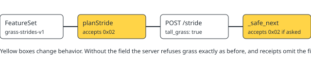

# Grass strides (grass-strides-v1)

> Markdown twin of [grass-strides-v1.html](../grass-strides-v1.html), generated from the HTML by `just explainer-twins`. The HTML is the source; edit it, not this file.

Default off in the registry; on in both arms (control and bundle) of the current fixed-run recipe, by the operator's decision on 2026-10-27. When it is on, a `navigate_to` stride may cross ordinary tall grass, so the player can run there instead of being forced to walk. Needs `safe-navigation-strides-v1` and `automatic-running-v1`.

## Why

With safe strides on, both the agent's corridor planner (`planStride`) and the game server's per-step check accepted only plain floor (behavior 0). Any step on or into tall grass got no stride, and navigation then pressed that step with automatic running turned off. The game itself lets the player run in tall grass. In run `2026-10-27T17-35-16_qwen36-gpu0_a702`, 173 `navigate_to` presses on tall grass where the game permitted running all walked.

## Off and on, same route

Illustrative row; the same layout is pinned by `grass-strides.test.ts` (four grass tiles, one stride) and `test_strides.py` (long grass at the third step stops after two).

## What each step still checks

| Check | Off | On |
|---|---|---|
| Tile behavior accepted (agent plan and server step) | 0x00 only | 0x00 and 0x02 |
| Long grass 0x03, water, ledges, other special tiles | stop before | stop before |
| Collision, elevation, objects, warps, script coordinates, dialogue | checked every step | checked every step |
| B (running) added | only when the game's running permission is true that frame | same |
| Battle starts mid-stride | stride stops | stride stops (`field input unavailable`), no further direction |

## Wiring

## What the model reads

Only the `navigate_to` description changes when the switch is on: "Straight corridors of plain floor or tall grass use explicit strides …" and "Strides stop before turns, other grass, ledges, …". No tool is added or removed.

## Status

Not landed. On in both arms of `experiments/feature-configs/current.json` (`onInBoth`), so it is not an A/B variable between control and bundle. Registry default and new presets stay off.
