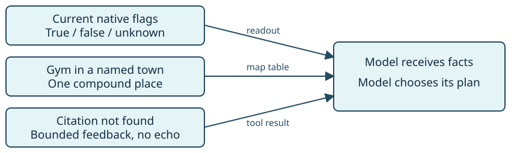

# Gym evidence

> Markdown twin of [gym-evidence-v1.html](../gym-evidence-v1.html), generated from the HTML by `just explainer-twins`. The HTML is the source; edit it, not this file.

`gym-evidence-v1` · Default OFF · Bundle ON · Control OFF

## Completion is a game fact

The model defeated Josh, Tommy and Marc, left to heal, and then claimed the Gym was finished. Native memory still said the Gym and Roxanne were undefeated. This switch supplies those current facts; it does not select the next objective or action.

```
Gym progress (game memory): RUSTBORO CITY GYM incomplete; ROXANNE not defeated.
```

This is the new output for recorded d548 state 15558, raw archive 7023, native frame 274474. The quote is a proposed switched-ON replay output, not text that the active run received.

## One switch, three repairs

On a narrow screen, scroll the diagrams and tables sideways.



## OFF and ON

| Signal | OFF: previous behavior | ON |
|---|---|---|
| Gym state | Story lists completed trainers; false flags omitted. | Current Gym completion and seen leader defeat status; unknown stays unknown. |
| Dad's place | “POKéMON GYM” unresolved; “RUSTBORO CITY” resolves to town. | “POKéMON GYM in RUSTBORO CITY” resolves to map 11/3. Missing or ambiguous Gym stays unresolved. |
| Citation miss | input-cuts can suppress model feedback. | Model receives the same factual message recorded in destination_citation. |

```
Destination citation: the supplied because text was not found in the game observations shown this run.
```

Navigation still uses its existing execution and refusal rules. This message does not claim that movement happened.

## Names and state remain grounded

Gym facts appear only after a successful delivered game-tool result has named the Gym. Roxanne appears only after her name has been shown. A heal, map exit or arrival does not change completion. Each new result reads its own state; unavailable data never reuses an earlier false or true value.

Grounding: pret/pokeemerald revision 731ad5bfd6e6f265508d0efcca0ba42f9dcf5881. `RustboroCity_Gym_EventScript_RoxanneDefeated` sets the Gym completion and badge flags; Josh, Tommy and Marc use separate trainer scripts. Dad's `PetalburgCity_Gym_Text_NormanGoToRustboro` names the Gym and town together. Map identity comes from the game map table.

## Status

Authorized correctness repair, one bundled switch. Regression fixture: run 2026-10-21T13-33-36_qwen36-gpu1_d548, source 4590d681; five original events retained with schema validation. The running benchmark stays on its recorded source. Pending experiment is unqueued and unapproved. No measured gameplay-benefit claim.
