Harness switch · guard · `gym-heal-warning-v1` · needs `heal-before-trainers-v2` · agent side only · bundle arm only · off by default

# Gym heal warning

> Markdown twin of [gym-heal-warning-v1.html](../gym-heal-warning-v1.html), generated from the HTML by `just explainer-twins`. The HTML is the source; edit it, not this file.

The operator, 2026-10-20: "the supervisor warning for when it enters a gym without full HP is the right way to go". When a game-tool result shows the player on a GYM map, or on a map with a door to one, and any party Pokémon is below max HP, the result gains one paragraph: the hurt Pokémon, what losing a battle costs and where the player would wake up, and the nearest place that heals.

## What b300 did

Run `2026-10-20T13-54-28_qwen36-gpu0_b300` arrived in RUSTBORO CITY with TORCHIC at 25/33 (result 14717). That result listed the gym door at (27,19) and the POKéMON CENTER door at (16,38). It walked straight into the gym (result 14882), beat JOSH and TOMMY, lost to HIKER MARC, and woke up in RED's HOUSE 2F: the save's last heal location, because it had never entered a POKéMON CENTER.



*Replay of b300's 18 recorded tool results 14698-15600 through the production wrapper (test "b300 replay"). It fires at 14717 and 14882 only. At 15198 it is silent: TORCHIC was never at full HP after entering the gym, and it re-arms only on another map or a full party.*

## What the model would read

Result 14717, RUSTBORO CITY (exact text from the test)

```
SUPERVISOR: An exit on this map at (27,19) leads to RUSTBORO CITY GYM (map 11/3), and your party is not at full HP: TORCHIC 25/33. If your whole party faints in a battle, the game says "RED is out of usable POKéMON!" and "RED whited out!"; you lose half your money (₽3142 of ₽6284) and wake up in RED's HOUSE 2F (map 1/1), 8 map changes from here. The nearest place you know of that heals your party is the POKéMON CENTER in RUSTBORO CITY (map 11/5), 1 map change from here in the game's map table; you have not entered it; this result lists it as an exit at (16,38) on this map; its nurse says "We restore your tired POKéMON to full health."
```

Result 14882, entering the gym, after heal-before-trainers-v2's paragraph

```
SUPERVISOR: You are in RUSTBORO CITY GYM (map 11/3), and your party is not at full HP: TORCHIC 25/33. If your whole party faints in a battle, the game says "RED is out of usable POKéMON!" and "RED whited out!"; you lose half your money (₽3142 of ₽6284) and wake up in RED's HOUSE 2F (map 1/1), 9 map changes from here. The nearest place you know of that heals your party is the POKéMON CENTER in RUSTBORO CITY (map 11/5), 2 map changes from here in the game's map table; you have not entered it, but an earlier result listed it as an exit at (16,38) in RUSTBORO CITY; its nurse says "We restore your tired POKéMON to full health."
```

Result 15198, after JOSH

Nothing from this switch. heal-before-trainers-v2's paragraph still names ROXANNE, TOMMY and MARC and the same POKéMON CENTER.

## When it fires


*All three on the result's own state. Names come from the game's map table (GET /pokebench/places), as the readout prints them: RUSTBORO CITY GYM is MAP_RUSTBORO_CITY_GYM. Once per map entry; another map or a whole party at full HP re-arms it. It also fires in PETALBURG CITY and PETALBURG CITY GYM, the first GYM on the way, where the story's early visits start no battle; the paragraph only states facts, so it is not wrong there, but it adds text on those visits.*

## Where the facts come from

| Words | Source |
|---|---|
| "RED is out of usable POKéMON!" and "RED whited out!" | `sText_PlayerWhiteout` and `sText_PlayerWhiteout2` (src/battle_message.c), printed by `BattleScript_LocalBattleLostPrintWhiteOut`. The player's name comes from the state; without it the text says "you white out". |
| lose half your money (₽3142 of ₽6284) | `DoWhiteOut` (src/overworld.c) sets money to money / 2; the loss is the rest. |
| wake up in RED's HOUSE 2F (map 1/1) | `SetWarpDestinationToLastHealLocation` warps to `SaveBlock1.lastHealLocation` (the server's `heal_before_trainers.last_heal`), named as the readout names that map, with map changes from here. |
| the nearest place that heals | heal-before-trainers-v2's list: centers entered, the last heal location's center, POKéMON CENTERs a delivered result listed as an exit, home while MOM heals. |

## Wiring and recording

- It runs in the same wrapper as heal-before-trainers (`withLowHpTrainerWarning` in `playGameTools`). Its paragraph follows heal-before-trainers' paragraph, and it shares that arm's heal list and map table read.
- It is recorded as `gym_heal_warning`: an Activity History SUPERVISOR row "Gym heal warning added to the … result". No timeline mark (timeline closed to additions).
- Agent side only: no new server facts.
- Off: no paragraph, no event; everything else unchanged.

## Status

- On top of heal-before-trainers-v2. Tests: b300 replay on and off, conditions, the arm, the event, Activity History, the timeline, and `playGameTools`.
- Pending experiment `experiments/gym-heal-warning-v1.json`, not queued. No measured runs.
