# Gym puzzle supervisor hold

> Markdown twin of [gym-puzzle-supervisor-hold-v1.html](../gym-puzzle-supervisor-hold-v1.html), generated from the HTML by `just explainer-twins`. The HTML is the source; edit it, not this file.

`gym-puzzle-supervisor-hold-v1`. Correctness fix, on in both arms of the current recipe (the operator 2026-11-07). Default off in the registry.

## The problem

Run 37ca (DeepSeek) entered the FORTREE CITY GYM at turn 1773 and came close to its last gate. Then the stall supervisor treated the gym work as a stall:

- T1895: walked between FORTREE CITY and its POKéMON CENTER 4 times.
- T1902 and T1937: walked between FORTREE CITY and FORTREE CITY GYM, "What you have been trying is not working, so do not try it again."
- T2014 to T2039: drought notes inside the gym listing "Exits to maps you have not entered".

At T2040 the model wrote "The supervisor confirms a 40-minute stall ... I must stop" and left for good. ee2a weighed the same kind of note at T42 and decided to leave; only a failed Escape Rope kept it in.

## What changes

*Each row is one situation; the Off column is today's behavior and the On column is the switch. Only pairs that touch the open gym, or its town and a POKéMON CENTER, are held.*

## How it decides

- A gym opens on its gym-entry milestone (`DEWFORD_GYM_ENTERED` through `SOOTOPOLIS_GYM_ENTERED`; the map comes from the milestone catalog). It closes on the badge that follows it in the catalog, from the save or observed. Rustboro has no entry milestone, so it is not covered.
- The gym's town is any map the player walked to or from the gym map. A POKéMON CENTER is known by its map name.
- A stall note given while the player is on the open gym's map leaves out three lines: exits to maps not entered, untried targets on other maps, and ways off across the map's edge. The same three lines the story-character hold already drops.
- Nothing model-facing names the gym, a badge or the reason. The held notes are recorded as diagnostic `loop_guard` events with `phase: would_warn`, so Activity History still shows them.

## Not changed

- The loop guard's own cycle note ("Moving back and forth between the same maps…", T1936 in 37ca) is a different detector and still fires.
- Drought notes are still sent on the gym map; only their off-map lines go.

## Status

11 tests in `stall-briefing.test.ts` through the production factory; deleting the wiring turns 4 red. Decision probes on DeepSeek (runs/probes/gym-puzzle-switches-20261107, 32 draws per arm): at 37ca T1903, one result after the map-cycle note, the model walks back into the gym 22/32 times with the hold against 9/32 without it (p=.002), and leaves 2/32 against 20/32. At T2040 its first moves do not change (stays 18/32 against 13/32, p=.32). These are development cases, not a confirmation, and the switch is not yet measured in a run.
